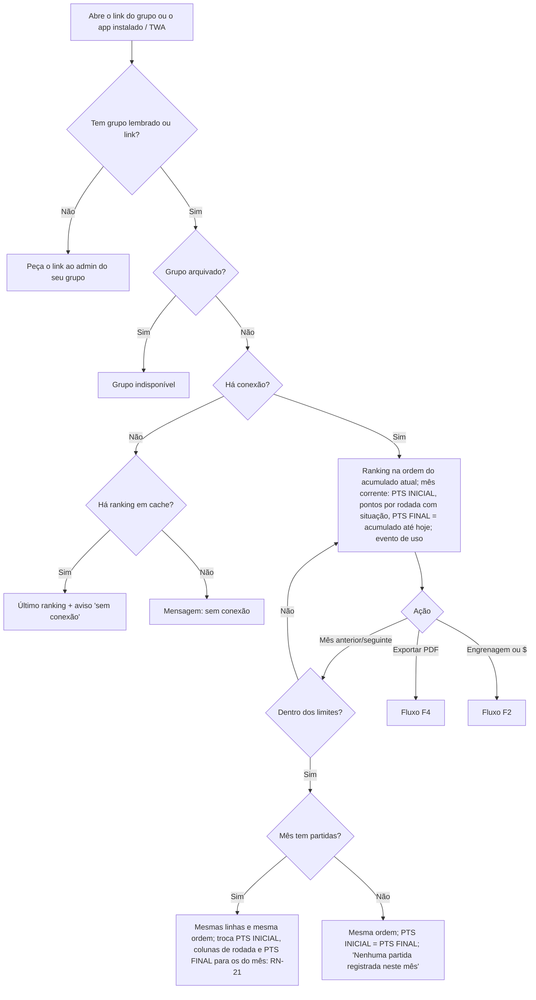
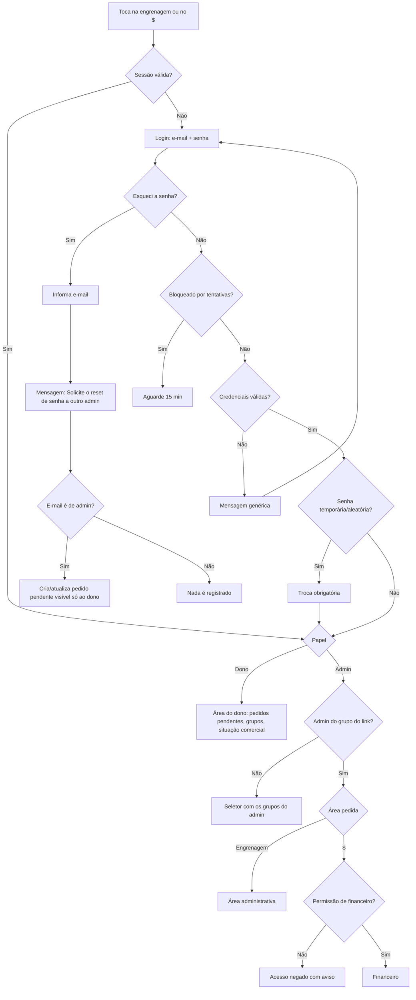
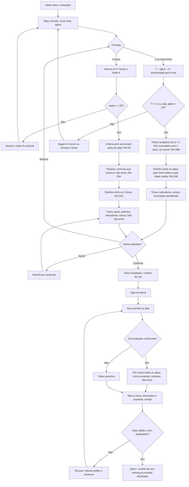
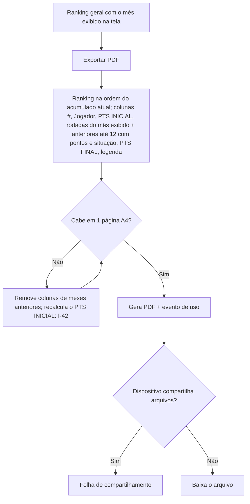
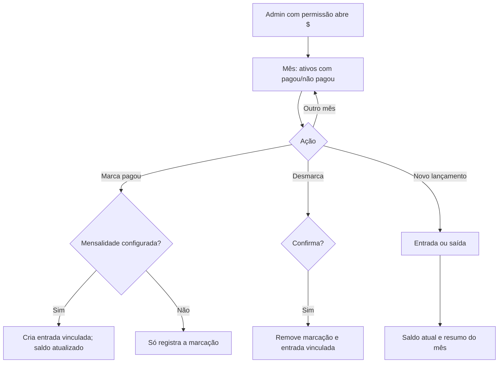
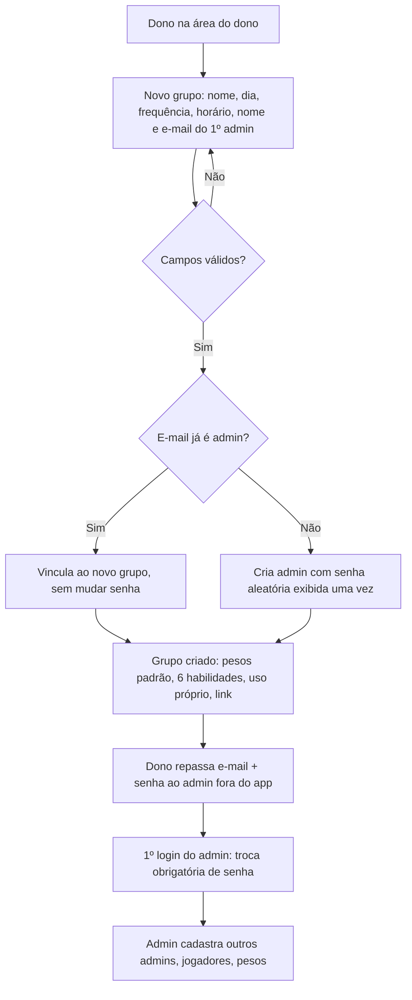
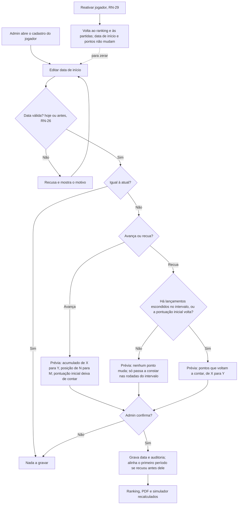
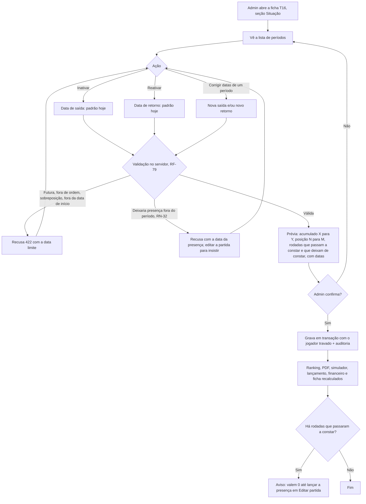

# PRD-TECNICO — Gestão da Pelada

Versão: rascunho 4.4 (reabertura pontual "Datas de saída e de retorno do jogador"; base: 4.3) | Data: 2026-10-21 | Autor: Gestor (chapéu Business Analyst)
Base: `.md/PRD.md` (rascunho 4.2), `.md/CTO-REVIEW.md` (Gate 1 e adendo da rodada 2), `.md/PLANO-COMERCIAL.md` v2 e as respostas do Leandro nas rodadas 1 a 4 e na decisão P-30.

Este documento detalha **o quê** o sistema faz e **com que regras**. Não decide arquitetura, stack, banco ou algoritmo: isso é do Coordenador no `SDD.md`. Toda ambiguidade resolvida está na Seção 7. Há uma interpretação provisória pendente (I-42, ligada à P-32). As interpretações I-49 a I-52 foram confirmadas pelo usuário em 2026-10-20, com uma premissa técnica pendente para o Coordenador (I-49).

**Reabertura pontual 4.4 ("Datas de saída e de retorno do jogador", pedida em 2026-10-21; correção interna, sem impacto comercial, só produção, ADR-020):**
- Objetivo: "Reativar" com data de retorno; corrigir saída e retorno de períodos já registrados (só admin do grupo); listar os períodos na seção Situação; prévia do efeito; auditoria. Decisões do Gestor: P-43 (antecipar o retorno não cria pontos sozinho: rodadas viram falta 0 e o admin lança a presença), P-44 (presença que ficaria fora do período bloqueia a correção, nada é apagado), P-45 (qualquer admin do grupo).
- Novos: RF-75 a RF-82 (§1.17), RN-30 a RN-34, RNF-14, F8, PR-22 a PR-25, I-53 a I-56. Alterados por referência cruzada (texto original preservado): RF-21 (data de retorno e correção, RF-75/RF-76), RF-69 (mensagem com data limite, RF-82), RN-06, RN-29, RNF-12.
- Fora: regra de pontuação por rodada, TWA e a data de início da pontuação em si (RF-69 a RF-74). Observação central: o acumulado (RN-25) não depende dos períodos; a correção de períodos muda quem aparece nas rodadas e permite lançar presenças, e os pontos só mudam por presença lançada ou pela data de início.

**Demanda pontual 4.3 ("Data de início do jogador", pedida pelo usuário em 2026-10-20; adição pontual, sem impacto comercial; só produção, ADR-020):**
- Objetivo (modelo mínimo da rodada 3, substitui o da rodada 2): duas regras. (1) **Reativar** só devolve o jogador ao ranking e às partidas, sem mexer em pontos nem em data. (2) **Data de início** (a data de entrada do cadastro) editável: o acumulado conta apenas as presenças com data igual ou posterior a ela. "Zerar" é pôr a data de hoje; "voltar a contar" é voltar a data. Nada é apagado.
- Novos: RF-69 a RF-74, RN-25 a RN-29, RNF-13, F7, PR-18 a PR-21, I-49 a I-52. Alterados por referência cruzada (texto original preservado): RN-01, RN-05, RN-06, RN-08, RN-21, RN-22, RF-21, RNF-12.
- Decisões do usuário aplicadas: P-33 "Sim", P-35 "um campo só", P-38 "correto" e a simplificação da rodada 3. A P-34 ("preservar o histórico") foi resolvida pela P-41. **Em 2026-10-20 o usuário aprovou este recorte com todas as recomendações do Gestor: P-33 a P-41 estão DECIDIDAS** (P-36, P-37, P-39, P-40 e P-41 como recomendadas). Resta só a premissa técnica para o Coordenador (I-49).
- Invariante central: **na implantação, nenhum ponto de nenhum jogador muda** (RNF-13, RF-74); depois, só a edição da data muda pontos, e só os do próprio jogador (RN-25, RN-28).

**Demanda pontual 4.2 ("Adequação ao legado", aprovada pelo usuário em 2026-10-19):**
- Objetivo: importar para o grupo real o histórico de outro app (57 jogadores, 231 rodadas desde 03/04/2022) sem perder o acumulado de cada um. Os "ajustes manuais" do legado não são importados.
- Alterados: RF-19, RF-20, RF-23, RF-24, RF-50, RN-01, RN-02, RN-04, RN-05, RN-08, RN-18, RN-21, RNF-06, RNF-07, RNF-12, I-08, I-22 (e RN-21 estende a I-41). Novos: RF-65 a RF-68, RN-22 a RN-24, PR-15 a PR-17, I-44 a I-48.
- Ordem de entrega (RF-68): primeiro as mudanças de pontuação inicial, 6 posições e 6 pesos, em produção (deploy); depois a simulação e a execução do script. Nenhuma credencial nem dado pessoal real entra nos documentos (G-21).
- Decisões de default (Seção 7.1.2): lesionado = presença; telefones não importados; habilidades importadas; "Goleiro" mantido como sétima posição; diferenças de total por ajustes ignorados são esperadas.

**Reabertura pontual 4.1 (P-30, colunas do ranking):**
- Tela e PDF passam a ter as colunas #, Jogador, PTS INICIAL, uma coluna por partida do mês com os **pontos** da rodada (cor por situação; ícone de chuva ou de sol no cabeçalho) e PTS FINAL. Saem as contagens de presenças e faltas do mês (I-41).
- É mudança **só de apresentação**, confirmada pelo usuário: pontuação (RN-01), acumulado contínuo (I-35) e ordem sempre pelo acumulado atual em qualquer mês (P-26, RF-30, RN-05, RN-06) não mudam.
- Alterados: RF-29, RF-31, RF-32, RF-50, RN-03, RNF-10, F1, F4. Nova: RN-21. Novas interpretações: I-41 (confirmada), I-42 (provisória), I-43 (BA).

**Rodada 4:**
- No formato de 3 ou mais times, quem sobra forma um time incompleto (P-29, opção c).
- O número de times passa a ser arredondado para cima.
- Não existe mais "aguardam".
- O equilíbrio do formato de 3 ou mais times passa a comparar médias, não somas (decisão I-39).

**Rodada 3:**
- Ranking sempre na ordem do acumulado atual, sem "foto" por mês (P-26).
- Simulador em dois formatos: 2 times, com 1º e 2º tempo e substituições; ou 3 ou mais times, só com a divisão inicial (P-27).
- "Só 1º tempo" pode ficar como "não entra" (P-28).
- Os IDs de RF da rodada 2 foram mantidos.

Convenções:
- Os critérios de aceite usam o formato EARS (Quando / Enquanto / Se... então / O sistema deve).
- "Admin" é um admin autenticado e vinculado ao grupo em questão.
- "Dono" é o dono da plataforma.
- "Link do grupo" é a URL pública e somente leitura do ranking de um grupo.
- Numeração renovada nesta rodada: os IDs de RF da rodada 1 não valem mais.

---

## 1. Requisitos Funcionais

### 1.1 Dono da plataforma (RA-16, RA-13)

| ID | Requisito | Critério de aceite (EARS) |
|---|---|---|
| RF-01 | Conta do dono | **O sistema deve** ter exatamente uma conta com o papel de dono da plataforma, de e-mail **leandrosegheto17@gmail.com**, criada na implantação. O dono entra pela mesma tela de login dos admins. A forma de criar a credencial inicial é decisão do Coordenador. |
| RF-02 | Criar grupo e primeiro admin | **Quando** o dono informar o nome do grupo (de 3 a 60 caracteres), o dia da semana, a frequência (semanal, quinzenal ou mensal), o horário (HH:MM) e o nome e e-mail do primeiro admin, **o sistema deve**: criar o grupo; aplicar os pesos padrão e as 6 habilidades iniciais (RN-18); definir a situação comercial "uso próprio"; gerar o link do grupo; e criar o admin com uma **senha aleatória exibida uma única vez** ao dono, com permissão de financeiro e troca obrigatória no primeiro login (RF-14). **Se** o e-mail já pertencer a um admin, **então** o sistema deve apenas vinculá-lo ao novo grupo, sem mudar a senha. **Se** faltar algum campo obrigatório, **então** deve recusar e apontar o campo. |
| RF-03 | Arquivar e reativar grupo | **Quando** o dono arquivar um grupo e confirmar digitando o nome dele, **o sistema deve** bloquear o acesso dos admins a esse grupo, e o link do grupo deve passar a mostrar "Grupo indisponível", com os dados preservados. **Quando** o dono reativar o grupo, **o sistema deve** restaurar o acesso. |
| RF-04 | Situação comercial | **O sistema deve** guardar em cada grupo uma situação comercial (uso próprio, trial com data de início, ativo, inadimplente ou cancelado), editável só pelo dono. **O sistema não deve** mudar nenhum comportamento por causa desse campo (RN-16). |
| RF-05 | Redefinir senha de qualquer admin | **Quando** o dono pedir a redefinição da senha de qualquer admin, **o sistema deve** gerar uma senha temporária, exibi-la uma vez ao dono e aplicar RF-14 no próximo login desse admin. |
| RF-06 | Pedidos de "esqueci a senha" | **Quando** o dono entrar na área administrativa e houver pedidos pendentes (RF-12), **o sistema deve** mostrar a lista com e-mail do admin, grupos dele e data e hora do último pedido. Para cada pedido, deve oferecer "Redefinir senha" (RF-05) e "Marcar como resolvido". Um pedido some da lista quando é resolvido ou quando a senha daquele admin é redefinida por qualquer meio. **O sistema não deve** mostrar esses pedidos a nenhum outro usuário. |
| RF-07 | Alcance do dono | **O sistema deve** mostrar ao dono os metadados de todos os grupos: nome, dia, frequência, horário, situação comercial, admins, data de criação e se o grupo está arquivado. **Se** o dono não for admin de um grupo, **então** o sistema não deve mostrar a ele jogadores, notas, partidas nem o financeiro desse grupo (I-30). O dono pode ser também admin de grupos, como qualquer outro admin. |

### 1.2 Grupos (RA-01)

| ID | Requisito | Critério de aceite (EARS) |
|---|---|---|
| RF-08 | Editar grupo | **Quando** um admin editar o nome, o dia, a frequência ou o horário do grupo, **o sistema deve** salvar sem alterar o histórico. A criação e o arquivamento de grupos são exclusivos do dono (I-31). |
| RF-09 | Isolamento por grupo | **Se** uma operação de leitura ou escrita sobre dados de um grupo G vier de alguém que não é admin de G, **então** o sistema deve negar a operação sem revelar se o recurso existe. As exceções são a leitura pública do ranking e do PDF pelo link de G e os metadados vistos pelo dono (RF-07). |
| RF-10 | Grupo ativo do admin | **Enquanto** um admin estiver vinculado a mais de um grupo, **o sistema deve** mostrar um seletor de grupo na área administrativa, e toda operação deve valer só para o grupo selecionado. |

### 1.3 Admins e acesso (RA-02)

| ID | Requisito | Critério de aceite (EARS) |
|---|---|---|
| RF-11 | Login | **Quando** alguém tocar na engrenagem ou no "$" sem estar autenticado, **o sistema deve** pedir e-mail e senha. **Quando** as credenciais forem válidas, **o sistema deve** abrir a área pedida no grupo ativo. Para o dono, abre primeiro a área do dono, com os pedidos pendentes de RF-06. **Se** as credenciais forem inválidas, **então** deve mostrar a mensagem genérica "e-mail ou senha incorretos". **Se** houver 5 falhas para o mesmo e-mail em 15 minutos, **então** deve bloquear novas tentativas desse e-mail por 15 minutos. |
| RF-12 | Esqueci a senha | **Quando** alguém tocar em "Esqueci a senha" na tela de login e informar um e-mail, **o sistema deve** mostrar a mensagem "Solicite o reset de senha a outro admin". **Se** o e-mail pertencer a um admin, **então** o sistema deve registrar um pedido pendente visível só ao dono (RF-06). Se já houver um pedido pendente desse e-mail, deve apenas atualizar a data e a hora. **Se** o e-mail não pertencer a nenhum admin, **então** o sistema deve mostrar a mesma mensagem e não registrar nada (I-29). **O sistema não deve** enviar e-mail. |
| RF-13 | Adicionar admin ao grupo | **Quando** um admin informar nome e e-mail de um novo admin do grupo, **o sistema deve** criar a credencial com uma senha temporária aleatória, exibida uma única vez ao admin que fez o cadastro, e vincular o novo admin ao grupo, sem permissão de financeiro por padrão. **Se** o e-mail já pertencer a um admin, **então** o sistema deve apenas vinculá-lo ao grupo. |
| RF-14 | Troca obrigatória de senha temporária | **Quando** um admin entrar com uma senha temporária ou aleatória, **o sistema deve** exigir uma nova senha (mínimo de 8 caracteres, diferente da temporária) antes de liberar qualquer área. |
| RF-15 | Remover admin do grupo | **Quando** um admin remover outro admin do grupo, **o sistema deve** desfazer o vínculo e encerrar o acesso dele a esse grupo. **Se** ele for o último admin do grupo, **então** o sistema deve recusar (RN-13). |
| RF-16 | Redefinir senha de outro admin do grupo | **Quando** um admin pedir a redefinição da senha de outro admin do mesmo grupo, **o sistema deve** gerar uma senha temporária, exibi-la uma vez e aplicar RF-14 no próximo login. Também deve resolver o pedido pendente desse e-mail, se houver (RF-06). |
| RF-17 | Trocar a própria senha e sair | **Quando** um admin ou o dono trocar a própria senha informando a senha atual, **o sistema deve** salvar a nova. **Quando** tocar em "Sair", **o sistema deve** encerrar a sessão no dispositivo. |
| RF-18 | Permissão de financeiro | **O sistema deve** manter, por admin e por grupo, a permissão "acessa financeiro". **Se** um admin sem essa permissão tocar no "$", **então** o sistema deve negar o acesso com aviso. Um admin com a permissão pode concedê-la ou retirá-la de outros admins do grupo. |

### 1.4 Jogadores (RA-03)

| ID | Requisito | Critério de aceite (EARS) |
|---|---|---|
| RF-19 | Cadastrar jogador | **Quando** um admin informar os dados abaixo e salvar, **o sistema deve** criar o jogador como ativo. Os dados são: nome/apelido (de 2 a 30 caracteres, único no grupo, sem diferenciar maiúsculas), ano de nascimento (de 1940 até o ano atual menos 10), posição (Zagueiro, Lateral, Volante, Meia, Atacante, Centroavante ou Goleiro, só para cadastro, I-22), pontuação inicial (inteiro de 0 a 9999, padrão 0, RN-22), telefone (opcional, formato brasileiro com DDD) e data de entrada no grupo (padrão: hoje). **Se** o apelido já existir no grupo, **então** deve recusar e avisar. **Se** a pontuação inicial não for inteiro ou estiver fora de 0 a 9999, **então** deve recusar. **O sistema deve** mostrar a pontuação inicial na tela de cadastro e de edição do jogador. |
| RF-20 | Editar jogador | **Quando** um admin editar um jogador, **o sistema deve** salvar. Uma mudança no ano de nascimento ou na data de entrada se reflete no desempate e nas faltas (RN-03, RN-05). **Quando** o admin alterar a pontuação inicial (mesma faixa do RF-19), **o sistema deve** recalcular o acumulado, o PTS INICIAL, o PTS FINAL e a ordem do ranking (RN-21, RN-05) e registrar quem alterou e quando, com o valor anterior (RNF-12). |
| RF-21 | Inativar e reativar | **Quando** um admin inativar um jogador, informando a data de saída (padrão: hoje), **o sistema deve** tirá-lo do lançamento, do simulador e do financeiro a partir dessa data. Ele sai das linhas do ranking (RN-06), mas o histórico e os pontos acumulados são preservados. **Quando** o admin reativar o jogador, **o sistema deve** voltar a considerá-lo a partir da data da reativação, mantendo o acumulado anterior. |
| RF-21A | Nota da reabertura 4.4 | Em "Reativar", a data de retorno é pedida e pode ser anterior a hoje (RF-75). As datas de saída e de retorno registradas podem ser corrigidas por um admin do grupo (RF-76, RF-79). Texto original de RF-21 preservado acima. |
| RF-22 | Excluir jogador | **Quando** um admin pedir a exclusão de um jogador sem nenhuma presença, nota ou registro financeiro, **o sistema deve** excluí-lo. **Se** houver histórico, **então** deve recusar e oferecer a inativação. |

### 1.5 Pontuação (RA-04)

| ID | Requisito | Critério de aceite (EARS) |
|---|---|---|
| RF-23 | Configurar pesos | **Quando** um admin informar os 6 pesos (presença sem chuva, presença com chuva, lesionado sem chuva, lesionado com chuva, expulso sem chuva e expulso com chuva), cada um inteiro de −10 a 10, e salvar, **o sistema deve** registrar uma nova configuração vigente a partir de hoje, aplicada segundo RN-04. **Se** algum peso estiver fora da faixa ou não for inteiro, **então** deve recusar. **O sistema não deve** aceitar data de vigência no passado. |
| RF-24 | Histórico de pesos | **Quando** um admin abrir a pontuação, **o sistema deve** mostrar a configuração vigente e as anteriores, com os 6 pesos de cada uma, as datas de vigência e quem as registrou. **Se** a configuração anterior foi criada antes da existência do expulso com chuva, **então** o sistema deve mostrar nela o expulso com chuva igual ao expulso sem chuva (RF-68). |

### 1.6 Partidas (RA-05)

| ID | Requisito | Critério de aceite (EARS) |
|---|---|---|
| RF-25 | Lançar partida | **Quando** um admin abrir "Nova partida", **o sistema deve** sugerir como data o dia de jogo mais recente do grupo até hoje (I-26), mostrar a opção "Choveu?" (padrão: não) e listar os jogadores ativos na data. Cada jogador pode ser marcado como ausente (padrão), presente, lesionado (foi e não jogou) ou expulso. **Quando** o admin salvar, **o sistema deve** registrar a partida e atualizar o ranking. |
| RF-26 | Pré-preenchimento pelo simulador | **Se** existir uma escalação confirmada (RF-48) para o grupo naquela data, **então** o sistema deve marcar como "presente" todos os aptos dessa escalação, **inclusive os "não entra"** (RN-19). O admin pode alterar antes de salvar. |
| RF-27 | Restrições de data | **Se** a data for futura, **então** o sistema deve recusar. **Se** já existir partida do grupo nessa data, **então** deve recusar e oferecer a edição da partida existente (RN-14). |
| RF-28 | Editar e excluir partida | **Quando** um admin editar ou excluir uma partida, **o sistema deve** recalcular o ranking e registrar quem alterou e quando (RNF-12). A exclusão exige confirmação. |

### 1.7 Ranking (RA-06)

| ID | Requisito | Critério de aceite (EARS) |
|---|---|---|
| RF-29 | Ranking como tela principal | **Quando** alguém abrir o link do grupo ou o app instalado, **o sistema deve** mostrar, sem pedir login: o ranking geral com o nome do grupo; as partidas do mês corrente (RN-07); e uma linha por jogador listado (RN-06). Cada linha tem, nesta ordem (I-41): **#** (posição, RF-30); **Jogador** (apelido); **PTS INICIAL** do mês exibido; **uma coluna por partida do mês**, em ordem de data, com os **pontos da rodada** do jogador e a indicação da situação dele (presente, lesionado, expulso, falta ou "–" quando não estava ativo na data), segundo RN-21; e **PTS FINAL** do mês exibido (RN-21). O cabeçalho de cada coluna de partida mostra a data (dd/mm) e um ícone de **chuva** (partida com chuva) ou de **sol** (partida sem chuva), com texto alternativo (RNF-10). **O sistema não deve** mostrar contagens de presenças nem de faltas do mês. |
| RF-30 | Ordenação | **O sistema deve** ordenar o ranking sempre pelo acumulado geral atual (todas as partidas até hoje), com o desempate da RN-05. **O sistema não deve** mudar a ordem, as posições nem os pontos acumulados ao trocar o mês exibido (P-26). Jogadores empatados nos três critérios recebem a mesma posição. |
| RF-31 | Navegação entre meses | **Quando** o usuário tocar em "mês anterior" ou "mês seguinte", **o sistema deve** trocar as colunas de partida, o PTS INICIAL e o PTS FINAL para os daquele mês (RN-21), mantendo as linhas e a ordem (RF-30). **O sistema não deve** permitir navegar para depois do mês corrente nem para antes do mês da primeira partida do grupo. |
| RF-32 | Mês sem partidas | **Se** o mês exibido não tiver partidas, **então** o sistema deve manter as linhas e a ordem (posição, apelido), mostrar PTS INICIAL e PTS FINAL do mês (iguais entre si, RN-21), mostrar "Nenhuma partida registrada neste mês" no lugar das colunas de partida e manter a navegação. |
| RF-33 | Dados exibidos publicamente | **O sistema não deve** mostrar na visão pública nem no PDF: telefone, ano de nascimento, idade, posição, notas, nível ou dados financeiros (RNF-06). |
| RF-34 | Lembrar o grupo | **Quando** alguém abrir o link de um grupo, **o sistema deve** lembrar esse grupo no dispositivo, para que a abertura seguinte do app instalado vá direto ao ranking dele. |

### 1.8 Habilidades (RA-07)

| ID | Requisito | Critério de aceite (EARS) |
|---|---|---|
| RF-35 | Catálogo de habilidades | **Quando** um grupo for criado, **o sistema deve** cadastrar as 6 habilidades iniciais (RN-18). **Quando** um admin criar, renomear ou excluir uma habilidade (nome de 2 a 30 caracteres, único no grupo), **o sistema deve** atualizar o catálogo. A exclusão exige confirmação e apaga as notas daquela habilidade. |
| RF-36 | Avaliar jogador | **Quando** um admin der a um jogador uma nota inteira de 1 a 10 em uma habilidade, **o sistema deve** salvá-la. **Se** a nota estiver fora da faixa, **então** deve recusar. A nota pode ficar em branco. |
| RF-37 | Nível do jogador | **O sistema deve** calcular o nível segundo RN-11 e mostrá-lo só na área administrativa e no simulador. |

### 1.9 Simulador de divisão de times (RA-08)

| ID | Requisito | Critério de aceite (EARS) |
|---|---|---|
| RF-38 | Acesso | **O sistema deve** liberar o simulador só para os admins do grupo. |
| RF-39 | Entradas | **Quando** um admin abrir o simulador, **o sistema deve** pedir: data da partida (padrão: o próximo dia de jogo do grupo, hoje incluso); **formato**, que pode ser "2 times (1º e 2º tempo)" (padrão) ou "3 ou mais times"; jogadores por time N (inteiro de 2 a 11); e aptos (seleção entre os jogadores ativos). **Enquanto** o formato for "2 times", **o sistema deve** pedir também a marcação "só 1º tempo" de cada apto (padrão: não) e o limite de substituições por time K (inteiro de 0 a 20, ou "ilimitado"). **Enquanto** o formato for "3 ou mais times", **o sistema não deve** mostrar "só 1º tempo" nem o limite K. Deve mostrar o número de times calculado, T = aptos ÷ N **arredondado para cima**, e a composição prevista (ex.: "5 times de 4 + 1 time de 2") (I-38). |
| RF-40 | Aptos insuficientes | **Se** o formato for "2 times" e houver menos de 2×N aptos, **então** o sistema deve impedir a sugestão e mostrar o maior N possível (aptos ÷ 2, arredondado para baixo). **Se** o formato for "3 ou mais times" e houver até 2×N aptos (o que daria menos de 3 times), **então** deve impedir a sugestão e indicar um N menor ou o formato "2 times". |
| RF-41 | Ordem de prioridade (só 2 times) | **Enquanto** o formato for "2 times", **o sistema deve** ordenar os aptos segundo RN-08 e mostrar essa ordem ao pedir a sugestão. No formato "3 ou mais times", todos os aptos jogam, a ordem do ranking não é usada e não é mostrada (RN-09B). |
| RF-42 | Classificação dos aptos | **Se** o formato for "2 times", **então** o sistema deve classificar cada apto como titular, reserva que entra no 2º tempo ou "não entra", segundo RN-09A. Os "não entra" aparecem numa lista à parte, com o aviso de que recebem a pontuação de presença (RN-19). **Se** o formato for "3 ou mais times", **então** deve colocar todos os aptos em times: os completos com N jogadores e, quando a divisão não for exata, um único time incompleto com o resto (RN-09B), identificado como "incompleto". |
| RF-43 | Quem sai no 2º tempo (só 2 times) | **Enquanto** o formato for "2 times", **o sistema deve** definir em cada time quem sai no intervalo, segundo RN-09A, e mostrar os pares "sai → entra". Um reserva marcado "só 1º tempo" aparece com a indicação "joga só o 2º tempo", e pode ficar como "não entra" se o limite acabar antes dele (P-28). |
| RF-44 | Distribuição equilibrada | **O sistema deve** distribuir os jogadores entre os times segundo RN-10A (2 times) ou RN-10B (3 ou mais times). O resultado deve ser determinístico: as mesmas entradas geram a mesma sugestão. |
| RF-45 | Indicadores | **Enquanto** uma divisão estiver na tela, **o sistema deve** mostrar, por time: no formato "2 times", nível somado e médio no 1º e no 2º tempo, idade média e número de substituições; no formato "3 ou mais times", número de jogadores, nível médio e somado e idade média. |
| RF-46 | Ajuste manual | **Quando** o admin mover um jogador entre os times e, no formato "2 times", as listas "reservas" e "não entra", trocar dois jogadores ou, no formato "2 times", mudar o "só 1º tempo", **o sistema deve** recalcular os indicadores (e, em 2 times, os pares "sai → entra") sem refazer a sugestão. **Quando** ele tocar em "Refazer sugestão", **o sistema deve** descartar os ajustes e sugerir de novo. |
| RF-47 | Avisos | **O sistema deve** avisar, sem bloquear, quando: (a) no formato "2 times", um time tiver mais titulares "só 1º tempo" do que reservas entrando nele (fica com menos jogadores no 2º tempo); (b) um ajuste manual deixar times com composição diferente da prevista (no formato "2 times", times com tamanhos diferentes; no formato "3 ou mais times", mais de um time incompleto ou um time com mais de N jogadores); (c) houver apto sem nenhuma nota (nível neutro aplicado, RN-11); (d) no formato "3 ou mais times", o time incompleto tiver menos da metade de N jogadores. Nesse caso, o aviso sugere outros valores de N (I-40). **O sistema não deve** ter regra nem aviso sobre goleiros (P-13). |
| RF-48 | Confirmar escalação | **Quando** o admin confirmar a divisão, **o sistema deve** salvá-la como a escalação do grupo naquela data, substituindo uma confirmação anterior da mesma data, e registrar o evento de uso (RF-57). A escalação confirmada alimenta RF-26. |

### 1.10 PDF do ranking (RA-09)

| ID | Requisito | Critério de aceite (EARS) |
|---|---|---|
| RF-49 | Exportar | **Quando** qualquer pessoa que esteja vendo o ranking de um mês tocar em "Exportar PDF", **o sistema deve** gerar o PDF desse mês e registrar o evento de uso (RF-57). |
| RF-50 | Conteúdo | **O sistema deve** incluir no PDF: nome do grupo, mês exibido e data de geração; a tabela do ranking na ordem do acumulado geral atual, com as mesmas colunas e na mesma ordem da tela (#, Jogador, PTS INICIAL (que inclui a pontuação inicial do jogador, RN-21), uma coluna por partida com os pontos da rodada e a indicação da situação, PTS FINAL; RF-29, RN-21), sem contagens de presenças e faltas; o cabeçalho de cada coluna de partida com a data (dd/mm) e o ícone de chuva ou de sol, igual à tela (RF-29), com a legenda dos dois ícones; a legenda das situações (com equivalente que não dependa de cor, RNF-10); e um rodapé com o nome do app. As colunas de partida incluem todas as partidas do mês e, se couber, as anteriores, até 12 no total, com separação visual entre os meses. Com colunas de meses anteriores, o PTS INICIAL segue a I-42 (provisória). Os dados de RF-33 ficam de fora. |
| RF-51 | Uma página | **O sistema deve** gerar em A4 retrato com exatamente 1 página para até 40 jogadores e 12 colunas de partida, com fonte de no mínimo 7 pt. **Se** não couber, **então** deve cortar primeiro as colunas de meses anteriores e nunca remover partidas do mês exibido. |
| RF-52 | Compartilhar | **Quando** o dispositivo permitir compartilhar arquivos, **o sistema deve** abrir a folha de compartilhamento do sistema. **Se** não permitir, **então** deve baixar o arquivo. |

### 1.11 PWA e TWA (RA-10, RA-14)

| ID | Requisito | Critério de aceite (EARS) |
|---|---|---|
| RF-53 | Instalação do PWA | **O sistema deve** ser instalável na tela inicial no Android (Chrome) e no iPhone (Safari) e abrir em tela cheia, com nome e ícone próprios. **Quando** for aberto no Safari do iPhone sem estar instalado, **o sistema deve** mostrar instruções de "Adicionar à Tela de Início". |
| RF-54 | Ranking sem conexão (Should) | **Enquanto** não houver conexão, **o sistema deve** mostrar o último ranking carregado, somente leitura, com o aviso "sem conexão, atualizado em dd/mm hh:mm". As funções administrativas exigem conexão. |
| RF-55 | TWA na Google Play (Should) | **O sistema deve** ser distribuído na Google Play como TWA da mesma URL do PWA, abrindo sem a barra do navegador (vínculo de domínio verificado) e com as mesmas funcionalidades do PWA. **Quando** o I1 estiver no ar, **o sistema deve** entrar em teste fechado com pelo menos 12 testadores por 14 dias contínuos. Só depois disso deve ir para produção (PR-13). |

### 1.12 Registro de uso (RA-11)

| ID | Requisito | Critério de aceite (EARS) |
|---|---|---|
| RF-56 | Identificador anônimo | **Quando** o ranking for aberto pela primeira vez num dispositivo, **o sistema deve** gerar um identificador aleatório, sem relação com a pessoa, e guardá-lo no dispositivo. |
| RF-57 | Eventos | **O sistema deve** registrar, por grupo: abertura do ranking (identificador anônimo, data e hora), exportação de PDF (data e hora, mês exportado), escalação confirmada (data da partida) e partida lançada (data da partida e data do lançamento). **O sistema não deve** registrar nome, telefone, IP nem localização nesses eventos. |
| RF-58 | Painel de uso (Should) | **Quando** um admin abrir "Uso do app", **o sistema deve** mostrar, por semana: dispositivos distintos que abriram o ranking, PDFs exportados, partidas lançadas (e quantas em até 48 h) e escalações confirmadas em relação às partidas lançadas. |

### 1.13 Financeiro do caixa da pelada (RA-12)

| ID | Requisito | Critério de aceite (EARS) |
|---|---|---|
| RF-59 | Configuração | **Quando** um admin com permissão de financeiro informar o valor da mensalidade (opcional) e o saldo inicial com sua data, **o sistema deve** salvar. |
| RF-60 | Pagamentos do mês | **Quando** o admin abrir o financeiro, **o sistema deve** mostrar o mês corrente (com navegação entre meses) e a lista dos jogadores ativos no mês, cada um marcado como pagou ou não pagou (padrão: não pagou). |
| RF-61 | Marcar e desmarcar pagamento | **Quando** o admin marcar "pagou" e houver mensalidade configurada, **o sistema deve** criar a entrada vinculada (descrição "Mensalidade <apelido> <mm/aaaa>", valor igual à mensalidade, editável), segundo RN-15. **Quando** o admin desmarcar e confirmar, **o sistema deve** remover a entrada vinculada. **Se** não houver mensalidade configurada, **então** deve apenas registrar a marcação. |
| RF-62 | Lançamentos | **Quando** o admin criar, editar ou excluir um lançamento de entrada ou saída, com data, descrição (obrigatória, até 80 caracteres) e valor (maior que zero, com 2 casas decimais), **o sistema deve** salvar e atualizar os saldos. |
| RF-63 | Saldos | **O sistema deve** mostrar o saldo atual (saldo inicial + entradas − saídas) e, para o mês exibido: total de entradas, total de saídas, resultado do mês e quantos jogadores não pagaram. |

### 1.14 Privacidade (RA-15)

| ID | Requisito | Critério de aceite (EARS) |
|---|---|---|
| RF-64 | Aviso de privacidade | **O sistema deve** oferecer, a partir do ranking e da área administrativa, um aviso curto em pt-BR dizendo: quais dados são guardados; quem os vê (o público vê apelido e pontos; os admins veem o resto); e como pedir a exclusão (ao admin do grupo). **Quando** um admin entrar pela primeira vez, **o sistema deve** exibir o aviso uma vez. |

### 1.15 Adequação ao legado: importação do histórico (RA-17)

Operação do dono da plataforma (Leandro), executada por script, **sem tela**. Entradas: `Pontuacoes.md` (classificação e uma tabela de rodadas por mês) e `Cadastro.md` (dados e habilidades dos ativos; só telefone e pontuação final dos inativos), ambos em tabelas Markdown, guardados fora do repositório (contêm dados pessoais).

| ID | Requisito | Critério de aceite (EARS) |
|---|---|---|
| RF-65 | Importar jogadores, habilidades e rodadas | **Quando** o operador executar o script em modo real sobre o grupo alvo, **o sistema deve** criar, numa só transação: (a) os 57 jogadores, com apelido, ano de nascimento (só o ano da data do arquivo, a data completa é descartada), posição principal (primeira da lista de posições preferidas), pontuação inicial (coluna "Inicial abr/2022"), telefone em branco e data de entrada igual à data da primeira rodada em que o jogador tem número; (b) para cada um dos 17 inativos, data de saída igual ao dia seguinte à data da última rodada com número (RF-21); (c) para cada um dos 40 ativos, as 6 notas de habilidade (1 a 10) do cadastro; (d) as 231 rodadas como partidas, com a data do arquivo (já ajustada para domingo), "Choveu?" marcado quando a rodada tem algum valor em dobro (6 ou 5), e por jogador a situação: 3 ou 6 = presente, 2 ou 5 = expulso, 0 = ausente, "—" = sem registro (RN-06); (e) a configuração de pesos vigente desde 03/04/2022 com presença 3 (sem chuva) e 6 (com chuva), lesionado 3 e 6, expulso 2 (sem chuva) e 5 (com chuva). **O sistema não deve** importar telefones, data de nascimento completa nem os "ajustes manuais" (I-44, I-45). **Se** qualquer passo falhar, **então** deve desfazer tudo e não deixar dado parcial. |
| RF-66 | Simulação e comparação de totais | **Quando** o operador executar o script com `--dry-run`, **o sistema deve** executar toda a leitura, validação e cálculo sem gravar nada no banco, e exibir: contagens (jogadores, ativos, inativos, rodadas, rodadas com chuva) e, por jogador, o total calculado (pontuação inicial + soma das rodadas, pelas regras RN-01 e RN-22) comparado com a coluna "Atual" do arquivo. **Se** a diferença (Atual − calculado) de um jogador for diferente da coluna "Ajustes" do arquivo, **então** deve acusar erro e impedir a execução real. **Se** for igual e diferente de zero, **então** deve listá-la como diferença esperada (ajuste ignorado). O dry-run deve usar o mesmo código de leitura e cálculo da execução real. |
| RF-67 | Segurança, idempotência e privacidade da execução | **Se** o grupo alvo já tiver qualquer partida ou algum apelido do arquivo, **então** o script deve recusar a execução real e não gravar nada (nunca duplica; rodar duas vezes no mesmo grupo é recusado). **O sistema deve** obter a conexão de produção apenas de variável do ambiente do operador e **não deve** ler credencial de arquivo do projeto, argumento de linha de comando ou documento (G-21). **Se** o operador não confirmar explicitamente que há backup ou ponto de restauração recente, **então** deve recusar a execução real (RNF-07). **O sistema não deve** gravar em log persistente telefone, data de nascimento nem nome; o log guarda só contagens e o número de linha (#) do arquivo. A saída com apelidos só aparece no terminal do operador. **Quando** os arquivos de entrada tiverem linha inválida, nota fora de 1 a 10, valor de rodada fora de {0, 2, 3, 5, 6, —}, duas rodadas na mesma data (RN-14) ou data futura, **então** deve abortar sem gravar e indicar a linha. |
| RF-68 | Ordem de entrega e migração de dados | **O sistema deve** ser entregue em 2 etapas, nesta ordem: (1) em produção (deploy), pontuação inicial (RF-19/RF-20, RN-22), 6 posições (RF-19, I-22) e 6 pesos (RF-23, RN-01), com migração dos dados existentes; (2) só depois, a simulação (RF-66) e a execução real (RF-65, RF-67) do script. **Quando** a etapa 1 for implantada, **o sistema deve** migrar os dados existentes sem alterar nenhum ponto já calculado: posição Defensor → Zagueiro, Meio-campo → Meia, Atacante → Atacante e Goleiro → Goleiro; pontuação inicial de todo jogador existente = 0; em toda configuração de pesos existente, expulso com chuva = o expulso atual. **Se** a etapa 1 não estiver em produção, **então** o script deve recusar a execução real. |

### 1.16 Data de início do jogador (RA-18)

**Modelo mínimo da rodada 3.** Vocabulário: **data de início do jogador** é a data de entrada do cadastro (RF-19), igual ao início do primeiro período de atividade (RN-06, RF-21). É o **único campo** editado e decide a partir de quando a pontuação do jogador conta (RN-25). Reativar (RF-21) **não** altera a data de início nem pontos: só devolve o jogador ao ranking e às partidas (RN-29). Não existe campo de "corte" à parte. Os requisitos marcados "(P-nn)" citam a decisão do usuário correspondente (todas tomadas em 2026-10-20). **Premissa técnica pendente para o Coordenador, a confirmar pelo Coordenador:** que a data de entrada do cadastro e o início do primeiro período são o mesmo dado (ou que o sistema consegue mantê-los alinhados, RF-71).

| ID | Requisito | Critério de aceite (EARS) |
|---|---|---|
| RF-69 | Editar a data de início do jogador | **Quando** um admin do grupo abrir o cadastro de um jogador (RF-20), informar uma nova data de início e confirmar, **o sistema deve** salvar a data e aplicar RF-70 ou RF-71 conforme ela avance ou recue, recalculando ranking, PDF e simulador. **Se** a nova data for igual à atual, **então** o sistema não deve gravar nada nem registrar auditoria. **Se** a data for vazia, inválida, futura (hoje no fuso America/Sao_Paulo, RNF-02) ou violar RN-26, **então** deve recusar e dizer o motivo. **O sistema não deve** pedir nem criar outro campo de "corte" (P-35), e **não deve** editar períodos encerrados nem as datas de saída. |
| RF-70 | Avançar a data: a pontuação anterior deixa de contar | **Quando** a nova data for posterior à atual, **o sistema deve**, antes de gravar, mostrar a prévia "acumulado de X pontos passa a Y, posição de N para M" e exigir confirmação. **Quando** o admin confirmar, **o sistema deve** passar a contar para o jogador apenas as partidas com data igual ou posterior à nova data e, se a nova data passar da primeira presença do jogador, **deixar de contar a pontuação inicial do cadastro** (P-33, RN-25). **O sistema não deve** apagar nem alterar partida, presença ou o valor da pontuação inicial cadastrada. A regra vale em qualquer mês exibido (RN-27, P-41). |
| RF-71 | Recuar a data | **Quando** a nova data for anterior à atual, **o sistema deve**, antes de gravar, mostrar a prévia do acumulado e das rodadas que passam a constar, exigir confirmação e gravar. **Se** não houver nenhuma presença, lesão ou expulsão lançada do jogador com data entre a nova data (inclusive) e a data atual (exclusive), **então** o acumulado, o PTS INICIAL, o PTS FINAL e a posição de **todos** os jogadores devem ficar idênticos aos de antes (RN-28). **Se** houver tais lançamentos, **então** eles voltam a contar (o "voltar a contar a pontuação antiga", P-35). **Quando** a nova data for anterior ao início do primeiro período de atividade do jogador, **o sistema deve** alinhar esse início à nova data, para que ele conste nas partidas a partir dela (RN-06); as partidas sem presença lançada passam a ser falta com 0 ponto. |
| RF-72 | Auditoria e permissão | **Quando** uma data de início for alterada, **o sistema deve** registrar: o admin, a data e a hora, a data anterior e a nova, e o acumulado do jogador antes e depois (RNF-12, P-39, decidida). **O sistema deve** deixar a edição apenas para admins vinculados ao grupo (RF-09, RN-17), o mesmo nível das demais edições do elenco (RF-20, RF-21) (P-40). **O sistema não deve** mostrar essa auditoria na visão pública nem no PDF (RF-33, RNF-06); o público vê só os pontos e o "–". |
| RF-73 | Todos os consumidores usam a mesma regra | **O sistema deve** calcular o acumulado do jogador (RN-25) num único lugar e usá-lo no ranking (RF-29 a RF-32), no PDF (RF-50), na prioridade do simulador (RN-08) e na verificação de totais do script de importação (RF-66) (G-05). **Quando** o simulador calcular a prioridade para uma data de partida, **o sistema deve** considerar a data de início do jogador na véspera dessa data: partidas anteriores à data de início ou posteriores à véspera não contam. |
| RF-74 | Verificação prévia de regressão (continua necessário) | **Antes** de a regra de RN-25 entrar em produção, **o sistema deve** oferecer ao operador uma verificação que liste, por jogador, o acumulado atual, o acumulado pela nova regra e a primeira presença lançada, e **deve** levar a data de início de quem tiver presença anterior a ela até a data da primeira presença (RNF-13), alinhando o início do primeiro período (RF-71). **Se** restar qualquer diferença de acumulado depois do ajuste, **então** a regra não deve ser ligada sem decisão do usuário. |

### 1.17 Datas de saída e de retorno do jogador (RA-19)

**Reabertura 4.4 (2026-10-21).** Vocabulário: **período** = intervalo de atividade do jogador (entrada ou retorno → saída ou "atual"), RN-06. **Saída** = fim do período; **retorno** = início de um período que não é o primeiro. O início do **primeiro** período é a data de início da pontuação e só muda por RF-69 (fora desta reabertura). Intervalo semiaberto: o jogador está ativo de `início` (inclusive) até `fim` (exclusive), como hoje (RF-21). Contexto verificado no código: o acumulado (RN-25, `acumuladoPorInicio`) **não olha períodos**; períodos decidem quem aparece nas rodadas, nas linhas do ranking, no lançamento, no simulador e no financeiro. Decisões do Gestor: P-43, P-44, P-45 (PRD.md §7.0).

| ID | Requisito | Critério de aceite (EARS) |
|---|---|---|
| RF-75 | Reativar com data de retorno | **Quando** um admin do grupo reativar um jogador inativo, **o sistema deve** pedir a "Data de retorno" (padrão: hoje, no fuso America/Sao_Paulo, RNF-02) e abrir um período a partir dela. **Se** a data for vazia, inválida ou futura, **então** deve recusar com 422 e dizer o motivo. **Se** a data for anterior à saída do último período, **então** deve recusar informando a data limite ("O retorno não pode ser antes da saída anterior (dd/mm/aaaa)."). **Se** a data for igual à saída anterior, **então** deve aceitar. **Quando** a data for anterior a hoje, **o sistema deve** registrar a ação na auditoria (RF-80). Reativar continua sem alterar a data de início da pontuação, a pontuação inicial e qualquer ponto (RN-29). Chamada sem corpo continua valendo e significa retorno hoje (compatibilidade, RNF-14). |
| RF-76 | Corrigir saída e retorno de um período | **Quando** um admin do grupo escolher um período já registrado, informar nova data de saída e/ou nova data de retorno e confirmar, **o sistema deve** gravar a correção numa transação que trava o jogador (dois pedidos juntos se enfileiram) e aplicar RF-79. **Se** o período for o primeiro, **então** só a data de saída pode ser corrigida (o início do primeiro período é a data de início da pontuação, RF-69). **Se** o período estiver aberto ("atual"), **então** só o retorno pode ser corrigido. **Se** as datas novas forem iguais às atuais, **então** o sistema não deve gravar nada nem auditar. **O sistema não deve** criar, apagar ou reordenar períodos, nem alterar partida, presença ou pontuação inicial. |
| RF-77 | Períodos na seção Situação | **Quando** um admin abrir a ficha do jogador (T16), **o sistema deve** mostrar na seção Situação a lista de períodos em ordem cronológica, cada um como "dd/mm/aaaa → dd/mm/aaaa" ou "dd/mm/aaaa → atual", com o rótulo "Entrada" no primeiro e "Retorno" nos demais, e o botão "Corrigir datas" em cada período (desabilitado, com a explicação, quando não houver nada corrigível). O contrato do elenco deve entregar cada período com identificador, início e fim (RNF-14). A lista é só para admin (RF-33, RNF-06). |
| RF-78 | Prévia do efeito | **Quando** o admin informar novas datas no diálogo "Corrigir datas" (e **quando** informar a data de retorno no "Reativar"), **o sistema deve**, antes de gravar, mostrar a prévia sem alterar nada: acumulado de X pontos passa a Y; posição de N para M (ou "sem posição" se o jogador não estiver ativo hoje); **quantas rodadas passam a constar** (de "–" para falta ou presença) e **quantas deixam de constar**, com as datas delas; e o aviso, quando houver rodadas que passam a constar, "Elas valem 0 ponto até você lançar a presença em Editar partida" (P-43). O botão "Confirmar" só habilita depois da prévia sem erro. A prévia e a gravação devem aplicar a mesma validação e o mesmo cálculo (RF-73). **Se** a data for inválida, **então** a prévia deve devolver a mesma mensagem de recusa da gravação. |
| RF-79 | Validação (o servidor decide) | **O sistema deve** recusar, com 422 e mensagem que informa a data limite, e **nunca** com 500: (a) data futura (limite: hoje); (b) data de saída anterior ao início do próprio período (limite: o início); (c) data de retorno anterior à saída do período anterior (limite: essa saída); (d) saída posterior ao início do período seguinte (limite: esse início) ou retorno posterior à saída do próprio período (limite: essa saída); (e) períodos do mesmo jogador que se sobreponham; (f) correção que deixe fora dos períodos resultantes uma data de partida com presença, lesão ou expulsão do jogador (limite: a data da presença mais próxima da correção, RN-32); (g) saída do **primeiro** período anterior à data de início da pontuação (limite: essa data; mensagem manda usar antes "Alterar data de início", RN-34); (h) data inexistente ou formato inválido. **Se** mais de uma regra falhar, **então** deve informar a primeira na ordem acima, com o campo (saída ou retorno) a que ela se refere. O mesmo conjunto vale para a saída informada no "Inativar" (RF-21), que já recusa saída antes da entrada e presença depois dela. |
| RF-80 | Auditoria e permissão | **Quando** uma data de saída ou de retorno for corrigida, ou um retorno retroativo for registrado, **o sistema deve** registrar: o admin, a data e a hora, o período (ordem e datas anteriores), as datas novas, e o acumulado e a posição do jogador antes e depois (RNF-12), no mesmo registro de auditoria do grupo usado na RF-72. **O sistema deve** deixar a operação a qualquer admin vinculado ao grupo (P-45, RF-09, RN-17); o dono só opera se for admin do grupo (RF-07). **O sistema não deve** mostrar a auditoria na visão pública nem no PDF (RF-33, RNF-06). |
| RF-81 | Todos os consumidores | **Quando** uma correção for confirmada, **o sistema deve** refletir as novas datas, no próximo carregamento, no ranking (linhas e grade, RF-29 a RF-32), no PDF (RF-50), no simulador (aptos e RN-08), no lançamento e edição de partida (quem aparece, RF-25, RF-28), no financeiro (jogadores ativos no mês, RF-60) e na ficha. O acumulado continua calculado só pela função única (RF-73, G-25). Os pontos só mudam por RN-25. |
| RF-82 | Mensagens e robustez | **O sistema deve** devolver, para toda recusa de RF-75, RF-76, RF-78 e RF-79, uma mensagem em pt-BR com o campo e a data limite (formato dd/mm/aaaa), e para jogador inexistente ou de outro grupo a resposta genérica de "não encontrado" (RF-09). **Quando** o admin tentar "Alterar data de início" para uma data depois da saída do 1º período, **o sistema deve** acrescentar à mensagem existente a data limite e a orientação "corrija antes a data de saída do primeiro período". |

Critérios de aceite de sistema (EARS) dos casos centrais:
- **Quando** o jogador tem o período aberto desde 20/10/2026 e o admin reativa-o com retorno em 12/10/2026 (saída anterior em 05/10/2026), **o sistema deve** abrir o período em 12/10/2026 e as rodadas de 12/10 a 19/10 devem aparecer para ele como falta (0), ou presença se já houver.
- **Se** o admin corrigir a saída do 1º período para uma data anterior à sua última presença, **então** deve recusar informando a data limite.
- **Se** o 1º período saiu em 05/10/2026 e o admin tenta pôr a data de início da pontuação em 15/10/2026, **então** o sistema deve recusar (RF-69, RF-82) informando que o limite é 05/10/2026. **Quando** o admin corrigir a saída do 1º período para 15/10/2026 ou depois (respeitando o retorno seguinte, RF-79d), **o sistema deve** passar a aceitar essa data de início.
- **Quando** o admin corrigir a saída do 1º período para uma data posterior ao retorno do 2º período, **o sistema deve** recusar informando o retorno como data limite (sem sobreposição, RF-79d/e).

---

## 2. Requisitos Não-Funcionais

| ID | Categoria | Requisito | Como verificar |
|---|---|---|---|
| RNF-01 | Plataformas | Funcionar no Safari do iOS 16.4 ou posterior (no navegador e instalado), no Chrome para Android nas 2 últimas versões principais, na TWA da Google Play e nos navegadores de desktop atuais (para os admins) | Teste manual em aparelhos reais do grupo |
| RNF-02 | Localização | Interface em pt-BR. Datas em dd/mm/aaaa e moeda em R$ 1.234,56. Mês e "hoje" no fuso America/Sao_Paulo | Teste com partidas na virada de mês |
| RNF-03 | Desempenho | Ranking em até 2 s (p75) em 4G num celular intermediário. Sugestão do simulador em até 2 s para 30 aptos, nos dois formatos. PDF em até 5 s | Medição em produção |
| RNF-04 | Usabilidade | Lançar uma partida de 20 a 24 jogadores com mediana de até 2 minutos (G1). Interface pensada primeiro para celular, com alvos de toque de pelo menos 44×44 px | Cronometragem no fim do I1 (PR-02) |
| RNF-05 | Segurança | Senhas guardadas com hash forte e não reversível. Senhas aleatórias e temporárias geradas com fonte criptograficamente segura e válidas só para a troca obrigatória (RF-14). Tráfego só por HTTPS. Autorização verificada no servidor, por grupo e por papel, em toda operação (RF-07, RF-09). Limite de tentativas de login (RF-11). "Esqueci a senha" não revela se um e-mail existe (RF-12). Sessão expira após 30 dias sem uso. O papel de dono não pode ser atribuído pela interface | Revisão do Validador (DevSecOps) |
| RNF-06 | Privacidade | Telefone, ano de nascimento, posição, notas, nível e financeiro ficam só na área administrativa; a pontuação inicial aparece ao público apenas dentro do PTS INICIAL e do PTS FINAL, como qualquer ponto. A importação do histórico (RF-65 a RF-67) não leva telefone nem data de nascimento completa e não registra dado pessoal em log. Eventos de uso são anônimos. Exclusão de jogador a pedido, por admin (PR-09) | Checagem da visão pública e do PDF |
| RNF-07 | Durabilidade | RPO de até 24 h, com cópia de segurança restaurável testada uma vez antes do go-live. Sem SLA formal. A execução real da importação (RF-67) exige antes backup ou ponto de restauração do banco de produção, confirmado pelo operador | Teste de restauração |
| RNF-08 | Custo | Infraestrutura da Fase 1 em plano gratuito (meta). Custo total de caixa até R$ 180, sem a conta da Play, que já está paga | Estimativa no SDD.md (PR-08) |
| RNF-09 | Escala | Fase 1: até 5 grupos, 40 jogadores ativos por grupo e cerca de 1 partida por semana. A modelagem deve aceitar N grupos sem mudar estrutura. O ranking acumulado é contínuo, sem limite de tempo (I-35) | Revisão do SDD.md |
| RNF-10 | Acessibilidade | Contraste WCAG 2.1 AA. A situação de cada rodada (presente, lesionado, expulso, falta, "–") e a chuva nunca indicadas só por cor, na tela e no PDF: com os pesos padrão, presente e lesionado valem os dois 1 ponto, e a falta vale 0, o mesmo número de um peso configurado como 0, então a cor sozinha não basta (I-43). A forma do indicador secundário é do Coordenador/UX | Ferramenta de contraste e checagem da grade em escala de cinza |
| RNF-11 | Prontidão para TWA | O PWA cumpre os critérios de instalabilidade do Chrome, de modo que a TWA não exige mudança de funcionalidade | Auditoria de instalabilidade |
| RNF-12 | Rastreabilidade | Partidas, pesos, alterações da pontuação inicial de jogador (com o valor anterior), lançamentos financeiros, pagamentos e redefinições de senha guardam quem fez e quando. A importação guarda quem executou e quando. A edição da data de início de um jogador guarda quem, quando, data anterior e nova e acumulado antes e depois (RF-72) | Teste funcional |
| RNF-13 | Não regressão e reversibilidade da data de início | (1) **Na implantação** desta demanda, nenhum ponto, posição, PTS INICIAL ou PTS FINAL de nenhum jogador pode mudar. Como a regra passa a olhar a data de início S (RN-25) e hoje o acumulado ignora datas, **antes** de ligar a regra a verificação e o ajuste de RF-74 devem levar S de cada jogador à data da primeira presença dele quando esta for anterior (é o caso esperado do Vandré e de qualquer jogador do legado com período aberto em 20/10), e garantir que quem tem pontuação inicial acima de 0 continue contando-a. (2) **Recuar** uma data sem lançamentos escondidos não pode alterar nenhum acumulado do grupo (RN-28). (3) **Avançar** não pode apagar nem modificar partida, presença ou pontuação inicial: a operação é reversível recuando a data (RF-71). (4) A mudança de contrato e de banco deve ser aditiva e compatível com o PWA da versão anterior por um deploy (G-14, G-20). (5) Como o projeto só tem produção (ADR-020), a implantação segue o `deploy.yml` com o backup prévio (G-15) | Teste de regressão que compara o acumulado de todos os jogadores antes e depois da migração e antes e depois de recuar uma data; conferência do Leandro no ranking real após o deploy |
| RNF-14 | Compatibilidade, integridade e não regressão das datas de período | (1) Mudança de contrato aditiva (G-14): campos novos opcionais (data de retorno no "reativar", períodos com identificador na ficha, rotas de prévia e de correção do período); o PWA da versão anterior, que chama "reativar" sem corpo, continua funcionando como retorno hoje. (2) Sem migração obrigatória: a auditoria usa o registro de auditoria existente; só se o Coordenador decidir guardar histórico de versões do período é que haveria migração, aditiva e com backup (G-15, G-20). (3) A correção é transacional e trava o jogador; duas correções simultâneas não geram sobreposição; as restrições do banco (fim >= início, um período aberto) continuam valendo e são a última barreira, convertidas em 422, nunca em 500. (4) A correção de períodos **não altera** nenhum acumulado, pontuação inicial ou data de início da pontuação; teste de regressão em que o acumulado de todos os jogadores sai idêntico antes e depois de uma correção sem presença lançada. (5) A prévia e a gravação usam o mesmo cálculo (RF-78, G-25). (6) A lista de períodos e a auditoria não aparecem na visão pública nem no PDF (RNF-06) | Testes automatizados (domínio, aplicação, rotas, contrato e regressão do acumulado); conferência do Leandro com o caso real; teste de concorrência da correção |

---

## 3. Regras de Negócio

| ID | Regra | Racional |
|---|---|---|
| RN-01 | Os pontos de uma presença são o peso da situação do jogador (presente, lesionado ou expulso) combinada com a chuva, segundo a configuração vigente na data da partida. São 6 pesos: presença, lesionado e expulso, cada um sem e com chuva (a expulsão deixou de ter peso único, RN-23). Os **pontos acumulados** de um jogador são a **pontuação inicial do jogador (RN-22)** mais a soma dos pontos de todas as suas partidas no grupo até a data de referência | Briefing, item 1, e respostas P-05 e P-10; demanda "Adequação ao legado" (pontuação inicial e expulso com chuva) |
| RN-02 | Cada jogador tem exatamente uma situação por partida: ausente, presente, lesionado (foi e não jogou) ou expulso. Expulso prevalece sobre qualquer outra e pontua pelo peso de expulso sem chuva ou com chuva, conforme a partida (RN-23) | Resposta P-09. Evita contagem dupla |
| RN-03 | Falta é a partida em que o jogador estava ativo (RN-06) e ficou ausente. Falta vale 0 ponto. Na grade, aparece como 0 com a indicação de falta (RN-21). Não há contagem de faltas exibida (P-30) | Respostas P-11 e P-30 |
| RN-04 | Uma nova configuração de pesos vale da data do registro em diante e nunca altera partidas anteriores a essa data. Única exceção: a importação do histórico (RF-65), que registra a configuração do legado com vigência retroativa a 03/04/2022 num grupo ainda sem partidas (RN-24) | Resposta P-06 |
| RN-05 | A ordem do ranking segue três critérios: (1) pontos acumulados (incluindo a pontuação inicial, RN-22) até a data de referência, do maior para o menor; (2) ano de nascimento crescente, ou seja, o mais velho primeiro; (3) apelido em ordem alfabética, sem diferenciar maiúsculas nem acentos. Na tela e no PDF, a data de referência é **sempre hoje**, qualquer que seja o mês exibido | Briefing e respostas P-05, P-12 e P-26 |
| RN-06 | Um jogador está ativo numa data quando a data de entrada é igual ou anterior a ela e ele não está inativado nela. As linhas do ranking são os jogadores **ativos hoje**, iguais em qualquer mês exibido. Um jogador inativado sai do ranking, mas seu histórico é preservado e volta se ele for reativado (I-37). Numa partida em que o jogador não estava ativo, a marcação é "–" e não conta falta | Respostas P-24 e P-26 |
| RN-07 | O mês é o mês do calendário no fuso America/Sao_Paulo | Clareza nas viradas de mês |
| RN-08 | A prioridade do simulador segue a ordem da RN-05, usando como data de referência o dia anterior à data da partida (só partidas anteriores contam). **Se** o grupo ainda não tiver partidas, **então** só o desempate decide | Resposta P-05: o ranking é geral e contínuo |
| RN-09A | **Formato 2 times**, com N jogadores por time e limite K por time (ou ilimitado). (1) Os 2×N primeiros na ordem são titulares. (2) Os demais são reservas, em ordem; entram no 2º tempo, pela ordem, até 2×min(K, N) reservas (no ilimitado, até 2×N, porque um time não troca mais jogadores do que tem em campo, I-32). Os que passarem disso ficam como "não entra". (3) Em cada time, saem no intervalo primeiro os titulares "só 1º tempo" e depois os de pior prioridade, até igualar o número de reservas que entram naquele time. Titulares "só 1º tempo" saem mesmo sem reserva para substituí-los. (4) Um reserva marcado "só 1º tempo" joga só o 2º tempo e segue a regra (2) como qualquer reserva; se o limite acabar antes dele, fica como "não entra" | Briefing, item 4, e respostas P-15, P-16 e P-28 |
| RN-09B | **Formato 3 ou mais times**, com N jogadores por time. Não há 1º e 2º tempo, substituições, "só 1º tempo" nem "não entra", e todos os aptos jogam. Com R = resto de aptos ÷ N: o número de times é T = aptos ÷ N **arredondado para cima**; há (aptos − R) ÷ N times completos de N jogadores; e, se R > 0, um time incompleto de R jogadores. O formato exige T ≥ 3, ou seja, mais de 2×N aptos. Exemplos: 22 aptos com N = 4 dão 5 times de 4 e 1 time de 2; 20 aptos com N = 4 dão 5 times de 4. A ordem do ranking não define quem fica no time incompleto (I-36) | Respostas P-27 e P-29 |
| RN-10A | Equilíbrio no formato 2 times, por prioridade: (1) N titulares em cada time (regra rígida); (2) diferença máxima de 1 no número de substituições entre os times (regra rígida sempre que possível); (3) menor diferença de nível somado entre os times, no 1º e no 2º tempo; (4) menor diferença de idade média | Resposta P-17 |
| RN-10B | Equilíbrio no formato 3 ou mais times, por prioridade: (1) composição da RN-09B (times completos com N e no máximo 1 time incompleto com R; regra rígida); (2) menor diferença entre o maior e o menor **nível médio** entre todos os times, incluindo o incompleto; (3) menor diferença entre a maior e a menor idade média, incluindo o incompleto. Todos os aptos são candidatos ao time incompleto. Nenhum é colocado nele por ranking ou por nível baixo (I-39) | Respostas P-27 e P-29. A média torna comparáveis times de tamanhos diferentes. Entre times completos, ela equivale à soma |
| RN-11 | O nível de um jogador é a média simples das suas notas, de 1 a 10. Um jogador sem nenhuma nota recebe nível 5,5 e fica sinalizado | Valor neutro, para não favorecer nem penalizar quem ainda não foi avaliado |
| RN-12 | A idade, para o equilíbrio, é o ano corrente menos o ano de nascimento | Só se captura o ano |
| RN-13 | Todo grupo tem pelo menos 1 admin | Evita grupo sem gestão |
| RN-14 | Um grupo tem no máximo uma partida por data | Evita lançamento duplicado |
| RN-15 | Marcar "pagou" com mensalidade configurada gera exatamente uma entrada vinculada a (jogador, mês). Desmarcar remove essa entrada | Resposta P-20 |
| RN-16 | A situação comercial não altera nenhum comportamento na Fase 1 | Prepara a Fase 2 |
| RN-17 | Nenhum dado de um grupo é visível ou alterável a partir de outro grupo. O dono só vê metadados de grupos dos quais não é admin. O financeiro é o caixa da pelada, nunca a cobrança do app | Isolamento (Gate 1) e I-30 |
| RN-18 | Todo grupo novo nasce com: pesos de 1 para presença sem chuva, presença com chuva, lesionado sem chuva e lesionado com chuva, e −1 para expulsão sem chuva e para expulsão com chuva (6 pesos no total); e as 6 habilidades Visão de Jogo, Passe, Preparo Físico, Drible, Chute e Desarme | Respostas P-04, P-10 e P-22 |
| RN-19 | Um apto que ficou como "não entra" no simulador (só existe no formato 2 times) compareceu: recebe a situação "presente" e a pontuação de presença correspondente, com ou sem chuva. Nunca conta como falta | Respostas P-16 e P-28 |
| RN-20 | Só existe um dono da plataforma (leandrosegheto17@gmail.com). Só ele cria e arquiva grupos e vê os pedidos de "esqueci a senha" | Resposta P-07 e P-25 |
| RN-21 | Colunas de pontos do ranking, para um jogador e um mês M exibido. (1) **Pontos da rodada** numa partida de M: os pontos da RN-01 se ele estava presente, lesionado ou expulso; 0 se teve falta (RN-03); "–" se não estava ativo na data (RN-06), sem valor numérico. (2) **PTS INICIAL**: pontuação inicial do jogador (RN-22) mais a soma dos pontos de todas as partidas do grupo com data anterior ao dia 1 de M (só a pontuação inicial para quem não tinha partidas antes; 0 se ela for 0). (3) **PTS FINAL**: PTS INICIAL + soma dos pontos das rodadas de M. Logo, o PTS FINAL de um mês é igual ao PTS INICIAL do mês seguinte, e no mês corrente é igual ao acumulado até hoje (RN-01), que é o critério de ordem (RN-05). Pontos de partidas em que o jogador estava inativo não existem, e um período de inativação não zera nem altera o acumulado (RF-21) | Decisão P-30 do usuário. O item (1) para falta e "–" é a I-43. A pontuação inicial no PTS INICIAL: demanda "Adequação ao legado" |
| RN-22 | Pontuação inicial: inteiro de 0 a 9999 por jogador (padrão 0), que representa os pontos acumulados antes da primeira partida registrada no app. Soma-se ao acumulado e ao PTS INICIAL em qualquer mês (RN-01, RN-05, RN-21), vale para o simulador (RN-08) e o PDF (RF-50), não é afetada por inativação nem reativação (RF-21) e não depende de nenhuma configuração de pesos (RN-04) | Permite trazer o saldo de um histórico anterior sem lançar partidas. Demanda "Adequação ao legado" |
| RN-23 | Expulso: tem dois pesos, sem chuva e com chuva (cada um inteiro de −10 a 10). Os pontos de uma expulsão numa partida são o peso conforme a chuva daquela partida, pela configuração vigente na data (RN-01, RN-04). Padrão de grupo novo: −1 e −1. Na migração, o com chuva recebe o valor do expulso atual (RF-68). A norma do legado "o expulso perde 1 ponto em relação à presença" (2 contra 3 sem chuva; 5 contra 6 com chuva) vale como valor da configuração importada, **não** como validação do sistema | Demanda "Adequação ao legado". Substitui o peso único (I-08) |
| RN-24 | Configuração do legado: na importação (RF-65), o grupo alvo tem a configuração de pesos do legado (presença 3/6, lesionado 3/6, expulso 2/5) como a **única vigente de 03/04/2022 em diante**. Como o grupo ainda não tem partidas (RF-67), qualquer configuração anterior do grupo sem partida não pode ser aplicada a nenhuma rodada importada: o script substitui a(s) existente(s) por essa, com vigência retroativa, e registra a operação (quem e quando, RNF-12). Alterações de pesos posteriores seguem a RN-04 | Sem isso, rodadas de 2026 seriam pontuadas pela configuração padrão do grupo e os totais não bateriam |
| RN-25 | **Regra única (campo único, P-35).** Para um jogador com data de início S e data de referência D: acumulado = soma dos pontos das partidas com data de S até D (inclusive), **mais** a pontuação inicial (RN-22) **somente se** S for igual ou anterior à data da **primeira presença lançada do jogador em todo o histórico** (considerando também as anteriores a S), ou se ele não tiver nenhuma presença. A pontuação inicial deixa de contar quando S passa da primeira presença (P-33) e volta a contar quando S recua até ela. Nada precisa ser guardado além de S: a condição é derivada das partidas. O PTS INICIAL, o PTS FINAL (RN-21) e a prioridade do simulador (RN-08) usam a mesma conta. S só muda por RF-69 (e pelo ajuste único de RF-74); reativar, importar e cadastrar não o alteram depois de gravado | O usuário quer um só campo ("já tem o campo no cadastro"). Como nada é apagado, **avançar zera e recuar devolve** com a mesma fórmula, sem regra extra: as respostas "voltar a data volta a contar" e "recuar não muda pontos de quem não tinha nada escondido" não entram em conflito. Limitação: um jogador sem nenhuma presença não é "zerável" (só tem a pontuação inicial) |
| RN-26 | **Janela da data de início.** A nova data deve ser uma data de calendário válida e igual ou anterior a hoje (America/Sao_Paulo). Não há outro limite: pode ser anterior à primeira partida do grupo (P-36, decidida). Períodos encerrados e datas de saída nunca são alterados por esta edição | Impede datas inexistentes sem restringir o uso legítimo (recuar o Vandré para 20/09; pôr hoje para zerar o Kim) |
| RN-27 | **Meses anteriores à data de início (consequência da regra única, P-41).** Em qualquer mês exibido, as rodadas do jogador anteriores a S aparecem como "–" (sem número, fora de qualquer soma, sem falta; P-37, decidida), e o PTS INICIAL e o PTS FINAL desses meses são calculados pela RN-25 (0 para quem foi zerado). **A pontuação que o jogador tinha na época não é preservada na tela nem no PDF** para os meses anteriores a S; os dados de presença continuam gravados e voltam a aparecer se S recuar. A igualdade PTS FINAL de um mês = PTS INICIAL do seguinte **continua valendo** para todos os jogadores, e a conta PTS INICIAL + rodadas = PTS FINAL também. A ordem do ranking segue o acumulado atual (RN-05). Só a última data S é guardada | A resposta anterior "preservar o histórico" (P-34) é incompatível com "o ranking ignora as presenças anteriores à data" num campo só. O usuário aceitou a consequência em 2026-10-20 (P-41) |
| RN-28 | **Efeito de avançar e de recuar (decorre da RN-25).** Recuar S para S' < S **muda os pontos só do próprio jogador, e só se houver presença, lesão ou expulsão lançada com data em [S', S) ou se S' alcançar a primeira presença dele (a pontuação inicial volta)**. Caso contrário nada muda de ponto: as partidas sem presença lançada passam de "–" para falta com 0 ponto, e só isso muda (RF-71). **Vandré:** após o ajuste de RF-74 (S = 20/09), as presenças de 20/09, 27/09 e 11/10 contam e nada muda; recuar de novo antes de 20/09 não muda ponto. **Kim:** pôr S = hoje zera (todas as presenças ficam antes de S e a pontuação inicial deixa de contar), e voltar S devolve tudo. Casos de borda: (1) falta vale 0; (2) uma presença nunca conta duas vezes; (3) a posição de outros jogadores muda apenas pelo efeito normal da nova soma do jogador editado | Mostra que as respostas 3 e 4 do usuário se encaixam na mesma regra |
| RN-29 | **Reativar só devolve visibilidade e disponibilidade.** Quando um admin reativa um jogador inativo (RF-21), o jogador volta a aparecer nas linhas do ranking (RN-06) e a ficar disponível nas partidas e no simulador, a partir da data de reativação (novo período). Reativar **não** altera a data de início S, a pontuação inicial nem nenhum ponto. Para o retorno "zerado" (Kim), o admin edita S (RF-70) | Resposta do usuário na rodada 3; separa as duas coisas (presença nas partidas e contagem de pontos) |
| RN-30 | **Período e correção.** Cada período é um intervalo semiaberto [início, fim). Corrigem-se a **saída** (fim) de qualquer período encerrado e o **retorno** (início) de qualquer período que não seja o primeiro. O início do 1º período é a data de início da pontuação (RN-25, RF-69). A correção nunca cria, apaga nem funde períodos. Períodos do mesmo jogador não se sobrepõem; a saída de um período pode ser igual ao retorno do seguinte | Mantém o modelo de períodos atual e a regra de que reativar abre um novo período. Evita editar o que muda pontos (a data de início) por um caminho paralelo |
| RN-31 | **Rodadas que passam a constar (P-43).** Ao antecipar um retorno (ou adiar uma saída), as rodadas do intervalo ganho passam de "–" para a situação real do jogador: presença/lesão/expulsão se já houver lançamento, senão **falta (0 ponto)** (RN-03, RN-21). O sistema não cria presença. Ao adiar um retorno (ou antecipar uma saída), as rodadas do intervalo perdido passam a "–"; só é permitido se não houver presença nelas (RN-32). Os pontos do jogador só mudam por presença lançada depois, ou pela data de início (RN-25) | Não há dado de quem jogou; criar presença inventaria pontos. A falta vale 0, então a mudança é neutra para o acumulado até o admin lançar a presença |
| RN-32 | **Presença bloqueia a correção (P-44).** Uma correção é recusada se, depois dela, alguma data de partida em que o jogador tem presença, lesão ou expulsão deixar de estar dentro de algum período — **considerando só as datas que a correção retira** (uma presença que já estava fora antes, por dado antigo, não bloqueia uma correção que não a afeta, I-55). A mensagem informa a data limite (a data da presença mais próxima). Nada é removido; para insistir, o admin edita a partida (RF-28) | Mesma lógica de hoje no "Inativar" ("presença desde a saída"), estendida às duas bordas. Preserva o histórico e a auditoria |
| RN-33 | **Quem corrige (P-45).** Qualquer admin vinculado ao grupo; toda correção é auditada com autor, momento, datas e acumulado e posição antes e depois | Consistente com P-40 e com as demais edições do elenco |
| RN-34 | **Data de início e 1º período.** Vale sempre: data de início da pontuação (S) ≤ saída do 1º período (quando encerrado). Logo, corrigir a saída do 1º período para antes de S é recusado (limite: S); para chegar lá, o admin primeiro altera S (RF-69). Em sentido contrário, adiar a saída do 1º período libera uma data de início posterior à saída antiga | Preserva a invariante de RF-69 e resolve o caso real em que a saída do 1º período registrada tarde demais impedia a data de início legítima |

---

## 4. Fluxos de Usuário/Processo

### F1 — Jogador consulta o ranking

### F2 — Login, esqueci a senha e acesso às áreas

### F3 — Dia de jogo: simulador, partida e ranking (fluxo crítico de G1 e M4)

### F4 — Exportar o ranking em PDF

### F5 — Financeiro: fechar o mês

### F6 — Dono cria um grupo e o primeiro admin

### F7 — Admin edita a data de início de um jogador

### F8 — Admin registra um retorno retroativo ou corrige saída/retorno

---

## 5. Dependências entre Requisitos e Integrações Externas

### 5.1 Dependências entre requisitos

| Requisito | Depende de | Motivo |
|---|---|---|
| RF-02 a RF-07 (dono) | RF-01 | É preciso a conta do dono |
| RF-08 a RF-10 (grupos) | RF-02 | O grupo nasce pelo dono |
| RF-11 a RF-18 (admins) | RF-02 | O primeiro admin nasce com o grupo |
| RF-12 → RF-06 | — | O pedido de "esqueci a senha" aparece na área do dono |
| RF-19 a RF-22 (jogadores) | RF-02, RF-11 | O jogador pertence a um grupo e é cadastrado por admin |
| RF-23/24 (pesos) | RF-02 (RN-18) | Os pesos padrão nascem com o grupo |
| RF-25 a RF-28 (partidas) | RF-19, RF-23 | Usam os jogadores e os pesos vigentes |
| RF-29 a RF-34 (ranking) | RF-25, RF-23, RF-19 | O ranking acumulado é calculado das partidas |
| RF-35 a RF-37 (habilidades) | RF-02, RF-19 | O catálogo inicial nasce com o grupo; as notas são por jogador |
| RF-38 a RF-48 (simulador) | RF-29/30 (RN-08), RF-37, RF-19 | Ordem pelo acumulado, nível e idade |
| RF-26 (pré-preenchimento) | RF-48 | Usa a escalação confirmada |
| RF-49 a RF-52 (PDF) | RF-29 a RF-32 | Reproduz o ranking |
| RF-56 a RF-58 (uso) | RF-29, RF-48, RF-49, RF-25 | Os eventos vêm dessas ações |
| RF-59 a RF-63 (financeiro) | RF-18, RF-19, RF-21 | Permissão e jogadores ativos |
| RF-55 (TWA) | RF-53, RNF-11, I1 no ar | A TWA empacota o PWA instalável |
| RF-65 a RF-67 (importação) | RF-68 etapa 1 em produção (RF-19, RF-20, RF-23), RF-21, RF-25, RF-35, RF-36, RN-22 a RN-24 | O script grava pontuação inicial, posições, 6 pesos, habilidades, períodos de atividade e partidas |
| RF-66 (simulação) → RF-65 | — | A execução real só depois do dry-run sem erro |
| RF-69 a RF-73 (data de início) | RF-19, RF-21 (períodos), RF-29 a RF-32, RF-50, RN-06, RN-08, RN-21, RN-22, RF-09 | Edita o período aberto; muda o acumulado usado pelo ranking, PDF e simulador; só admin do grupo |
| RF-73 → RF-66 | RF-69 a RF-72 | O script de importação usa o mesmo cálculo de acumulado; com as datas de início ajustadas (RF-74), o resultado dele não muda |
| RF-70 (avançar) | P-33, P-37, P-41 (decididas) | "–" nas rodadas anteriores (P-37) e o efeito sobre os meses anteriores (P-41) foram aceitos pelo usuário |
| RF-74 (verificação prévia) | RF-69 a RF-73, dados atuais de produção | Precede a ativação da regra de RN-25 (RNF-13) |
| RN-29 (reativar) | RF-21 | Reativar só muda visibilidade e disponibilidade |
| RF-75 (retorno com data) | RF-21, RN-29 | Estende o reativar; não mexe em pontos |
| RF-76 a RF-80 (corrigir períodos) | RF-21, RF-69 (data de início = início do 1º período), RF-28 (editar partida para lançar/remover presença), RF-72 (auditoria), RF-09 | Edita saída/retorno; valida contra presenças e contra a data de início |
| RF-78 (prévia) | RF-73 (função única de acumulado), RF-70/RF-71 (diálogo de prévia existente) | Reaproveita o componente e o cálculo |
| RF-81 (consumidores) | RF-25, RF-29 a RF-32, RF-38 a RF-48, RF-50, RF-60 | Todos leem o mesmo conjunto de períodos |
| RF-82 → RF-69 | RN-34 | A mensagem de recusa da data de início passa a informar a data limite |
| Sequência de uso (caso real) | RF-76 (corrigir saída do 1º período) → RF-69 (data de início) → RF-28 (lançar presenças nas rodadas que passaram a constar) | Ordem em que o admin destrava e corrige |

Caminho crítico até a janela de 8 semanas:
RF-01 → RF-02 → RF-11/14 → RF-19 → RF-23 → RF-25 → RF-29/30 → (RF-35/36 → RF-38..48) → RF-49..52 + RF-56/57.

A TWA (RF-55) corre em paralelo a partir do fim do I1.

### 5.2 Integrações externas

| Integração | Uso | Obrigatória? | Observação |
|---|---|---|---|
| Navegador (Safari iOS e Chrome Android): instalação de PWA, service worker, armazenamento local | RF-53, RF-54, RF-34, RF-56 | Sim | Restrições do iOS na Seção 6 (PR-06) |
| Folha de compartilhamento do sistema (Web Share com arquivos) | RF-52 | Não (há alternativa: baixar) | PR-07 |
| Google Play Console e vínculo de domínio (TWA) | RF-55 | Sim (Should) | A conta já está paga. Teste fechado com 12 testadores por 14 dias (PR-13) |
| Hospedagem, banco de dados e domínio | Todos | Sim | Escolha do Coordenador, com meta de plano gratuito |
| WhatsApp | Só como destino do compartilhamento | Não | Sem integração por API |
| Gateway de pagamento / Pix | — | Não (fora da Fase 1) | Cobrança do app é da Fase 2 |
| Serviço de e-mail | — | **Não** | Por decisão do usuário (P-25), a recuperação de senha é interna, sem e-mail |

---

## 6. Premissas e Riscos Resolvidos

Status de cada premissa ou risco herdado do PRD.md §6. "Validada" e "Refutada" têm evidência citada. "Não resolvível por pesquisa" significa que só o usuário ou o uso real resolvem. Essas ficam abertas, com dono e prazo.

| # | Premissa / risco | Status | Evidência / conclusão | Efeito no requisito |
|---|---|---|---|---|
| PR-01 | O grupo aceita os pesos e o desempate por idade | **Não resolvível por pesquisa** | Depende de conversa com o grupo. Dono: Leandro, antes do I1. O usuário já definiu os pesos padrão (1 e −1) | RN-18. RN-04 protege contra efeito retroativo |
| PR-02 | Lançamento de partida em até 2 min | **Não resolvível agora** | Medição no fim do I1 | O pré-preenchimento (RF-26) reduz o tempo |
| PR-03 | O admin sabe quem foi lesionado ou expulso | **Não resolvível por pesquisa** | A confirmar com o Leandro antes do I1. A definição "foi e não jogou" (P-09) facilita, porque é observável na hora | RF-28 permite corrigir depois |
| PR-04 | O simulador é usado | **Não resolvível agora** | M4 via RF-57/58 | — |
| PR-05 | Os jogadores abrem o ranking sem login | **Parcialmente sustentada pelo desenho** | Acesso público por link, confirmado (P-08). A adesão é medida por M2 | RF-29, RF-34 |
| PR-06 | O PWA no iPhone mantém dados e sessão | **Parcialmente validada, com risco residual** | A Apple esclareceu que apps na tela de início têm contador próprio no limite de 7 dias e não espera apagar seus dados próprios ([The Register, 2020](https://www.theregister.com/2020/03/26/apple_relax_were_not_totally/); [Search Engine Land](https://searchengineland.com/what-safaris-7-day-cap-on-script-writeable-storage-means-for-pwa-developers-332519)). Segundo o WebKit, cookies criados por JavaScript ainda podem ser apagados no domínio principal; cookies do servidor e armazenamento HTML não ([WebKit Bugzilla 211775](https://bugs.webkit.org/show_bug.cgi?id=211775)). Há um relato de logout após 7 dias ([WebKit Bugzilla 237350](https://bugs.webkit.org/show_bug.cgi?id=237350)) | **Risco para o Coordenador avaliar no SDD.md:** a sessão do admin no iPhone não deve depender de um mecanismo sujeito ao limite. Teste em iPhone real. Os dados ficam no servidor |
| PR-07 | Compartilhar o PDF no WhatsApp | **Parcialmente validada** | A Web Share API é suportada no Safari do iOS e no Chrome para Android ([caniuse](https://www.caniuse.com/web-share)), exige HTTPS e um gesto do usuário ([web.dev](https://web.dev/web-share?authuser=1)). O suporte a arquivos no iOS atual não foi confirmado ([WebKit Bugzilla 198606](https://bugs.webkit.org/show_bug.cgi?id=198606)) | RF-52 tem a alternativa de baixar. Testar em aparelho real no I3 |
| PR-08 | A infraestrutura cabe no plano gratuito | **Não resolvida, com dono técnico** | O volume (RNF-09) segue para o Coordenador | Dono: Coordenador, no `/definir` |
| PR-09 | Dados pessoais sem exposição indevida (LGPD) | **Validada em nível estratégico** | O art. 4º, I, da Lei 13.709/2018 exclui o tratamento por pessoa natural para fins exclusivamente particulares e não econômicos ([Senado, LGPD 1ª ed.](https://www2.senado.leg.br/bdsf/bitstream/handle/id/658231/Lei_geral_protecao_dados_pessoais_1ed.pdf); [Trilhante](https://trilhante.com.br/trilha/direito-do-trabalho/curso/lgpd-nas-relacoes-trabalhistas/aula/a-lgpd-se-aplica-as-relacoes-de-trabalho-domesticas-2)). A Fase 1 tende a se enquadrar e a Fase 2 sai da exclusão. Não é parecer jurídico. Os pedidos de "esqueci a senha" guardam só o e-mail de um admin, sem dado de jogador | RF-33, RNF-06, RF-64 |
| PR-10 | Escopo largo para horas de hobby | **Mitigada** | Incrementos I1 a I4 (PRD.md §4) | Caminho crítico (5.1) |
| PR-11 | Disputa ao mudar os pesos | **Resolvida pelo usuário** | Os pesos valem só daqui para a frente (P-06) | RN-04, RF-23 (sem vigência no passado) |
| PR-12 | Com o ranking contínuo, os veteranos dominam o topo e os novatos quase nunca são titulares | **Não resolvível agora** (é efeito social) | Consequência direta de P-05. Observar nas 8 semanas a posição dos jogadores com menos de 2 meses de grupo | Nenhuma mudança agora. Uma janela móvel ou temporada seria mudança de escopo, a decidir pelo usuário no futuro |
| PR-13 | Teste fechado da Play com 12 testadores por 14 dias | **Validada como exigência; adesão do grupo pendente** | A Ajuda do Play Console exige, para contas pessoais criadas depois de 13/11/2023, teste fechado com pelo menos 12 testadores inscritos por 14 dias contínuos ([Google Play Console Help, answer 14151465](https://support.google.com/googleplay/android-developer/answer/14151465?hl=en-GB)). Se a conta do Leandro for anterior a essa data ou de organização, a exigência pode não se aplicar; isso não foi verificado | RF-55. Recrutamento no grupo: Leandro, no fim do I1 |
| PR-14 | Recuperação de senha sem e-mail não deixa admin travado | **Não resolvível agora** | Depende da rotina do dono em atender os pedidos (RF-06). Se o próprio dono perder a senha, a recuperação é manual, pela infraestrutura (I-34) | RF-06, RF-12, RF-16 |
| PR-15 | Defaults da importação (lesionado = presença, telefones fora, habilidades importadas, Goleiro mantido) | **Decididos pelo Gestor** | Legado sem lesionado; telefones do arquivo fictícios. Sem pesquisa possível | I-45, I-46, I-48, RF-65 |
| PR-16 | Os totais do app batem com o legado, exceto pelos ajustes ignorados | **Validável só na simulação** | O arquivo traz Inicial, Ajustes, Pontos em rodadas e Atual por jogador (Atual = Inicial + Ajustes + rodadas). Risco adicional tratado: sem a RN-24, as rodadas de 2026 seriam pontuadas pelos pesos do grupo; sem transação única e recusa em grupo com partidas, uma falha ou repetição corromperia o grupo real | RF-66, RF-67, RN-24 |
| PR-17 | Dados dos 17 inativos incompletos (sem ano de nascimento nem posição) | **Aceito, com preenchimento** | Tabela de inativos do cadastro | I-47 |
| PR-18 | Com a data de início S passando a decidir o que conta (campo único), quem tem presença lançada antes de S perderia pontos na implantação (Vandré: período aberto em 20/10, presenças em 20/09, 27/09 e 11/10) | **Risco confirmado pelo contexto técnico verificado; mitigado por verificação e ajuste prévios** | Hoje o acumulado não olha datas (`acumuladoComInicial`); os períodos só decidem quem aparece nas partidas e a situação "fora". Com ~57 jogadores a verificação é viável | RF-74, RNF-13, RN-25, I-49 |
| PR-19 | O grupo pode estranhar que o jogador zerado também apareça com "–" e 0 nos meses antigos | **Não resolvível por pesquisa** | Depende de conversa com o grupo (Leandro, antes do primeiro uso real) | RN-27, PR-21 |
| PR-20 | Avançar uma data por engano zera um jogador no ranking público | **Mitigado** | Prévia obrigatória, confirmação, auditoria e desfazer por recuo | RF-70, RF-71, RF-72 |
| PR-21 | Com um campo só, os meses anteriores à data de início deixam de preservar a pontuação da época para o jogador (aparece "–" e 0); só a última data é guardada | **Consequência da regra simples; aceita pelo usuário em 2026-10-20 (P-41)** | PTS FINAL de um mês = PTS INICIAL do seguinte continua valendo (RN-27) | RN-27, P-41 |
| PR-22 | Corrigir períodos não muda pontos sozinho; o admin pode esperar que o acumulado suba | **Verificado no código:** `acumuladoPorInicio` soma presenças a partir da data de início e ignora períodos; períodos decidem aparência e disponibilidade. Só se lança presença para quem está ativo na data da partida (RF-25) | RN-31, RF-78 (aviso e datas das rodadas na prévia). Premissa de produto: P-43 |
| PR-23 | Lançar presenças retroativas muda pontos e posições já vistos pelo grupo | **Não resolvível por pesquisa** | Combinar com o grupo; auditoria e prévia mitigam (RF-78, RF-80) |
| PR-24 | Recusa por presença fora do período pode frustrar o admin | **Mitigado** | Mensagem com data limite e caminho (RF-82, RN-32) |
| PR-25 | Presenças já fora de período por dado antigo (importação, I-48) poderiam travar correções legítimas | **Mitigado por desenho** | RN-32 olha só o que a correção retira; teste com histórico importado |

---

## 7. Interpretações Registradas

### 7.1 Interpretações provisórias (aguardam o usuário)

| ID | Ambiguidade | Interpretação escolhida | Por quê | Pergunta |
|---|---|---|---|---|
| I-42 | No PDF com colunas de meses anteriores (I-17), a que se refere o PTS INICIAL | PTS INICIAL do PDF = acumulado antes da **primeira partida impressa** (não do mês exibido). PTS FINAL = o do mês exibido (RN-21). Assim a linha sempre fecha: PTS INICIAL + rodadas impressas = PTS FINAL. Se o PDF tiver só partidas do mês exibido, coincide com a tela. O cabeçalho da coluna deve deixar claro a partir de quando ela conta (forma: Coordenador/UX) | Preserva ao mesmo tempo a fórmula que o usuário definiu na P-30 e a decisão P-19. A alternativa (PTS INICIAL do mês exibido, com as colunas anteriores "fora da conta") deixaria a linha sem fechar | P-32 (PRD.md §7.1) |

### 7.1.3 Interpretações da demanda "Data de início do jogador" (4.3, confirmadas pelo usuário em 2026-10-20)

Todas seguem as decisões P-33 a P-41 (PRD.md §7.1). Única pendência: a premissa técnica da I-49, para o Coordenador.

| ID | Ambiguidade | Interpretação vigente | Por quê | Origem |
|---|---|---|---|---|
| I-49 | Qual campo se edita e como se liga aos períodos (`periodos_ativos`) | A **data de início do cadastro** (entrada, RF-19) é o único campo e decide a pontuação (RN-25). Os períodos continuam decidindo só quem aparece nas partidas, e reativar não mexe na data (RN-29). Ao recuar antes do início do primeiro período, esse início é alinhado (RF-71). Premissa a confirmar pelo Coordenador: data de entrada e início do primeiro período são o mesmo dado | Resposta do usuário (P-35 e rodada 3) | P-35 (decidida). **Pendente, para o Coordenador:** confirmar a premissa técnica de que a data de entrada do cadastro e o início do primeiro período são o mesmo dado ou ficam alinhados |
| I-50 | Pontuação inicial, meses anteriores e rodadas anteriores | A pontuação inicial conta enquanto S não passar da primeira presença do jogador (nada novo a guardar, RN-25). Os meses anteriores a S passam a mostrar "–" e 0 para o jogador, sem preservar a época (RN-27) | P-33 "Sim" e a regra simples da rodada 3; custo em PR-21 | P-33, P-37, P-41 (decididas) |
| I-51 | Limites da data | Data válida e não futura, sem outro limite (RN-26) | Cobre os dois casos reais | P-36 (decidida) |
| I-52 | Auditoria e permissão | Auditoria com quem, quando, datas e acumulado antes/depois (RF-72); qualquer admin do grupo | Coerência com as demais edições do elenco | P-39, P-40 (decididas) |

### 7.1.4 Interpretações da reabertura "Datas de saída e de retorno" (4.4, Gestor, 2026-10-21; seguem P-43 a P-45)

| ID | Ambiguidade | Interpretação escolhida | Por quê |
|---|---|---|---|
| I-53 | O que a correção "refaz" no acumulado, já que o acumulado não olha períodos | Nada, diretamente. Muda quem aparece nas rodadas (falta/"–"), nas linhas e nas telas de lançamento, simulador e financeiro. Pontos só mudam por presença lançada ou pela data de início | Fidelidade ao código (`acumuladoPorInicio`, RN-25) e à regra de não inventar pontos (P-43) |
| I-54 | Que datas se corrigem | Saída de qualquer período encerrado; retorno de qualquer período que não seja o primeiro (inclusive o aberto). O início do 1º período fica com RF-69 | Evita dois caminhos para o mesmo dado que muda pontos |
| I-55 | "Nenhuma presença fora dos períodos resultantes" quando já existem presenças fora de período por dado antigo | Bloqueia só se a correção **retira** cobertura de uma data com presença; presenças já fora antes não travam a correção | Evita travar correções legítimas por legado (PR-25); a regra de hoje no "Inativar" já olha só o que a saída retira |
| I-56 | "Data limite" na mensagem de recusa | Sempre a data (dd/mm/aaaa) mais próxima que tornaria a entrada válida, e o campo a que se refere; vale também para a recusa existente de "Alterar data de início" | Critério de aceite do usuário |

### 7.1.2 Decisões de default da demanda "Adequação ao legado" (4.2, tomadas pelo Gestor onde faltava decisão; o usuário aprovou a demanda)

| ID | Ambiguidade | Interpretação escolhida | Por quê |
|---|---|---|---|
| I-44 | Os "ajustes manuais" do legado | Não são importados. O total no app = pontuação inicial + rodadas. As diferenças para o "Atual" do arquivo são esperadas e iguais à coluna Ajustes (4 jogadores hoje, de 12 a 240 pontos) | Decisão do usuário. A simulação (RF-66) prova que a diferença é só essa |
| I-45 | Telefones e data de nascimento do legado | Telefone em branco (os do arquivo são fictícios); do nascimento guarda-se só o ano (RN-12) | Evita dado falso no cadastro e minimiza dado pessoal (LGPD, G-21) |
| I-46 | Posição "Goleiro" na migração das 4 posições antigas | Mantida como sétima opção; Defensor → Zagueiro, Meio-campo → Meia, Atacante → Atacante | O legado não tem goleiro e a posição não tem efeito em regra (P-13), mas converter goleiro em outra posição apagaria informação existente. Custo de manter: zero |
| I-47 | Os 17 inativos não têm ano de nascimento nem posição no arquivo | Valores de preenchimento: ano 1970 e posição Meia, só nesses jogadores; sem efeito (ficam fora do ranking e do simulador). O admin corrige ao reativar | Os campos são obrigatórios (RF-19). Alternativa: aceitar nulo nesses casos (decisão do Coordenador, se preferir, sem mudar o resultado) |
| I-48 | Lesionado e intervalos de "—" no meio do histórico | Lesionado vale o mesmo que presença (3 e 6), porque o legado não tem lesionado. Um "—" no meio do histórico (saiu e voltou) é "sem registro": 0 ponto, sem falta. O Coordenador decide se registra como período de inatividade (RF-21) ou só omite a presença; o total não muda. Se a presença do legado cair numa data sem período ativo, a grade mostra os pontos dela (e não "–"), porque o acumulado a conta (BK-0018) | Total correto nos dois casos; só o desenho depende do modelo de períodos; grade e acumulado não divergem |

### 7.1.1 Interpretações confirmadas pelo usuário (reabertura pontual 4.1)

| ID | Ambiguidade original | Interpretação vigente | Origem |
|---|---|---|---|
| I-41 | Colunas do ranking na tela e no PDF | Nesta ordem: #, Jogador, PTS INICIAL (acumulado até o início do mês exibido = PTS FINAL do mês anterior), uma coluna por partida do mês com os **pontos** da rodada do jogador (no lugar das letras P/L/E/F), com cor por situação (presente, lesionado, expulso, falta, "–" antes de entrar no grupo) e, no cabeçalho, ícone de chuva (com chuva) ou de sol (sem chuva), e PTS FINAL (PTS INICIAL + soma das rodadas do mês = PTS INICIAL do mês seguinte; no mês corrente, acumulado até hoje). As contagens de presenças e faltas do mês saem da tela e do PDF. Substitui a composição de colunas de RF-29 e RF-50 da rodada 4; complementa I-02 (a navegação agora troca PTS INICIAL, rodadas e PTS FINAL, não mais contagens) e I-06 (o público continua vendo presença e falta, por rodada, não em contagem). **Mudança só de apresentação:** pontuação, acumulado contínuo e ordem sempre pelo acumulado atual (P-26) ficam como estão, também em mês passado, mesmo que nele a ordem não acompanhe o PTS FINAL exibido | P-30, decisão do Leandro, com o complemento de que o conceito do ranking não muda |

### 7.2 Interpretações confirmadas pelo usuário (rodada 4)

| ID | Ambiguidade original | Interpretação vigente | Origem |
|---|---|---|---|
| I-36 | Sobra no formato 3 ou mais times | Quem sobra forma um único time incompleto. T é arredondado para cima. Não há "aguardam" (RN-09B). Substitui a opção (a), que tinha sido aplicada provisoriamente na rodada 3 | P-29, opção (c) |

### 7.3 Interpretações confirmadas pelo usuário (rodada 3)

| ID | Ambiguidade original | Interpretação vigente | Origem |
|---|---|---|---|
| I-02 | Ranking contínuo e tela mensal | A ordem e os pontos acumulados são sempre os atuais (até hoje), em qualquer mês exibido. A navegação troca só as partidas do mês e as contagens de presenças e faltas daquele mês. Não existe "foto" do ranking por mês. O simulador usa o acumulado até a véspera do jogo | P-26 (corrigiu a interpretação provisória da rodada 2) |
| I-12 | Modelo com 3 ou mais times | Sem 1º e 2º tempo, sem substituições, sem "só 1º tempo" e sem "não entra". Só a divisão inicial equilibrada por habilidade e idade. Esse esquema completo vale só para o formato de 2 times | P-27 (corrigiu a interpretação provisória da rodada 2) |
| I-13 | "Só 1º tempo" fora dos titulares | Reserva comum: entra no 2º tempo pela ordem e pode ficar como "não entra" se o limite acabar, com pontuação de presença | P-28 |

### 7.4 Interpretações confirmadas pelo usuário (rodada 2)

| ID | Ambiguidade original | Interpretação vigente | Origem |
|---|---|---|---|
| I-01 | Semântica de "habilidades" | Catálogo por grupo, 6 habilidades iniciais (Visão de Jogo, Passe, Preparo Físico, Drible, Chute, Desarme), nota de 1 a 10 por jogador em cada uma. O nível é a média | P-04 |
| I-03 | Mudança de pesos | Vale só da data do registro em diante | P-06 |
| I-04 | Senha única ou login individual | Login individual com e-mail e senha | P-07 |
| I-05 | Senha separada para o "$" | Mesmo login, com permissão de financeiro | P-07 |
| I-06 | Ranking público | Público por link, sem login, mostrando apelido, presenças, faltas e pontos | P-08 |
| I-07 | "Lesionado" | Foi e não jogou | P-09 |
| I-08 | Pontos da expulsão | **Atualizada (4.2, RN-23):** dois pesos, expulso sem chuva e expulso com chuva. Pesos inteiros de −10 a 10. Padrão −1 e −1 | P-10; demanda "Adequação ao legado" |
| I-09 | Falta pontua? | Vale 0, só contagem | P-11 |
| I-10 | Desempate com o mesmo ano | Apelido em ordem alfabética | P-12 |
| I-11 | Goleiros no simulador | **Substituída:** os goleiros não são controlados. A posição é só um dado de cadastro | P-13 |
| I-14 | Sobra com limite de substituições | Os de pior ranking ficam "não entra", **com pontuação de presença** (RN-19) | P-16 |
| I-15 | Prioridade do equilíbrio | Formato 2 times: substituições iguais, depois habilidade, depois idade. Formato 3 ou mais times: habilidade, depois idade (P-27) | P-17 |
| I-16 | Quem usa o simulador | Só admin | P-18 |
| I-17 | Colunas do PDF | Partidas do mês e, se couber, as anteriores, até 12 | P-19 |
| I-18 | Financeiro | Mensalidade opcional. "Pagou" gera a entrada vinculada. Sem jogador avulso | P-20 |
| I-19 | Jogador em vários grupos | Um cadastro por grupo | P-21 |
| I-20 | Tamanho do grupo | Até 40 ativos e até 30 presentes (usuário indiferente; premissa mantida) | P-01 |
| I-21 | Pesos iniciais | 1 para cada presença e −1 para expulsão | P-22, P-10 |
| I-24 | Quem exporta o PDF | Qualquer pessoa com o link | P-23 |
| I-25 | Faltas de quem entrou no meio do mês | Campo de data de entrada. As faltas contam só a partir dela | P-24 |
| I-27 | Recuperação de senha | Outro admin do grupo ou o dono redefine. "Esqueci a senha" gera aviso interno só ao dono. Sem e-mail | P-25 |

### 7.5 Interpretações do BA sem pergunta pendente (decisão de interpretação, não de produto)

As decisões I-29, I-30 e I-32 (rodada 2) e I-37 (rodada 3) foram apresentadas ao usuário e não foram contestadas. Ficam mantidas.

| ID | Ambiguidade | Interpretação escolhida | Por quê |
|---|---|---|---|
| I-22 | Valores de "posição" | **Atualizada (4.2):** Zagueiro, Lateral, Volante, Meia, Atacante e Centroavante, mais Goleiro mantido como sétima opção (I-46), só para cadastro | O briefing pede o campo. Com a P-13, a posição não tem efeito em nenhuma regra |
| I-23 | Mais de uma partida por dia | No máximo uma por grupo por data | Evita duplicidade numa pelada recorrente |
| I-26 | Uso do dia e da frequência do grupo | Informativos, e usados para sugerir a data na partida e no simulador | O briefing pede os campos sem dizer o uso |
| I-28 | Edição da situação comercial | **Atualizada:** editável só pelo dono, na área dele, sem efeito no comportamento | Com o papel de dono (P-07), passou a existir um lugar natural para essa edição |
| I-29 | "Esqueci a senha" com e-mail que não é de admin | Mostra a mesma mensagem e não registra nada. Se o e-mail já tem pedido pendente, só atualiza a data | Não revela quais e-mails são de admin (segurança) e evita lotar a área do dono com pedidos repetidos. O comportamento pedido para o e-mail válido fica igual |
| I-30 | Alcance do dono sobre os dados dos grupos | Só metadados dos grupos dos quais não é admin. Jogadores, notas, partidas e financeiro ficam fora | O usuário definiu o dono como quem cria grupos e admins, não como quem opera cada grupo. Também prepara a privacidade da Fase 2 |
| I-31 | "CRUD de grupos" na área admin e o dono criando grupos | Criar e arquivar: só o dono. Editar dados do grupo: os admins do grupo | Concilia o briefing (CRUD de grupos) com P-07 (o dono cria o grupo) |
| I-32 | "Ilimitado" com mais reservas do que titulares | Cada time troca no máximo os seus N titulares no intervalo. Os reservas excedentes ficam "não entra" (com presença) | Um time não tem mais vagas no 2º tempo do que jogadores em campo |
| I-33 | Faixa do número de times | **Substituída pela I-38.** Não existe mais uma faixa de T digitada | P-27 mostrou que, com 3 ou mais times, o número de times sai dos aptos |
| I-34 | O dono perde a própria senha | Recuperação manual, pela infraestrutura, fora do app | Não há ninguém acima do dono. Detalhe operacional do Coordenador |
| I-35 | "Contínuo": o acumulado zera em algum momento? | Nunca zera. Soma desde a primeira partida do grupo | Leitura literal de "geral e contínuo". Qualquer temporada seria uma mudança futura (PR-12) |
| I-37 | Quem aparece nas linhas do ranking, se a ordem é sempre a atual | Os jogadores ativos hoje, iguais em qualquer mês exibido. Um inativado sai das linhas (histórico preservado; volta se for reativado). Numa partida anterior à entrada do jogador, a marcação é "–" | Com a ordem fixa no acumulado atual (P-26), a lista também é a atual. Consequência: ao ver um mês antigo, as presenças de quem já saiu do grupo não aparecem na grade |
| I-38 | Como se escolhe entre 2 times e 3 ou mais times, e de onde sai T | O admin escolhe o formato. No formato 3 ou mais times, T = aptos ÷ N **arredondado para cima** (atualizado na rodada 4, P-29), e precisa ser 3 ou mais (aptos > 2×N) | Os exemplos do usuário derivam T dos aptos. O formato precisa ser escolhido porque 2 times com reservas e 3 ou mais times sem reservas podem ter os mesmos aptos e o mesmo N |
| I-39 | Como o time incompleto entra no equilíbrio de habilidade e idade | Todos os times, inclusive o incompleto, são comparados pelo **nível médio** e pela **idade média**. Qualquer apto pode ir para o time incompleto. Não há regra de ranking nem de nível para escolher quem vai para ele | Times de tamanhos diferentes não são comparáveis por soma: a soma sempre deixaria o incompleto "mais fraco" e empurraria para ele os melhores. A média equilibra a qualidade por jogador, que é o que o usuário pediu ("divisão inicial equilibrada"). Sem 2º tempo nem reservas nesse formato, não há mérito de ranking a preservar. A desvantagem numérica do time incompleto é aceita, porque foi a escolha do usuário |
| I-43 | O que a coluna de uma partida mostra quando o jogador não pontuou | Falta: o número 0, com a indicação de falta. Jogador não ativo na data (antes de entrar, ou inativado): "–", sem número, e não entra em nenhuma soma. Presente, lesionado e expulso: o número de pontos da RN-01 (ex.: 1, 1 e −1 com os pesos padrão), cada um com sua indicação. Como os números se repetem entre situações, a situação precisa de indicador além da cor (RNF-10) | O usuário pediu os pontos no lugar das letras e cor por situação, e citou o "–". Falta vale 0 (P-11), então o número coerente é 0. A exigência de não depender só de cor já existia (RNF-10) e fica mais crítica porque presente e lesionado têm o mesmo número no padrão |
| I-40 | Time incompleto muito pequeno (ex.: 9 aptos com N = 4 dão 2 times de 4 e 1 time de 1) | Permitido, com aviso que sugere outros valores de N. Não bloqueia | Respeita a escolha do usuário pelo time incompleto e deixa o admin decidir pelo ajuste de N |
