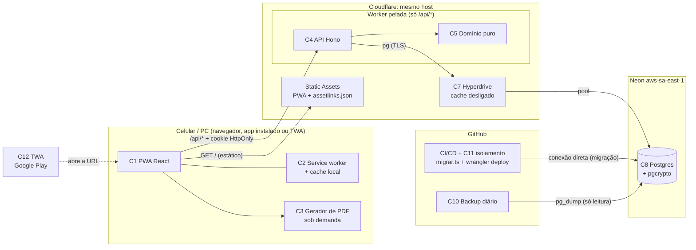
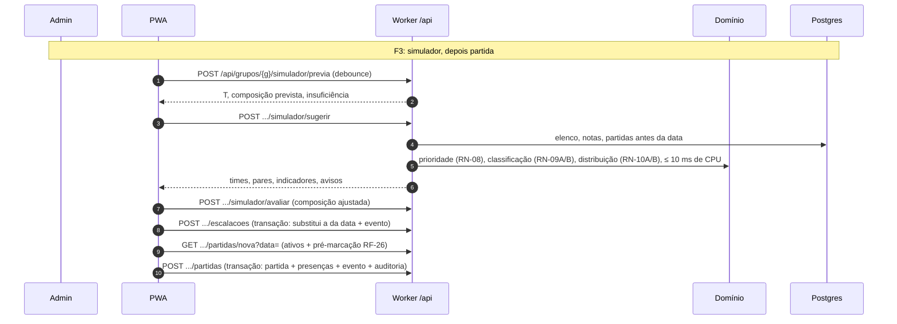
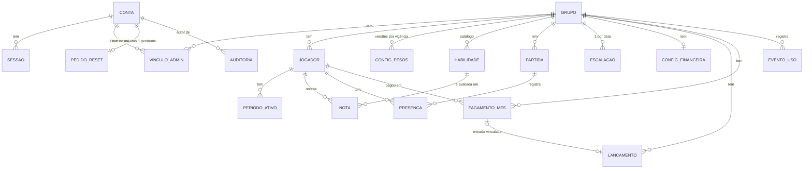

# SDD.md — Gestão da Pelada

**Status:** rascunho do Loop B, etapa B1, **rodada 3**, aguardando a revisão do usuário.
**Data:** 2026-10-16. **Autor:** Coordenador (chapéu Software Architect).
**Base:**
- `.md/PRD-TECNICO.md` (rascunho 4, aprovado);
- `.md/PRD.md` (rascunho 4);
- `.md/CTO-REVIEW.md` (Gate 1 com ressalvas e adendo);
- `.md/PLANO-COMERCIAL.md` v2.

**ADRs:** `.md/adr/001` a `017`.

| Situação | ADRs |
|---|---|
| Aceitos (rascunho) | 003, 005 a 009, 011 a 015 |
| Aceitos por decisão do usuário | 010, 016, 017 |
| Superados | 001 e 002 → 014; 004 → 015. O §5 do 014 foi substituído pelo 017 |

**Reabertura 4.4 (2026-10-21, "Datas de saída e de retorno do jogador", RA-19, PRD-TECNICO §1.17, RF-75 a RF-82, RN-30 a RN-34, RNF-14, F8)** — atualização pontual do Coordenador. Mudou só isto: a subseção "Datas de saída e de retorno" na Seção 2 (rotas, contrato aditivo, validação, auditoria e reaproveitamento de `previaDoInicio`), a linha de jogadores na superfície da API, `PERIODO_ATIVO` e `AUDITORIA` na Seção 5, o risco T-20 e uma linha em "Troca de dados em produção" na Seção 6, e uma linha na tabela de autorização da Seção 7. **Nenhum ADR novo** (justificativa na subseção). **Sem migração.**

**Mudanças da rodada 3** (respostas do usuário):
1. **Domínio:** a Fase 1 inteira fica em `pelada.prod-ljs.workers.dev` (ADR-020, que substitui o ADR-010). O custo de uma troca futura (T-18) é **risco aceito pelo usuário**. O que barateia a troca entra desde já:
   - nenhuma URL absoluta no código ou no banco;
   - a variável `URL_PUBLICA`;
   - o sinal `enderecoNovo` e a saída de emergência do service worker;
   - o pacote da TWA `com.gestaodapelada.app`, independente do domínio.
2. **Neon:** o usuário cria um **projeto novo** em `aws-sa-east-1`, no plano grátis. Está registrado como pré-requisito de infraestrutura (§3).
3. **Contingência do simulador** (ADR-017): otimizar → mover só o cálculo para a **Lightsail**, atrás de um proxy do Worker, tolerando latência → Workers Paid só se o usuário mudar de ideia. **O estouro de CPU no Workers Free é erro (1102), não lentidão.**

**Mudanças da rodada 2** (decisões do usuário):
1. **Hospedagem:** sai a Vercel e entra a Cloudflare: um Worker com arquivos estáticos e API no mesmo domínio, com o Neon por Hyperdrive (ADR-014). A dívida "Vercel Hobby não comercial" deixa de existir.
2. **Hash de senha** sai do Worker, por causa do limite de 10 ms de CPU, e passa a ser bcrypt no Postgres via `pgcrypto` (ADR-015).
3. **Lightsail do usuário:** não usada na Fase 1. Fica como contingência para o simulador e para o backup (ADR-014 §7).
4. **Framework mantido:** TypeScript, React + Vite (PWA) e Hono.
5. **Domínio:** o subdomínio `workers.dev` é viável e foi avaliado. A recomendação de domínio próprio antes do I1 continua em aberto para o usuário (ADR-010).
6. **Link do ranking legível por slug** (ADR-016). A enumeração de grupos passa a ser risco aceito pelo usuário.
7. **Exclusão de dados de jogador com histórico (LGPD):** fica para a Fase 2. Até lá, anonimização manual por script se houver pedido.
8. **Aprovadas na tela:** "Marcar todos como presentes" e o ajuste do simulador por toque e menu, sem arrastar.

---

## 1. Visão Geral da Arquitetura

O Gestão da Pelada é um **monólito modular em TypeScript** publicado como **um único Cloudflare Worker** (ADR-014):

- os **arquivos estáticos do PWA** (React + Vite) são servidos pela própria Cloudflare;
- a **API HTTP** (Hono) responde em `/api/*` no **mesmo host**. Só essas rotas executam código.

O banco é um **Postgres no Neon Free** em São Paulo (`aws-sa-east-1`), acessado pelo **Hyperdrive** (pool da Cloudflare perto do banco) com o driver `pg`, com o cache de consultas desligado.

As regras de negócio (ranking, pontuação, atividade, simulador e saldos) moram num **pacote de domínio puro**, sem I/O, usado só pela API (ADR-006, ADR-007). A tela consome um **contrato** de schemas compartilhado e só formata e desenha. A exceção é o PDF: o desenho é feito no navegador, mas a partir de uma projeção pronta da API (ADR-008).

**Por que este padrão:**
1. **Volume mínimo** (RNF-09): um processo só, sem fila nem cache distribuído.
2. **Um desenvolvedor, em horas de lazer:** uma linguagem, um repositório e um deploy (`wrangler deploy` pelo CI), sem servidor para administrar.
3. **Lógica densa e sob medida:** auth sem e-mail, simulador com objetivo lexicográfico e pesos por vigência. Fica mais simples e testável em TypeScript puro.
4. **Sessão estável no iPhone** (PR-06): a tela e a API ficam no mesmo host por construção, e o cookie `HttpOnly` é definido pelo servidor (ADR-003).
5. **Custo de R$ 0 por mês, com uso comercial permitido** (RNF-08 e Fase 2), mais o domínio (ADR-020).

**Restrição de projeto que vem da plataforma:** **10 ms de CPU por requisição** no Workers Free (ADR-014 §5). A espera por rede e por banco não conta. Por isso:
- o hash de senha roda no Postgres (ADR-015);
- o simulador tem orçamento de CPU testado (ADR-007 + ADR-014);
- o PDF é desenhado no navegador (ADR-008).

**Ambientes** (sem homologação, ADR-020; se voltar, abre-se novo BK):

| Ambiente | Worker | Hyperdrive | Banco |
|---|---|---|---|
| **Produção** (`https://pelada.prod-ljs.workers.dev`, ADR-020) | `pelada` | `pelada-prod` | branch `production` do Neon |
| **Local** | `docker compose` com `wrangler dev` (workerd) | `localConnectionString` | Postgres do Docker |

**Princípios que valem para todo o projeto:**

| # | Princípio | Origem |
|---|---|---|
| P-1 | Todo dado de grupo é lido e escrito com o `grupoId` vindo da rota, depois do middleware de vínculo. Uma negação responde 404, sem revelar se o recurso existe | RF-09, RN-17, ADR-005 |
| P-2 | Regra de negócio só no `@pelada/dominio`. A tela não calcula pontos, ordem, nível, pares, composição de times nem saldo | CONVENCOES §2, ADR-006, ADR-007 |
| P-3 | "Hoje" e o mês são de São Paulo, decididos no servidor. Datas de negócio são `date`. Dinheiro é centavo inteiro | RNF-02, ADR-012 |
| P-4 | A visão pública e o PDF só recebem a projeção pública. O que é privado nem sai da API pública | RF-33, RNF-06, PR-09 |
| P-5 | Sessão por cookie `HttpOnly` do próprio host. Nenhum token acessível ao JavaScript | PR-06, ADR-003 |
| P-6 | Toda requisição do Worker cabe em 10 ms de CPU. Trabalho pesado de CPU vai para o banco (hash) ou para o navegador (PDF), ou é otimizado e medido (simulador) | ADR-014, ADR-015 |
| P-7 | Custo zero por mês. Qualquer item pago passa pelo usuário | RNF-08 |

---

## 2. Componentes e Fluxo de Dados

### Componentes

| # | Componente | Onde roda | Responsabilidade | Requisitos |
|---|---|---|---|---|
| C1 | **PWA** (`frontend/web`) | Navegador / app instalado / TWA. Os arquivos são servidos pelos Static Assets do Worker | Telas, formatação pt-BR, navegação, chamadas ao contrato, instalação, aviso de iPhone | RF-11 a RF-64 (lado tela), RF-53, RNF-01, RNF-04, RNF-10 |
| C2 | **Service worker + cache local** (dentro do C1) | Navegador | Precache do app shell; último ranking em cache; grupo lembrado; identificador anônimo | RF-34, RF-54, RF-56, ADR-009 |
| C3 | **Gerador de PDF** (módulo `pdf/` do C1, sob demanda) | Navegador | Desenhar o A4 a partir da projeção; compartilhar ou baixar | RF-49 a RF-52, ADR-008 |
| C4 | **API HTTP** (`backend/api`, Hono) | Cloudflare Worker `pelada`, só em `/api/*` (`run_worker_first`) | Rotas públicas, de admin e de dono; sessão; autorização por grupo e papel; validação; casos de uso | Todos os RF, RNF-05 |
| C5 | **Domínio** (`backend/dominio`) | Dentro do C4 (biblioteca) | Pontuação, atividade, ranking, marcações, colunas do PDF, slug, nível, idade, simulador, saldos | RN-01 a RN-19 |
| C6 | **Contrato** (`backend/contrato`) | Usado pelo C1 e pelo C4 | Schemas, enums e limites (validação nos dois lados) | CONVENCOES §8 |
| C7 | **Hyperdrive** (`pelada-prod`, cache desligado) | Cloudflare | Pool de conexões para o Neon; conexão TLS reaproveitada | RNF-03, ADR-014 |
| C8 | **Banco** (Postgres no Neon, extensão `pgcrypto`) | Neon `aws-sa-east-1` | Persistência; integridade; **hash de senha bcrypt** | Todos; ADR-015 |
| C9 | **Scripts de operação** (`backend/scripts`, Node) | Máquina do desenvolvedor / GitHub Actions | Migração (conexão direta ao Neon), conta do dono, seed local, anonimização manual (Fase 2: só se houver pedido), **importação do histórico legado** (`importar-legado.ts`, `--dry-run`, transação única, ADR-021) | RF-01, RF-65 a RF-67, I-34, ADR-013, ADR-021 |
| C10 | **Backup** (`.github/workflows/backup.yml`) | GitHub Actions (cron diário) | `pg_dump` cifrado, retenção de 30 dias | RNF-07, ADR-011 |
| C11 | **Suíte de isolamento** (`backend/api/test/isolamento`) | CI e local (Postgres do Docker), **nunca em produção** | Toda rota tentando o acesso cruzado entre grupos | RF-09, RNF-05, ADR-005 |
| C12 | **TWA** (`frontend/twa`) | Google Play | Pacote Bubblewrap da URL do PWA; `assetlinks.json` servido pelo C1 | RF-55, RNF-11, ADR-009 |

**Bounded contexts.** São contextos lógicos no mesmo monólito, separados por pasta no domínio e na aplicação:

| Contexto | O que cobre | RF |
|---|---|---|
| Acesso | conta, sessão, tentativas, pedido de reset, vínculo admin↔grupo, papel de dono | RF-01, RF-05, RF-06, RF-11 a RF-18 |
| Grupos | grupo, slug público, situação comercial, arquivamento | RF-02 a RF-04, RF-07 a RF-10 |
| Elenco | jogador, períodos de atividade, habilidades, notas, nível | RF-19 a RF-22, RF-35 a RF-37 |
| Pontuação e partidas | pesos, partida, presença, ranking, colunas do PDF | RF-23 a RF-34, RF-49 a RF-51 |
| Simulador | prévia, sugestão, avaliação, escalação confirmada | RF-38 a RF-48, RF-26 |
| Caixa | configuração, pagamentos, lançamentos, saldos | RF-59 a RF-63 |
| Uso | eventos anônimos e painel semanal | RF-56 a RF-58 |

Dependências entre contextos, só por função de aplicação:
- o Simulador lê o ranking (RN-08) e o nível (Elenco);
- as Partidas leem a escalação (RF-26);
- o Caixa lê os ativos do mês (Elenco).

### Fronteiras externas

| Integração (PRD-TECNICO §5.2) | Fronteira na arquitetura |
|---|---|
| Navegador: instalação de PWA, service worker, armazenamento local | C1 + C2 (ADR-009) |
| Folha de compartilhamento (Web Share com arquivos) | C3, em diálogo Compartilhar/Baixar (ADR-022) |
| Google Play Console e vínculo de domínio (TWA) | C12 + `/.well-known/assetlinks.json` como arquivo estático do Worker |
| Hospedagem, banco e domínio | Cloudflare Workers + Hyperdrive (C1, C4, C7); Neon (C8); `pelada.prod-ljs.workers.dev` na Fase 1 inteira (ADR-020) |
| WhatsApp | Sem integração; só destino do compartilhamento e do link copiado |
| Gateway de pagamento / Pix | **Nenhuma** na Fase 1 |
| Serviço de e-mail | **Nenhum** (P-25) |
| GitHub | Código, CI/CD (testes, migração, `wrangler deploy`), backup (C10) |
| AWS Lightsail (do usuário) | **Não usada** na Fase 1. É contingência: (a) cálculo do simulador atrás de proxy do Worker, se o S-02 falhar (ADR-017); (b) executor do backup, se o cron do GitHub falhar (T-08) |

### Diagrama de componentes



### Fluxo de dados por fluxo do PRD-TECNICO

```mermaid
sequenceDiagram
    autonumber
    participant J as Jogador (sem login)
    participant W as PWA + SW
    participant A as Worker /api
    participant D as Domínio
    participant B as Postgres (via Hyperdrive)
    Note over J,B: F1: consultar o ranking
    J->>W: abre /g/{slug}
    W-->>J: mostra o último ranking do cache local (se houver)
    W->>A: GET /api/publico/{slug}/ranking?mes=AAAA-MM
    A->>B: grupo por slug; jogadores, períodos, partidas, presenças, pesos
    A->>D: ranking(hoje SP, mes)
    D-->>A: linhas na ordem do acumulado + marcações do mês
    A-->>W: projeção pública + geradoEm
    W->>A: POST /api/publico/{slug}/eventos {ranking_aberto, dispositivo}
```

```mermaid
sequenceDiagram
    autonumber
    participant Ad as Admin
    participant W as PWA
    participant A as Worker /api
    participant B as Postgres
    Note over Ad,B: F2: login (o hash é calculado no banco, ADR-015)
    Ad->>W: e-mail + senha
    W->>A: POST /api/sessao/entrar
    A->>B: conta tentativas do e-mail (15 min)
    A->>B: SELECT senha_hash = crypt($senha, senha_hash) (hash fixo se o e-mail não existir)
    A->>B: grava tentativa; cria sessão (hash SHA-256 do token)
    A-->>W: Set-Cookie __Host-sessao (HttpOnly, Secure, SameSite=Lax)
```



Os fluxos F4 (PDF), F5 (financeiro) e F6 (dono cria grupo, com o slug gerado no domínio, ADR-016) seguem o mesmo padrão: a tela chama a rota, o middleware autoriza, o caso de uso valida, chama o domínio e grava pelo repositório numa transação quando toca mais de uma tabela.

### Superfície da API (alto nível)

O contrato detalhado (OpenAPI) nasce por endpoint no `API-CONTRACT.yaml`, durante a execução.

| Prefixo | Autorização | Rotas principais |
|---|---|---|
| `/api/publico/:slug` | nenhuma (somente leitura, projeção pública) | `GET ranking?mes=` (linhas com `ptsInicial`, `rodadas[{situacao, pontos}]`, `ptsFinal`), `GET pdf?mes=` (até 12 `colunas`, mesmas linhas), `POST eventos` (só `ranking_aberto` e `pdf_exportado`). Formato de referência: `.md/mockup/respostas/publico-*.json` |
| `/api/sessao` | — / sessão | `POST entrar`, `POST sair`, `POST esqueci-senha`, `POST trocar-senha`, `GET eu` (conta, papel, grupos, escopo, aviso de privacidade visto, `enderecoNovo` opcional, ADR-020) |
| `/api/grupos/:grupoId` | sessão completa + vínculo (404 se não houver) | `GET/PATCH /` (o GET traz `permissoes` e o resumo `inicio` da T09); `admins`; `partidas?mes=`, `partidas/:data`; `jogadores` (CRUD, inativar, reativar, notas; `jogadores/:id/inicio/previa` e `PUT jogadores/:id/inicio` para a data de início, RF-69 a RF-72, ADR-023; a edição genérica não aceita mais `dataEntrada`; **datas de saída e de retorno, RF-75 a RF-82: `GET jogadores/:id/periodos`, `POST jogadores/:id/periodos/:periodoId/previa`, `PUT jogadores/:id/periodos/:periodoId`, `POST jogadores/:id/reativar/previa` e `dataRetorno` opcional em `POST jogadores/:id/reativar`**, detalhe logo abaixo); `habilidades`; `pesos`; `partidas` (`nova?data=`, CRUD); `simulador/contexto?data=`, `simulador/previa`, `simulador/sugerir`, `simulador/avaliar`, `escalacoes`; `uso` |
| `/api/grupos/:grupoId/financeiro` | vínculo + `acessa_financeiro` (403 se faltar) | `mes?mes=` (config, saldos, pagamentos e lançamentos do mês), `config`, `pagamentos`, `lancamentos`, `lancamentos/:id` |
| `/api/dono` | sessão completa + `e_dono` (404 se não for) | `painel` (pedidos + grupos), `grupos/:id`, `pedidos-reset`, `grupos` (listar metadados, criar com 1º admin e slug, situação comercial, arquivar, reativar), `contas/:id/redefinir-senha` |

### Datas de saída e de retorno do jogador (reabertura 4.4, RF-75 a RF-82)

Vocabulário (PRD-TECNICO §1.17): **período** = intervalo semiaberto `[início, fim)` de atividade do jogador; **saída** = `fim`; **retorno** = `início` de um período que não é o primeiro. O início do 1º período é a data de início da pontuação e só muda pela rota de `inicio` (ADR-023). O acumulado (RN-25) **não olha períodos**; corrigi-los muda quem aparece nas rodadas, no ranking, no lançamento, no simulador e no financeiro, e nunca um ponto. **Presença gravada fora de período (legado, I-48/PR-25; decisão do BK-0018, 2026-10-22):** como o acumulado a conta, a grade também a mostra — `rodadasDoJogador` devolve a situação e os pontos da presença quando existe presença na data, mesmo sem período ativo; "–" (`fora`) fica só para a data sem presença e sem período ativo, ou anterior à data de início da pontuação (que o acumulado também ignora). Assim PTS FINAL do mês = PTS INICIAL do seguinte. Não muda ponto (RNF-13), logo não exige o Gestor.

**Rotas** (todas sob `/api/grupos/:grupoId/jogadores/:id`, atrás do middleware de vínculo: jogador, período ou grupo de outro lugar respondem 404 genérico; escrita exige `X-Pelada: 1`; G-03, G-04, G-09):

| Rota | Para quê | Corpo → resposta |
|---|---|---|
| `GET periodos` | Lista da seção Situação (só admin) | → `{ periodos: [{ id, tipo: 'entrada'\|'retorno', inicio, fim \| null, corrigivel: { saida, retorno } }] }` em ordem cronológica. `tipo` e `corrigivel` vêm do domínio (G-05): 1º período aberto = nada corrigível; 1º encerrado = só a saída; aberto = só o retorno; demais = os dois |
| `POST periodos/:periodoId/previa` | Efeito de uma correção, sem gravar | `{ saida?, retorno? }` (ao menos um) → **prévia** |
| `PUT periodos/:periodoId` | Grava a correção | mesmo corpo → `{ alterado, periodos }` (`alterado: false` se nada mudou: não grava nem audita) |
| `POST reativar/previa` | Efeito de reativar com retorno retroativo | `{ dataRetorno }` → **prévia** |
| `POST reativar` (existente) | Reativa | corpo **opcional** `{ dataRetorno? }`; sem corpo, `{}` ou data de hoje = retorno hoje (comportamento atual). Resposta continua `JogadorDetalhe`, sem campo novo |

**Prévia** (esquema novo `elenco.periodo.previa.resposta`, usado pelas duas rotas de prévia): `{ acumuladoAntes, acumuladoDepois, posicaoAntes \| null, posicaoDepois \| null, rodadasQuePassamAConstar: [{ data, situacao }], rodadasQueDeixamDeConstar: [{ data }], aviso \| null }`. Posição nula = jogador fora do ranking de hoje. `aviso` é o texto pronto ("Elas valem 0 ponto até você lançar a presença em Editar partida.", singular ou plural), presente só se alguma rodada que passa a constar for falta (P-43). O esquema `inicioPreviaResposta` (contagem inteira) **não muda**.

**Contrato aditivo (RNF-14, G-20).** Só entram: as rotas e esquemas novos, e `dataRetorno` **opcional** no corpo de `reativar` (`strictObject({})` vira `strictObject({ dataRetorno: opcional })`). `elenco.detalhe` **não ganha campo**: o app anterior o valida com `strictObject` e recusaria a resposta (risco que `QUEBRAS.md` já aceitou uma vez para `inicioPontuacao`; aqui evitável). Por isso a lista de períodos com identificador vai numa rota própria, o que cumpre RF-77 ("o contrato do elenco entrega cada período com identificador") sem tocar o detalhe. O app anterior chama `reativar` sem corpo e continua funcionando; `checar-compatibilidade` deve passar **sem** entrada nova em `QUEBRAS.md`. **Sem migração** (G-14 não se aplica): `periodos_ativos.id` já existe e as restrições atuais (`fim >= início`, um período aberto) seguem como última barreira.

**Domínio (`@pelada/dominio`, puro; G-05, G-06).**
- `atividade/avaliar-periodos.ts`: **uma só função de validação** para as três operações (corrigir, reativar com retorno, inativar com saída), na ordem de RF-79 — (a) futura, (b) saída antes do início do período, (c) retorno antes da saída anterior, (d) saída depois do próximo retorno ou retorno depois da própria saída, (e) sobreposição, (f) presença fora do período, (g) saída do 1º período antes da data de início, (h) data inválida. Devolve `{ ok, periodos }` ou `{ regra, campo, limite }`; o texto em pt-BR e o formato dd/mm/aaaa são da `aplicacao/` (`mensagens.ts`), como hoje. Entrada: períodos com id, a operação, `hoje`, `inicioPontuacao` e as **datas de partida em que o jogador tem presença, lesão ou expulsão**. A regra (f) (RN-32) compara a cobertura **antes e depois** e só recusa data que a correção retira (I-55, PR-25); o limite informado é o aceito (saída: dia seguinte à presença mais tarde retirada; retorno: o dia da presença mais cedo retirada) e a mensagem cita também a data da presença. O mesmo conjunto vale para o Inativar (RF-79, última frase), que perde as mensagens fixas atuais.
- `ranking/previa-periodos.ts`: `previaDosPeriodos`. **Reaproveita `previaDoInicio`**: o miolo (cenário antes × depois do jogador alvo no ranking de hoje, `acumuladoPorInicio`, `ordenarPorRanking`, `rodadasDoJogador`) é extraído para um auxiliar comum, de modo que `previaDoInicio` mantém assinatura e resultado (contagem) e a nova função devolve as **datas** das rodadas que passam ou deixam de constar. Acumulado só por `acumuladoPorInicio` (G-25).
- Rodada "passa a constar" = era `fora` e deixa de ser; "deixa de constar" = o inverso; a nova situação vem da mesma `rodadasDoJogador` do ranking (falta, presente, lesionado, expulso).

**Aplicação e transação** (`aplicacao/elenco/`, G-02): `periodos-listar`, `periodos-previa`, `periodos-corrigir`; `reativar.ts` e `inativar.ts` passam a usar o mesmo caminho. A **gravação** é: `emTransacao` → `jogadores.travar` (a linha do jogador, como em `inicio-editar.ts`; dois pedidos juntos se enfileiram e o segundo parte do que o primeiro gravou) → carregar histórico e início **dentro** da transação → avaliar (mesma função da prévia) → `corrigirPeriodo` ou `reativar` → auditoria. A **prévia** é só leitura e chama a mesma avaliação e o mesmo cálculo (RF-78), então devolve a mesma recusa que a gravação devolveria. Toda recusa é 422 com `campos.<saida|retorno|dataRetorno>` (nunca 500); `PeriodoInvalido` e `JaAtivo` do banco são convertidos em 422/409 como hoje. Datas iguais às atuais: `alterado: false`, sem escrita e sem auditoria.

**Repositório** (`infraestrutura/db/repositorios/jogadores.ts`, único acesso ao Postgres): `PeriodoDoJogador` passa a trazer `id` (já selecionável na consulta; campo extra que o adaptador do domínio ignora); nova `corrigirPeriodo(tx, grupoId, jogadorId, periodoId, { inicio?, fim? })` (UPDATE filtrando `id`, `jogador_id` e `grupo_id`; zero linhas = não encontrado). As datas de presença saem do histórico já carregado, sem SQL novo; `temPresencaDesde` deixa de ser usada pelo Inativar. Nenhuma função nova escreve em `jogadores.inicio_pontuacao` (G-25 continua verde).

**Auditoria** (mesmo `auditoria.registrar` do ADR-023, sem tabela nova; só admin; fora da visão pública e do PDF): ação `jogador_periodo_corrigido` e, no `reativar` com data anterior a hoje, `jogador_reativado_retroativo`. Resumo plano (o filtro de chaves proíbe senha, token, hash e telefone, e o formato aceita `null`): `periodo` (ordem, a partir de 1), `saidaAnterior`, `saidaNova`, `retornoAnterior`, `retornoNovo`, `acumuladoAntes`, `acumuladoDepois`, `posicaoAntes`, `posicaoDepois`; no retroativo, `retorno`, `saidaAnterior`, acumulados e posições. As datas anteriores ali permitem desfazer. O Inativar com saída retroativa **não** passa a auditar (fora do RF-80).

**Consumidores (RF-81).** Nada a propagar: ranking, PDF, simulador, lançamento e financeiro leem os períodos a cada requisição (ADR-006, cache do Hyperdrive desligado), então o "próximo carregamento" já reflete a correção.

**Desempenho (G-12).** A prévia carrega o histórico do grupo em 4 consultas, o mesmo custo da `previaInicio` já em produção. Medir com o histórico importado do legado no teste de orçamento.

**Decisão sem ADR.** Não há alternativa estrutural em aberto: o modelo de períodos (RN-06, ADR-006), o padrão transacional com jogador travado, a prévia e a auditoria seguem o ADR-023; as escolhas novas são de detalhe (função única de validação, rota própria para a lista por causa do G-20, mensagem com data limite). Se o usuário preferir o campo `periodos` dentro de `elenco.detalhe`, basta registrar o risco em `QUEBRAS.md` como foi feito com `inicioPontuacao`; ainda assim sem ADR.

```mermaid
sequenceDiagram
    autonumber
    participant Ad as Admin
    participant W as PWA (T16)
    participant A as Worker /api
    participant D as Domínio
    participant B as Postgres
    Ad->>W: informa a nova data no diálogo
    W->>A: POST …/periodos/:p/previa  (ou …/reativar/previa)
    A->>B: histórico do grupo (4 consultas, só leitura)
    A->>D: avaliar (RF-79) + previaDosPeriodos (reaproveita previaDoInicio)
    A-->>W: prévia ou 422 com a data limite
    Ad->>W: confirma
    W->>A: PUT …/periodos/:p  (ou POST …/reativar)
    A->>B: BEGIN; travar jogador; recarregar; avaliar de novo
    A->>B: UPDATE/INSERT do período; INSERT auditoria; COMMIT
    A-->>W: { alterado, periodos } (ou JogadorDetalhe)
```

### Pacotes, pastas e fronteiras

**Convenção do ambiente:** duas pastas de topo, `backend/` e `frontend/`. Os únicos itens de topo fora delas não têm lógica:
- `.github/` (workflows);
- `docker-compose.yml`;
- `pnpm-workspace.yaml`;
- `wrangler.jsonc`.

A pasta `api/` e o `vercel.json` da rodada 1 **deixaram de existir**.

**Pacotes (pnpm workspaces) e quem depende de quem:**

| Pacote | Pasta | Depende de | Quem depende dele | Observação |
|---|---|---|---|---|
| `@pelada/contrato` | `backend/contrato` | `zod` | `@pelada/api`, `@pelada/web` | Schemas, enums e limites (inclusive senha de 8 a 72 caracteres, ADR-015). **Sem lógica de negócio** |
| `@pelada/dominio` | `backend/dominio` | nada | `@pelada/api`, `backend/scripts` (a importação do legado, a verificação `verificar-inicio.ts` e o seed local reaproveitam o cálculo do acumulado por data de início, RN-25/ADR-023, que substitui as chamadas diretas a `acumuladoComInicial`, em vez de recalcular) | Regras puras; não importa `contrato`, `pg`, `hono` nem lê o relógio |
| `@pelada/api` | `backend/api` | `@pelada/contrato`, `@pelada/dominio`, `hono`, `kysely`, `pg` | `wrangler.jsonc` (entrada do Worker), `backend/scripts` (só os repositórios, as migrações, `infraestrutura/db/index.ts` (`emTransacao`, `criarDb`), `infraestrutura/seguranca` e `aplicacao/acesso/senhas`; ajuste aprovado pelo usuário no Loop C, TASK.md L-2, para o `dono.ts` não duplicar a redefinição de senha) | Aplicação HTTP para workerd (`nodejs_compat`) |
| `@pelada/web` | `frontend/web` | `@pelada/contrato`, `react` etc. | — | **Sem `@pelada/dominio` nem `@pelada/api` nas dependências** (fronteira garantida pela dependência) |

**Camadas dentro de `@pelada/api`** e direção de import (a seta indica "pode importar"):

```
entrada (worker.ts, rotas Hono, middlewares) ─▶ aplicacao (casos de uso) ─▶ dominio (@pelada/dominio)
                                                    │
                                                    └─▶ infraestrutura (db/repositorios, sessao, relogio, config)
```

- Uma **rota nunca importa outra rota**. O que é comum vai para `aplicacao/`.
- A `aplicacao/` converte a entrada validada pelo contrato em tipos do domínio, com adaptadores tipados (sem `as unknown as`).
- O **único módulo que fala com o Postgres** é `backend/api/src/infraestrutura/db/`:
  - recebe o binding do Hyperdrive, cria e fecha o cliente por requisição;
  - expõe só funções de repositório por contexto e um `emTransacao(fn)` de uso interno da `aplicacao/`;
  - **não exporta a conexão** nem o objeto Kysely;
  - toda função de dado de grupo recebe `grupoId` como primeiro parâmetro (ADR-005);
  - **o SQL de hash de senha (`crypt`) também mora aqui**, no repositório de contas (ADR-015).
- **Onde a regra de negócio roda:** no `@pelada/dominio`, chamado pela `aplicacao/`. A tela recebe pronto:
  - ranking ordenado com marcações e contagens;
  - colunas do PDF;
  - nível e "sem nota";
  - prévia, sugestão, indicadores, pares e avisos do simulador;
  - saldos;
  - datas sugeridas;
  - limites de navegação de mês;
  - o slug gerado.
- **Rótulos de enums** ficam num único módulo do `@pelada/web` (`src/rotulos/`), derivado dos enums do contrato.

**Árvore de pastas alvo** (até o segundo nível):

```
/
├─ backend/
│  ├─ contrato/              @pelada/contrato: schemas zod, enums e limites
│  ├─ dominio/               @pelada/dominio: src/{pontuacao,atividade,ranking,pdf,elenco,grupos(slug),simulador,caixa,datas}; testes unitários + teste de orçamento de CPU do simulador
│  ├─ api/                   @pelada/api: src/{entrada (worker.ts = entrada do Worker),aplicacao,infraestrutura,config}; test/{rotas,isolamento,apoio}
│  │   └─ src/infraestrutura/db/   repositórios + migracoes/ (SQL versionado), único acesso ao Postgres
│  └─ scripts/               migrar.ts, dono.ts (criar / redefinir-senha), seed-local.ts, importar-legado.ts (+ `importar-legado/`: leitura, cálculo, gravação; ADR-021), verificar-inicio.ts (somente leitura, RF-74/ADR-023), anonimizar-jogador.ts (só se houver pedido LGPD); todos com trava de host para escrita local
├─ frontend/
│  ├─ web/                   @pelada/web: src/{telas,componentes,dados,pdf,pwa,rotulos,formatacao,estilos}; public/ (ícones, .well-known/assetlinks.json); e2e/ (Playwright + comparação visual)
│  └─ twa/                   projeto Android do Bubblewrap (twa-manifest.json, sem código próprio)
├─ .github/workflows/        ci.yml (PR), deploy.yml (disparo manual), backup.yml (cron)
├─ docker-compose.yml
├─ pnpm-workspace.yaml
└─ wrangler.jsonc            Worker pelada: main = backend/api/src/entrada/worker.ts; assets = frontend/web/dist (SPA); run_worker_first ["/api/*"]; hyperdrive; nodejs_compat; ambiente "teste"
```

---

## 3. Stack Tecnológica e Justificativa

| Componente | Tecnologia | Requisito que motiva | Alternativa considerada | Trade-off |
|---|---|---|---|---|
| Linguagem | **TypeScript** (workerd no Worker; Node 22 nos scripts e no CI) | Um desenvolvedor, contrato compartilhado, domínio testável | Python ou Go na API | Uma linguagem só. O desenvolvedor já usa TS no MyMoney. Nest/Next foram considerados a pedido do usuário e descartados: peso e convenções desnecessários para uma API pequena num Worker; o Next não roda bem no Workers Free |
| Runtime e hospedagem | **Cloudflare Workers Free** com **Static Assets** (um Worker, mesmo host) | RNF-08 (uso comercial permitido), RNF-03 (sem partida a frio), ADR-003 (mesma origem) | Vercel Hobby (ADR-002, superado); Pages + Functions | **10 ms de CPU por requisição** (ADR-014 §5); runtime workerd, não Node completo |
| Framework da API | **Hono** | Nativo em Workers e também em Node (plano de saída na Lightsail) | Express (não roda em Workers), itty-router | Ecossistema menor que o do Express, suficiente aqui |
| Conexão ao banco | **Hyperdrive** (cache de consultas **desligado**) + driver **`pg`** | Transações interativas; pool perto do banco; recomendado pelo Neon | Driver serverless do Neon (HTTP sem transação interativa; WebSocket abre conexão por requisição) | 100 mil consultas por dia no plano grátis; S-01 confirma `BEGIN`/`COMMIT` |
| Query builder | **Kysely** (dialeto Postgres sobre `pg`) | SQL tipado num só módulo (CONVENCOES §2) | Prisma (pesado para Workers), Drizzle | Consultas escritas à mão, sem mágica de relacionamento |
| Migrações | **SQL versionado** + `scripts/migrar.ts` (Node, conexão direta ao Neon, uma transação por migração) | Troca de schema atômica (§6) | `drizzle-kit`, `node-pg-migrate` | O runner próprio é mínimo |
| Hash de senha | **bcrypt (custo 12) via `pgcrypto`** no Postgres | RNF-05 sem estourar os 10 ms de CPU | PBKDF2 da WebCrypto (fraco para caber); Workers Paid | A senha trafega até o banco (TLS); cada login gasta CPU do Neon (ADR-015) |
| Validação | **zod** (`@pelada/contrato`) | Limites definidos uma vez (CONVENCOES §8) | valibot | Bundle um pouco maior; o Worker gratuito aceita até 3 MB comprimido |
| Banco | **Postgres 16/17 no Neon Free** (`aws-sa-east-1`) | Integridade, RNF-07, RNF-09; o usuário já tem conta | D1 (SQLite), Supabase | Suspende após 5 minutos (cerca de 0,5 a 1 s para acordar); histórico de 6 h (ADR-011). Se o projeto Neon que o usuário já tem estiver em outra região, cria-se um **novo projeto** em São Paulo (a região é fixa por projeto) |
| Tela | **React 19 + Vite + React Router** | RNF-01, familiaridade | Preact, SvelteKit | Bundle maior; divisão de código por rota |
| Dados na tela | **TanStack Query** | Estados uniformes, *stale-while-revalidate* | SWR | Uma dependência a mais |
| Estilo | **CSS Modules + `tokens.css`** do mockup | O mockup é a fonte da aparência | Tailwind | Um pouco mais de CSS escrito |
| PWA | **vite-plugin-pwa** (Workbox) | RF-53, RF-54, RNF-11 | SW escrito à mão | Configuração declarativa |
| PDF | **jsPDF** sob demanda + fonte do mockup | RF-49 a RF-52; fora da CPU do Worker | Servidor (estouraria 10 ms) | Desenho em coordenadas é verboso |
| Testes | **Vitest** (domínio; API com `@cloudflare/vitest-pool-workers` e Postgres do Docker), **Playwright** (e2e + `comparar-visual.mjs`) | CONVENCOES §7; comparação visual | Jest, Cypress | O pool de Workers roda em workerd, mais fiel que o Node |
| Deploy | **Wrangler** pelo **GitHub Actions** | Um deploy, volta atrás com `wrangler rollback` | Integração Git da Cloudflare | O workflow garante a ordem: dump, branch, migração e só então o deploy |
| TWA | **Bubblewrap CLI** | RF-55 | PWABuilder | — |

**Escolhas já feitas pelo usuário:**
- `workers.dev` na Fase 1 (ADR-020);
- Lightsail, não Workers Paid, como contingência do simulador (ADR-017). O Workers Paid (US$ 5 por mês) só entra se o usuário mudar de ideia.

### Pré-requisitos de infraestrutura (antes da 1ª tarefa de deploy)

| # | Pré-requisito | Quem | Observação |
|---|---|---|---|
| PI-1 | **Projeto novo no Neon**, região **`aws-sa-east-1` (São Paulo)**, plano grátis, Postgres 16 ou 17, com a extensão `pgcrypto` habilitada | Usuário | A região é fixa por projeto. Criar o branch `production` (produção; sem branch de homologação, ADR-020), um usuário de aplicação e um **usuário só de leitura** para o backup |
| PI-2 | Conta Cloudflare com o subdomínio `workers.dev` definido como **`prod-ljs`** (ADR-020) | Usuário | Confirmar antes do 1º deploy. O nome compõe a URL pública |
| PI-3 | Configuração do Hyperdrive `pelada-prod`, **com cache desligado**, apontando para a string **direta** do Neon do branch `production` | Executor, com credenciais do usuário | ADR-014 |
| PI-4 | Secrets do GitHub: `CLOUDFLARE_API_TOKEN` (escopo mínimo), as strings diretas do Neon (migração e backup só de leitura) e a chave do backup (também no gerenciador de senhas) | Usuário | ADR-011, ADR-014 |
| PI-5 | App na Play Console com o nome de pacote **`com.gestaodapelada.app`** e Play App Signing ativado (só no I1-TWA) | Usuário | ADR-009, ADR-020 |
| PI-6 | **Só se o ADR-017 for acionado:** hostname com TLS na Lightsail, Caddy, firewall só com a 443 e o segredo HMAC | Usuário + Executor | Não é feito agora |

**Custo de caixa estimado (Fase 1):**

| Item | Custo |
|---|---|
| Cloudflare Workers + Hyperdrive (Free) | R$ 0 |
| Neon Free | R$ 0 |
| GitHub (repositório privado, Actions) | R$ 0 |
| Lightsail | não usada; se a contingência for acionada, sem custo novo (já é paga) |
| Domínio (ADR-020) | R$ 0 (`workers.dev` na Fase 1) |
| Conta Google Play | já paga |
| **Total** | **R$ 0 na Fase 1** (teto de R$ 180) |

**Consumo previsto contra os limites gratuitos** (5 grupos, 40 jogadores, 1 partida por semana, cerca de 30 aberturas de ranking por grupo por semana):

| Recurso | Limite | Consumo previsto |
|---|---|---|
| Requisições à Worker | 100 mil por dia | algumas centenas por dia; pico no dia de jogo menor que 1 mil |
| Consultas no Hyperdrive | 100 mil por dia | menos de 3 mil por dia |
| Compute do Neon | 100 CU-hora por mês | cerca de 10 CU-hora por mês |
| Armazenamento | 0,5 a 1 GB | menos de 20 MB |

### Ambiente local (`docker-compose.yml`)

| Serviço | Imagem / build | Porta | Papel |
|---|---|---|---|
| `db` | `postgres:16` com `pgcrypto` | 5432 | Banco descartável. Migrações na subida; seed fictício (2 grupos, contas de teste) |
| `backend` | Node 22 + `wrangler dev` (workerd) | 8787 | O mesmo Worker da produção. O Hyperdrive usa `localConnectionString` apontando para `db` |
| `frontend` | Node 22 + Vite | 5173 | Tela, com proxy de `/api` para `backend:8787` (mesma origem, como em produção) |

O workerd local **não impõe o limite de 10 ms de CPU**. O orçamento é verificado pelo teste de orçamento do domínio (CI) e pela medição no Worker publicado (S-02). Nenhum script de escrita roda sem a trava de host local (CONVENCOES §7).

### CI/CD (GitHub Actions)

| Workflow | Gatilho | Passos |
|---|---|---|
| `ci.yml` | PR | lint, tipos; testes de domínio (inclui orçamento de CPU); testes de API e suíte de isolamento (workerd + Postgres de serviço); build; e2e com Playwright |
| `deploy.yml` | disparo manual (`gh workflow run deploy.yml --ref main`; o push não dispara deploy), só produção, environment `producao` sem revisor obrigatório; sem homologação | 1) dump cifrado + branch de restauração no Neon (API do Neon); 2) `migrar.ts` (conexão direta, uma transação por migração); 3) `wrangler deploy` (build do Vite + Worker). Em caso de falha depois da migração: `wrangler rollback` + restauração do branch (§6) |
| `backup.yml` | cron diário às 04:00 de São Paulo + manual | `pg_dump` com usuário só de leitura, cifrado, artefato com retenção de 30 dias (ADR-011) |

---

## 4. Decisões Arquiteturais (índice de ADRs)

| ADR | Título | Status |
|---|---|---|
| [001](adr/001-monolito-modular-typescript-com-api-propria-no-mesmo-dominio.md) | Monólito modular em TypeScript, com PWA e API própria no mesmo domínio | Superseded by ADR-014 |
| [002](adr/002-hospedagem-vercel-hobby-e-neon-free-em-sao-paulo.md) | Hospedagem na Vercel Hobby e Neon Free | Superseded by ADR-014 |
| [003](adr/003-sessao-por-cookie-httponly-opaco-do-proprio-dominio.md) | Sessão por cookie HttpOnly opaco do próprio domínio, guardada no banco | Accepted (rascunho) |
| [004](adr/004-autenticacao-propria-sem-email-com-senha-temporaria.md) | Autenticação própria sem e-mail, com senha temporária e bloqueio por e-mail | Superseded by ADR-015 (só o hash mudou; as demais regras são herdadas) |
| [005](adr/005-isolamento-por-grupo-na-camada-de-repositorio.md) | Isolamento por grupo na API, sem RLS na Fase 1 | Accepted (rascunho) |
| [006](adr/006-regras-no-dominio-puro-e-ranking-calculado-na-leitura.md) | Regras no domínio puro; ranking calculado na leitura | Accepted (rascunho) |
| [007](adr/007-simulador-deterministico-no-servidor-com-busca-local.md) | Simulador determinístico no servidor; ajuste reavaliado pela API (orçamento de CPU no ADR-014) | Accepted (rascunho) |
| [008](adr/008-pdf-gerado-no-cliente-a-partir-de-projecao-da-api.md) | PDF desenhado no navegador a partir de projeção da API | Accepted (rascunho) |
| [009](adr/009-pwa-com-service-worker-e-twa-empacotada-por-bubblewrap.md) | PWA com service worker; TWA por Bubblewrap | Accepted (rascunho) |
| [010](adr/010-dominio-proprio-desde-o-i1.md) | Fase 1 inteira em `pelada.gestaodapelada.workers.dev`, com a troca futura preparada | Superseded by ADR-020 |
| [020](adr/020-host-prod-ljs-workers-dev-sem-homologacao.md) | Host `pelada.prod-ljs.workers.dev`, sem homologação, mesma preparação de troca futura de domínio | Accepted (decisão do usuário) |
| [011](adr/011-backup-diario-cifrado-por-github-actions.md) | Backup diário cifrado por GitHub Actions + histórico do Neon | Accepted (rascunho) |
| [012](adr/012-datas-no-fuso-de-sao-paulo-e-dinheiro-em-centavos.md) | Datas de São Paulo decididas no servidor; dinheiro em centavos | Accepted (rascunho) |
| [013](adr/013-conta-do-dono-criada-e-recuperada-por-script.md) | Conta do dono criada e recuperada só por script | Accepted (rascunho) |
| [014](adr/014-worker-unico-cloudflare-com-assets-e-api-e-neon-via-hyperdrive.md) | Um Cloudflare Worker (assets + API, mesmo host) com Neon por Hyperdrive; Lightsail como contingência | Accepted (rascunho) |
| [015](adr/015-hash-de-senha-bcrypt-no-postgres-via-pgcrypto.md) | Hash de senha bcrypt no Postgres (`pgcrypto`) | Accepted (rascunho) |
| [016](adr/016-link-publico-do-grupo-legivel-por-slug.md) | Link público legível por slug, estável e nunca reutilizado | Accepted (decisão do usuário) |
| [017](adr/017-contingencia-do-simulador-na-lightsail-via-proxy-do-worker.md) | Contingência do simulador: otimizar → Lightsail atrás de proxy do Worker → Workers Paid só por decisão do usuário | Accepted (decisão do usuário; só acionado se o S-02 falhar) |
| [021](adr/021-importacao-do-legado-por-script-de-operacao-em-transacao-unica.md) | Importação do histórico legado por script de operação, em transação única, depois do deploy da etapa 1 (demanda "Adequação ao legado") | Accepted |
| [022](adr/022-pdf-com-escolha-entre-compartilhar-e-baixar.md) | PDF com escolha entre Compartilhar e Baixar em aparelho que compartilha arquivo (supersede só o §3 do ADR-008) | Accepted (decisão do usuário) |
| [023](adr/023-data-de-inicio-do-jogador-como-regra-de-pontuacao.md) | Data de início do jogador como regra de pontuação (`inicio_pontuacao`), separada do início do 1º período por invariante; prévia + auditoria; implantação sem regressão (demanda "Data de início do jogador") | Accepted |

---

## 5. Modelo de Dados de Alto Nível

Entidades principais e relacionamentos. A modelagem física é do Executor, dentro destas regras. Toda entidade de grupo tem `grupo_id`. As colunas de auditoria (RNF-12) estão indicadas por "quem/quando".



| Entidade | Atributos-chave | Regras de integridade |
|---|---|---|
| **CONTA** | e-mail normalizado (único), nome, `senha_hash` (bcrypt, `pgcrypto`), `senha_temporaria`, `e_dono`, `aviso_privacidade_visto_em`, criação | No máximo 1 `e_dono = true`, e ela tem o `DONO_EMAIL` (ADR-013) |
| **SESSAO** | hash do token, conta, escopo (`completo`/`troca_de_senha`), criada, último uso, expira | Expiração deslizante de 30 dias (ADR-003) |
| **TENTATIVA_LOGIN** | e-mail normalizado, momento, sucesso | Janela de 15 min; poda das linhas com mais de 1 dia, feita no próprio login |
| **PEDIDO_RESET** | conta, último pedido em, resolvido em/por | No máximo 1 pendente por conta (RF-12, I-29) |
| **GRUPO** | nome (3 a 60), **`slug` (único, imutável, nunca reutilizado)**, dia da semana, frequência, horário, situação comercial + início do trial, `arquivado_em`, criado por/em | Slug gerado na criação (ADR-016). Criação e arquivamento só pelo dono |
| **VINCULO_ADMIN** | conta, grupo, `acessa_financeiro`, criado por/em | Único por (conta, grupo); pelo menos 1 por grupo (RN-13, numa transação) |
| **JOGADOR** | grupo, apelido (2 a 30), ano de nascimento, posição (`zagueiro`, `lateral`, `volante`, `meia`, `atacante`, `centroavante`, `goleiro`), **`pontuacao_inicial`** (inteiro 0 a 9999, padrão 0, RN-22), telefone (opcional) | Apelido único por grupo, sem diferenciar maiúsculas. Migração: `defensor`→`zagueiro`, `meio_campo`→`meia`; `pontuacao_inicial` = 0 nos existentes. Mudança da pontuação inicial gera auditoria com o valor anterior (RNF-12). Só admin lê e escreve; o público a vê somada no PTS INICIAL/FINAL. **`inicio_pontuacao` (data de início S, ADR-023, RN-25):** decide a partir de quando os pontos contam; invariante `início do 1º período <= S`; só muda pela rota de edição da data de início (auditoria `jogador_inicio_alterado`: anterior, nova, acumulado antes e depois). Anulável na expansão (NULL = início do 1º período) |
| **PERIODO_ATIVO** | jogador, início, fim (opcional) | Sem sobreposição; no máximo 1 período aberto (ADR-006). Banco: `fim >= início` e índice único do aberto; **a ausência de sobreposição é garantida pela validação com o jogador travado** (não há restrição de exclusão no banco, T-20). Reabertura 4.4: a saída de qualquer período encerrado e o retorno de qualquer período que não seja o 1º podem ser corrigidos (RN-30); nunca se cria, apaga ou reordena período; o início do 1º é a data de início da pontuação. O `id` aparece só na rota admin `GET …/periodos` |
| **CONFIG_PESOS** | grupo, `vigente_desde`, **6 pesos** inteiros (−10 a 10): presença, lesionado e **expulso**, cada um sem e com chuva (RN-23); registrado por/em | Imutável; vigência = hoje (RF-23, RN-04), exceto a carga do legado (RN-24, ADR-021). Migração: `expulso_com_chuva` = o `expulso` atual (nenhum ponto muda) |
| **HABILIDADE** | grupo, nome (2 a 30) | Única por grupo; a exclusão apaga as notas |
| **NOTA** | jogador, habilidade, valor (1 a 10) | Única por (jogador, habilidade) |
| **PARTIDA** | grupo, data, `choveu`, criada/alterada por/em | Única por (grupo, data); data menor ou igual a hoje |
| **PRESENCA** | partida, jogador, situação (`presente`/`lesionado`/`expulso`) | Única por (partida, jogador); ausência = sem linha; o jogador precisa estar ativo na data |
| **ESCALACAO** | grupo, data, formato, N, K, composição, confirmada por/em | Única por (grupo, data); substitui a anterior |
| **CONFIG_FINANCEIRA** | grupo, mensalidade em centavos (opcional), saldo inicial em centavos, data | 1 por grupo |
| **PAGAMENTO_MES** | grupo, jogador, mês, lançamento vinculado (opcional), marcado por/em | Único por (jogador, mês) (RN-15) |
| **LANCAMENTO** | grupo, tipo, data, descrição (1 a 80), valor em centavos (> 0), criado/alterado por/em | A entrada vinculada é removida junto com a desmarcação |
| **EVENTO_USO** | grupo, tipo, momento, `dispositivo_id` anônimo (só em `ranking_aberto`), mês exportado, data da partida | **Sem nome, telefone, IP nem localização** (RF-57) |
| **AUDITORIA** | autor (conta ou "infraestrutura"), ação, entidade, id, grupo, momento, resumo | Exclusões, redefinições de senha, alterações de partida, pesos e financeiro, anonimização manual, `jogador_inicio_alterado` (RNF-12). Reabertura 4.4: `jogador_periodo_corrigido` e `jogador_reativado_retroativo`, com período, datas anteriores e novas, acumulado e posição antes e depois (RF-80); resumo plano, sem tabela nova |

---

## 6. Riscos Técnicos e Dívida Técnica Aceita

### Riscos e gargalos

| # | Risco / gargalo | Componente | Severidade | Mitigação ou plano |
|---|---|---|---|---|
| T-01 | **Neon acordando** (cerca de 0,5 a 1 s) depois de 5 minutos ocioso deixa a 1ª abertura do ranking perto do p75 de 2 s (RNF-03). O Worker não tem partida a frio relevante | C8 | **Baixa a média**. É menor que na rodada 1 | Cache local + SW mostram o último ranking na hora (ADR-009); Hyperdrive evita abrir conexão; Neon em São Paulo. Medir em 4G real no fim do I1 |
| T-02 | **Sessão no iPhone instalado cair** apesar do cookie de primeira parte (PR-06) | C1, C4 | **Média** | ADR-003. Teste em iPhone real: instalar, entrar, ficar 8 dias sem abrir e reabrir |
| T-03 | **Ponto único de falha:** Cloudflare ou Neon fora do ar | C4, C7, C8 | **Baixa** (sem SLA, RNF-07) | O ranking em cache continua visível sem conexão (RF-54) |
| T-04 | **Vazamento entre grupos** por consulta sem filtro | C4 | **Alta** no impacto, baixa na probabilidade | ADR-005: middleware único, `grupoId` obrigatório, suíte de isolamento em toda rota |
| T-05 | **Web Share com arquivo recusado no iOS** | C3 | **Baixa** (há alternativa) | ADR-008, ADR-022: a recusa do Web Share cai no mesmo diálogo Compartilhar/Baixar. Teste em aparelho real no I3 |
| T-06 | **Estouro de limite diário** (100 mil requisições ou consultas por dia; 1.000 por minuto) | C4, C7 | **Baixa** (consumo menor que 1%) | Os limites se renovam às 00:00 UTC. Revisão mensal do painel |
| T-07 | O **identificador anônimo é apagado** pelo Safari (não instalado) e infla M2 | C2 | **Baixa** | Limitação registrada da métrica |
| T-08 | **Workflow de backup desativado** após 60 dias sem atividade no repositório | C10 | **Média** | Checagem mensal do "último backup"; e-mail de falha do GitHub; histórico de 6 h do Neon. **Contingência:** mover o cron para a Lightsail (ADR-014 §7) se acontecer |
| T-09 | **Simulador sugere uma divisão abaixo do ótimo** (busca local) | C5 | **Baixa** | Testes de propriedade e casos de referência (ADR-007). O admin ajusta à mão |
| T-10 | **Service worker antigo** chamando uma API nova depois de um deploy | C2, C4 | **Média** | API compatível com o PWA anterior por um deploy; aviso "nova versão, recarregar" |
| T-11 | **Negação de serviço no login** por bloqueio dirigido a um e-mail; força bruta que acorda o banco (o bcrypt roda no Neon) | C4, C8 | **Baixa** na Fase 1 | Bloqueio por e-mail (ADR-004) + regra gratuita de limite de taxa da Cloudflare em `/api/sessao/entrar` |
| T-12 | **Ranking com histórico longo** (cálculo na leitura) passa a pesar | C4, C5 | **Baixa** | Revisar com > 5 ms de CPU medidos ou > 20 mil presenças num grupo (ADR-006) |
| T-13 | **Enumeração de grupos pelo slug legível** (`/g/<nome>`): terceiros podem ver o ranking público de outro grupo | C4 | **Baixa** na Fase 1. **Risco aceito pelo usuário** (rodada 2) | Só a projeção pública é exposta (RF-33); limite de taxa em `/api/publico/*`. Reavaliar na Fase 2 (sufixo aleatório ou link privado, ADR-016) |
| **T-14** | **Simulador estoura 10 ms de CPU** no Workers Free com 30 aptos. **O estouro é erro (1102) para o admin, não lentidão** | C4, C5 | **Média** (estimativa de 2 a 6 ms, margem curta) | Avaliação incremental, teto de iterações, teste de orçamento no CI e **spike S-02** no Worker publicado. Saída (ADR-017): otimizar → mover só o cálculo para a **Lightsail** atrás de proxy do Worker (latência maior, aceita) → Workers Paid só se o usuário mudar de ideia |
| **T-15** | **Transação interativa sobre o Hyperdrive** se comportar diferente do esperado (pool em modo transação) | C4, C7 | **Média** no impacto (escrita parcial), baixa na probabilidade | **Spike S-01** no primeiro deploy: `BEGIN`/`COMMIT`, rollback em erro e conexão liberada. Saída: driver serverless do Neon (WebSocket `Pool`) só nos casos de uso transacionais |
| **T-16** | **Senha em claro até o banco** (o hash é calculado no Postgres) | C4, C7, C8 | **Baixa** (TLS em todo o caminho; sem log de parâmetros) | ADR-015; revisão do Validador (DevSecOps) |
| **T-17** | **Dependência incompatível com workerd** (APIs de Node ausentes) | C4 | **Baixa** | `nodejs_compat`; testes de API rodando no pool de Workers (workerd) no CI |
| **T-18** | **Troca do `workers.dev` por um domínio próprio** (provável na Fase 2): reinstalação do app pelos jogadores, novo login dos admins, nova versão da TWA, M2 distorcida na semana | C1, C2, C12 | **Média**, só quando a troca acontecer. **Risco aceito pelo usuário** (rodada 3) | ADR-020 (ex-ADR-010), já preparado no código: sem URL absoluta, `URL_PUBLICA`, sinal `enderecoNovo` com faixa no app, saída de emergência do service worker, 301 que preserva caminho, pacote da TWA independente do domínio |
| **T-20** | **Correção de período concorrente com o lançamento ou a edição de uma partida** (reabertura 4.4): a correção trava a linha do jogador, mas lançar/editar partida não, então uma presença poderia ser gravada na data que a correção acabou de retirar do período. Também não há restrição de exclusão no banco para sobreposição de períodos | C4, C8 | **Baixa** (um admin por vez na prática; janela de milissegundos) | A correção revalida dentro da transação com o jogador travado, e duas correções se enfileiram. Mitigação opcional, se o QA ou o uso real mostrar a corrida: o lançamento/edição de partida toma `FOR SHARE` nas linhas dos jogadores marcados. Teste de concorrência da correção (RNF-14) e teste com o histórico importado do legado (PR-25) |
| **T-19** | **Contingência do simulador acionada** (ADR-017): a Lightsail entra no caminho de uma função (disponibilidade, TLS, segredo HMAC) | C4 + Lightsail | **Baixa** (só se o S-02 falhar). Uma falha afeta só o simulador | Serviço sem estado e sem banco; HMAC com janela de 60 s; firewall só na 443; erro tratado em T13/T14; o resto do app segue no Worker |

### Spikes técnicos identificados (entram no TASK.md, Loop C)

| Spike | Pergunta | Critério de saída |
|---|---|---|
| S-01 | Transação interativa com `pg` sobre o Hyperdrive funciona (commit, rollback, liberação da conexão)? | Teste no Worker de produção (sem homologação) ou em `wrangler dev` contra um Postgres descartável: 3 casos passam |
| S-02 | O `sugerir` cabe em 10 ms de CPU no Worker publicado (30 aptos; 2 times e 6 times de 5)? | Medição da CPU (painel ou `wrangler tail`) abaixo de 7 ms no p99 de 50 execuções, sem nenhum erro 1102. Se não, aplicar o ADR-017 na ordem: otimizar → Lightsail → Workers Paid só por decisão do usuário |

### Dívida técnica aceita

| Dívida técnica aceita | Motivo | Condição de revisão |
|---|---|---|
| **Sem RLS no banco** (isolamento só na API) | Simplicidade para 1 desenvolvedor e 5 grupos (ADR-005) | Antes de abrir a Fase 2 a terceiros |
| **Ranking sem materialização** | Consistência e simplicidade (ADR-006) | > 5 ms de CPU medidos ou > 20 mil presenças num grupo |
| **Bloqueio de login por e-mail, mais só a regra gratuita de taxa da Cloudflare** | Requisito do PRD; grupo fechado | Fase 2 ou primeiro abuso observado |
| **Sem observabilidade dedicada** (só `wrangler tail` e o painel da Cloudflare) | Custo zero | Primeiro incidente sem diagnóstico, ou Fase 2 |
| **Retenção de backup de 30 dias** | Sem requisito maior (ADR-011) | Pedido do usuário ou Fase 2 |
| **Aparência do PDF pode variar levemente** entre aparelhos | Diálogo Compartilhar/Baixar (ADR-022); CPU do Worker (ADR-008) | Reclamação real |
| **Hash de senha no banco** (senha trafega até o Postgres) | Limite de 10 ms de CPU do Worker gratuito (ADR-015) | Se o projeto passar a Workers Paid: avaliar mover o hash para o Worker |
| **Enumeração de grupos pelo slug** | Escolha do usuário pela legibilidade (ADR-016) | Fase 2 |
| **Endereço `workers.dev` na Fase 1** (troca futura com custo, T-18) | Custo zero; escolha do usuário (ADR-020) | Decisão de abrir a Fase 2, ou pedido do usuário |
| **Exclusão de dados de jogador com histórico (LGPD) fora do app** | Decisão do usuário: Fase 2. Até lá, script de anonimização manual sob pedido | Abertura da Fase 2 |

A dívida da rodada 1, "Vercel Hobby não comercial", **foi eliminada** pela mudança para a Cloudflare.

### Troca de dados em produção

| Fluxo que substitui dados | Janela de inconsistência | Como fica atômico | Como volta atrás |
|---|---|---|---|
| **Migração de schema** (`deploy.yml` → `migrar.ts` → `wrangler deploy`) | Entre a migração e o novo Worker, o código antigo roda contra o schema novo | Uma **transação** por migração (DDL transacional). Migrações **aditivas** (expandir → publicar → contrair num deploy seguinte; o projeto só tem produção, sem staging, e toda contração pendente tem tarefa dona, hoje a RTP-0180 para o CHECK de posição) | Antes: **branch do Neon** + dump (ADR-011). Volta atrás = `wrangler rollback` para a versão anterior + restaurar o branch (segundos) |
| **Recalcular o ranking** depois de editar partida, peso ou cadastro | **Não se aplica:** sem projeção materializada (ADR-006). O cache do Hyperdrive está **desligado**, para não servir leitura velha | — | — |
| **Confirmar escalação** (substitui a da mesma data) | Nenhuma | Transação única (`upsert` por (grupo, data) + evento) | Confirmar de novo |
| **Salvar ou editar partida** (presenças substituídas) | Nenhuma | Transação única (partida + presenças + auditoria + evento) | Editar de novo; histórico do Neon para erro grave |
| **Desmarcar pagamento** (remove a entrada vinculada) | Nenhuma | Transação única | Marcar de novo |
| **Remover admin / redefinir senha** | Nenhuma: vínculo e sessões lidos a cada requisição | Transação única (com RN-13) | Readicionar / nova senha temporária |
| **Excluir habilidade** (apaga as notas) | Nenhuma | Transação única (cascata) | Histórico do Neon (6 h) ou dump diário |
| **Anonimização manual de jogador** (script, só sob pedido LGPD antes da Fase 2) | Nenhuma | Transação única no script, com auditoria | Irreversível por natureza; o dump anterior é mantido pela retenção normal |
| **Importação do histórico legado** (script, uma vez; demanda "Adequação ao legado", ADR-021) | Nenhuma para o público: o grupo ainda não tem partidas, e a carga é uma transação | Transação única; recusa grupo com partida ou apelido repetido; exige backup confirmado e a etapa 1 em produção | Falha: nada é gravado, repete-se. Depois de gravada: restaurar o backup/branch do Neon confirmado antes da execução |
| **Migração da etapa 1** (posições, pontuação inicial, 6 pesos) | Entre a migração e o novo Worker, o código antigo lê o schema novo | Aditiva e em uma transação: colunas novas com padrão; `expulso_com_chuva` copiado de `expulso`; o CHECK de posição passa a aceitar as 7 novas **e** as antigas, e as linhas existentes são convertidas por `UPDATE`; o código antigo ignora as colunas novas. O CHECK só com as 7 novas fica para uma migração de contração num deploy seguinte (expandir → publicar → contrair) | `wrangler rollback` + restaurar o branch (ADR-011) |
| **Editar a data de início do jogador** (RF-69 a RF-72, ADR-023) | Nenhuma: o ranking é calculado na leitura (ADR-006) | Transação única: S + ajuste do início do 1º período (se recuou) + auditoria | Editar a data de novo (recuar devolve; nada é apagado) |
| **Corrigir saída/retorno de um período e reativar com retorno retroativo** (RF-75 a RF-82, reabertura 4.4) | Nenhuma: o ranking é calculado na leitura (ADR-006) e o cache do Hyperdrive está desligado | Transação única com o jogador travado: validação (RF-79) + UPDATE/INSERT do período + auditoria. Sem migração | Corrigir de novo, com as datas anteriores lidas da auditoria; nada é apagado e nenhum ponto muda (RN-31). Deploy: só `wrangler rollback`, sem restaurar branch |
| **Implantação da regra de início** (migração + `verificar-inicio.ts`, RNF-13) | Entre a migração e o novo Worker o código antigo ignora a coluna nova | Migração aditiva em uma transação; backfill de S = `LEAST(1º período, 1ª presença)` e, só para quem tinha presença anterior ao 1º período, alinhamento do início do período; nenhum acumulado muda. `verificar-inicio.ts` (somente leitura) roda antes (dry-run) e depois; diferença bloqueia o uso até decisão do usuário | `wrangler rollback` + restaurar o branch (ADR-011) |
| **Restauração de backup** (manual) | O app fica com dados antigos até terminar | Restaura num **branch novo** do Neon; a origem do Hyperdrive é trocada para ele no fim (troca de ponteiro) | Voltar a origem do Hyperdrive para o branch anterior |

---

## 7. Requisitos de Segurança e Compliance

Requisitos de arquitetura. A análise tática é do Validador (DevSecOps).

### Autenticação

| Borda | Mecanismo exigido |
|---|---|
| Admin e dono | E-mail + senha (8 a 72 caracteres). **Hash bcrypt de custo 12 calculado no Postgres** (`pgcrypto`), senha sempre como parâmetro (ADR-015). Senha temporária com 12 caracteres de fonte criptográfica, válida só para a troca obrigatória (escopo `troca_de_senha`) |
| Sessão | Token opaco de 256 bits em cookie `__Host-sessao` `HttpOnly; Secure; SameSite=Lax; Path=/`, definido pelo **mesmo host** que serve a tela (ADR-003, ADR-014). O banco guarda o hash SHA-256. Expiração deslizante de 30 dias. Sair, redefinir ou trocar a senha encerram as sessões |
| Força bruta | 5 falhas por e-mail em 15 min bloqueiam aquele e-mail por 15 min, inclusive para e-mail inexistente; mesmo custo (hash fixo) e mesma mensagem. Mais a regra gratuita de limite de taxa da Cloudflare em `/api/sessao/entrar` |
| "Esqueci a senha" | Mesma resposta para qualquer e-mail; pedido visível só ao dono; nenhum envio |
| Dono | Criado e recuperado só por script (ADR-013); nenhuma rota escreve `e_dono` |
| Jogador | **Sem autenticação** (RF-29). Acesso pelo **slug legível** do grupo (ADR-016). **A enumeração é risco aceito pelo usuário** (T-13) |
| Serviço a serviço | Worker → Hyperdrive → Neon com TLS. A credencial do banco fica só na configuração do Hyperdrive (o Worker recebe um binding, não a senha). A migração e o backup usam a string direta, guardada em secret do GitHub; **o backup usa usuário só de leitura** |
| CI → Cloudflare | `CLOUDFLARE_API_TOKEN` com escopo mínimo (editar Workers e Hyperdrive da conta), em secret do GitHub |
| Integração externa | TWA: `assetlinks.json` com a impressão digital da chave de assinatura da Play |

### Autorização

RBAC por grupo, com um papel global, verificado **no servidor, em toda requisição**:

| Ação | Quem pode | Base |
|---|---|---|
| Ler ranking e PDF de um grupo | Qualquer pessoa com o slug; grupo arquivado ou inexistente responde "indisponível" | RF-29, RF-49, RF-03, ADR-016 |
| Registrar `ranking_aberto` / `pdf_exportado` | Qualquer pessoa com o slug; só esses dois tipos, com o payload validado | RF-57 |
| Qualquer dado de grupo (jogadores, partidas, pesos, habilidades, notas, simulador, admins, uso) | Admin **vinculado**, com sessão de escopo completo. Os demais recebem 404 | RF-09, RF-38, ADR-005 |
| Ver e corrigir períodos de um jogador, reativar com data de retorno e pedir as prévias | Qualquer admin vinculado ao grupo (o dono só se for admin do grupo); período de outro jogador ou grupo responde 404 | RF-80, RN-33, P-45, RF-09 |
| Financeiro | Admin vinculado **com `acessa_financeiro`**. Sem a permissão: 403 com aviso | RF-18 |
| Conceder e retirar `acessa_financeiro` | Admin vinculado com `acessa_financeiro` | RF-18 |
| Adicionar e remover admin, redefinir senha de admin do grupo | Admin vinculado; não remove o último admin | RF-13, RF-15, RF-16, RN-13 |
| Criar, arquivar e reativar grupo; pedidos de reset; situação comercial; redefinir senha de qualquer admin; metadados de todos os grupos | Só o **dono** | RF-02 a RF-07, RN-20 |
| Dados internos de um grupo pelo dono | Só se o dono for admin vinculado daquele grupo | RF-07, I-30 |
| Atribuir o papel de dono | **Ninguém pela interface** | RNF-05, ADR-013 |

### Criptografia

| Dado | Em trânsito | Em repouso |
|---|---|---|
| Navegador ↔ Cloudflare | **HTTPS obrigatório** (TLS da Cloudflare). HSTS de 1 ano depois que o domínio definitivo estiver confirmado (no `workers.dev`, o próprio domínio já é HSTS) | — |
| Worker ↔ Hyperdrive ↔ Neon | TLS (`sslmode=require` na origem do Hyperdrive) | — |
| Senhas | Do navegador ao Worker e do Worker ao banco, só dentro de TLS; nunca em log | Só o hash bcrypt (`pgcrypto`). A senha temporária aparece uma única vez na resposta, com `Cache-Control: no-store` |
| Tokens de sessão | Só em cookie `Secure` | Só o hash SHA-256 |
| Dados pessoais (telefone, ano de nascimento, notas, financeiro) | TLS | Criptografia de disco do Neon (padrão); sem criptografia por campo na Fase 1 |
| Backup | — | Arquivo cifrado com chave simétrica guardada em secret do GitHub e no gerenciador de senhas do Leandro (ADR-011) |

### Isolamento Multi-Tenant

**Aplicável:** o tenant é o **grupo**. O isolamento é lógico, com `grupo_id` em toda linha de dado de grupo, garantido na API por três mecanismos:
1. o middleware de vínculo;
2. os repositórios com `grupoId` obrigatório;
3. a suíte de isolamento em toda rota registrada (ADR-005).

Erro entre grupos responde **404**. O dono vê só os metadados dos grupos dos quais não é admin. **Não há RLS** na Fase 1 (dívida aceita).

A leitura **pública** é deliberadamente aberta a quem souber ou adivinhar o slug, e expõe só a projeção pública (T-13, risco aceito).

### Superfície de Exposição

| Componente exposto | Proteção mínima exigida |
|---|---|
| Static Assets (PWA) | HTTPS. Cabeçalhos definidos num arquivo `_headers` dos assets ou pelo Worker: `Content-Security-Policy` restritiva (`default-src 'self'`; sem `unsafe-eval`; `connect-src 'self'`), `X-Content-Type-Options: nosniff`, `Referrer-Policy: same-origin`, `frame-ancestors 'none'`, `Permissions-Policy` mínima |
| `/api/publico/*` | Só leitura, exceto `POST eventos` (tipos fechados, tamanho máximo, sem dado pessoal). Resposta só com a projeção pública, conferida por teste que procura campos proibidos. Limite de taxa (regra gratuita da Cloudflare) contra varredura de slugs. `X-Content-Type-Options: nosniff` |
| `/api/sessao/*` | Bloqueio por e-mail + limite de taxa; mensagens genéricas; mesmo custo de hash; nunca registrar a senha; `X-Content-Type-Options: nosniff` |
| `/api/grupos/*`, `/api/dono/*` | Sessão + vínculo ou papel em toda rota; validação pelo contrato no servidor; CSRF (`SameSite=Lax` + JSON + cabeçalho próprio); `Cache-Control: no-store`; `X-Content-Type-Options: nosniff` |
| Cadeia de suprimento (CI) | Toda ação do GitHub referenciada por SHA de 40 caracteres, com a tag em comentário. `pnpm-workspace.yaml` com `blockExoticSubdeps`, `trustPolicy` e `minimumReleaseAge` (mínimo 1440, alvo 10080) |
| Neon | Não exposto ao navegador. As credenciais ficam só no Hyperdrive (aplicação, leitura e escrita) e nos secrets do GitHub (migração; backup só de leitura) |
| Logs | **Nunca** registrar senha, token, telefone nem corpo de autenticação. A aplicação não persiste o IP. Os logs de plataforma da Cloudflare ficam fora do banco |

### Compliance (LGPD — nível de arquitetura)

- **Minimização:** só os campos do RF-19; telefone opcional; eventos de uso anônimos; pedidos de reset só com a referência à conta do admin.
- **Público vs. privado:** a projeção pública e o PDF nunca carregam telefone, ano de nascimento, idade, posição, notas, nível nem financeiro (RF-33). Isso é garantido pelo schema da resposta pública e por teste.
- **Exclusão a pedido:** na Fase 1, só RF-22 (sem histórico) ou inativação. **Exclusão de dados de quem tem histórico: Fase 2** (decisão do usuário). Se houver pedido antes, o desenvolvedor roda `scripts/anonimizar-jogador.ts`, com auditoria. O script:
  - troca o apelido por "Ex-jogador N";
  - apaga telefone, ano de nascimento, posição e notas;
  - mantém as presenças, para não alterar o histórico das partidas.
  A Fase 1 tende a se enquadrar na exclusão do art. 4º, I (PR-09).
- **Aviso de privacidade** (RF-64): texto estático do PWA; a marcação "visto" fica na conta.
