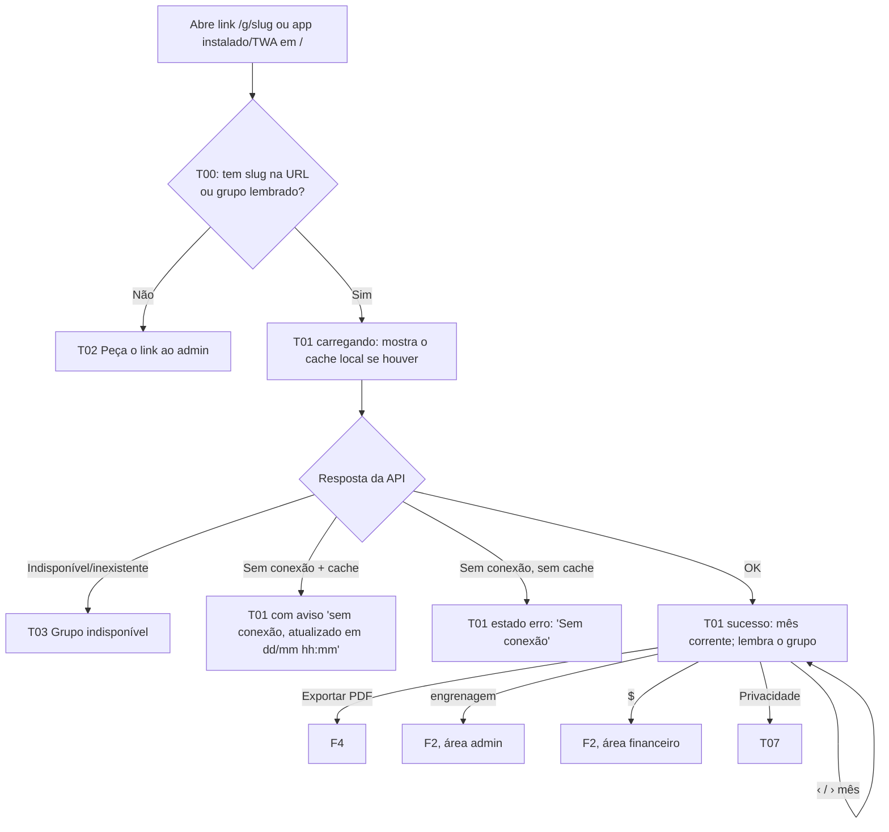
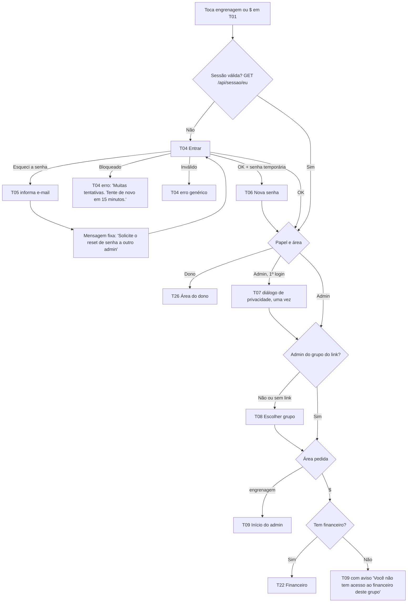
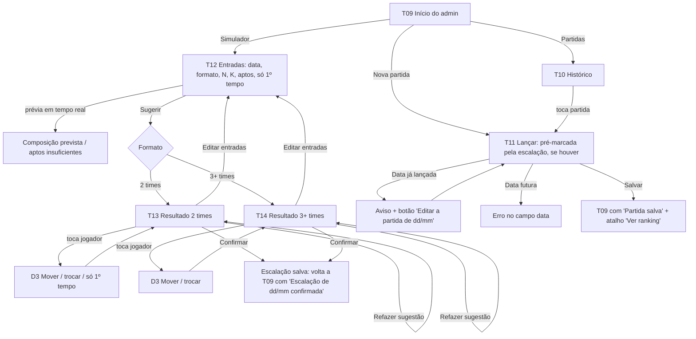
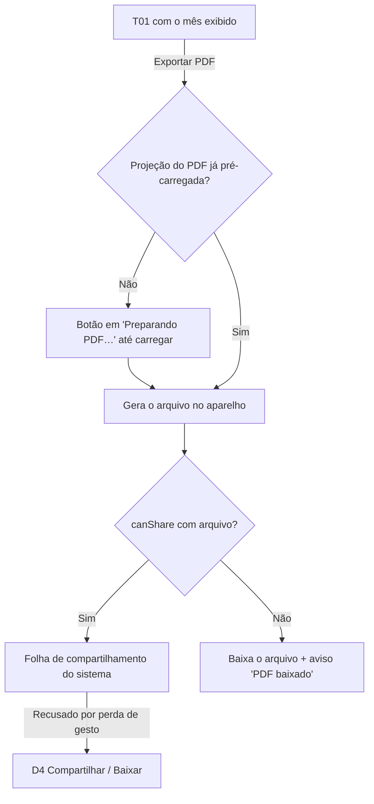
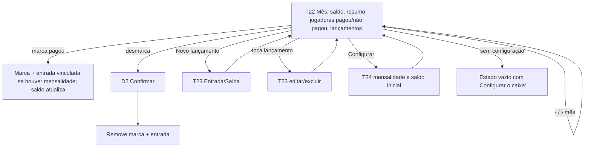
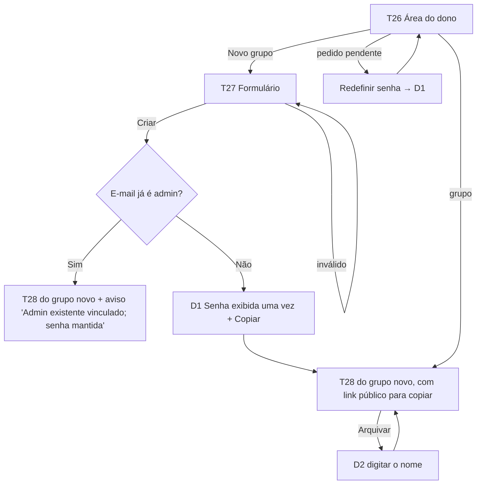

# UX-SPEC.md — Gestão da Pelada

**Status:** Loop B, etapa **B3**. Documento fechado junto com o mockup completo em `.md/mockup/` (direção A, Gramado). Aguarda a aprovação conjunta de SDD + UX-SPEC + mockup.

**Mudanças da etapa B3:**
- A §0 e a §3 apontam para o mockup e para `tokens.css`.
- **Decisão do usuário: novas colunas da tabela do ranking (T01 e P01).** A ordem das colunas passa a ser:
  1. #;
  2. Jogador;
  3. **Pts inicial** (acumulado até o início do mês exibido);
  4. uma coluna por partida do mês, com os **pontos daquela rodada** na cor da situação;
  5. **Pts final** (Pts inicial + rodadas = Pts inicial do mês seguinte; no mês corrente, é o acumulado até hoje).
  
  As colunas P e F saíram. A **ordem das linhas continua sendo a do acumulado de hoje** (P-26, confirmado pelo usuário): é só uma mudança de apresentação.
- **Decisão do usuário:** toda coluna de partida tem um ícone no cabeçalho, sol (sem chuva) ou nuvem (com chuva). Para o leitor de tela, ", sem chuva" / ", com chuva". A legenda traz os dois.
- **Decisão do Coordenador (pode ser vetada): pista não-cromática nas marcas.** Como presente e lesionado podem valer os mesmos pontos, a cor não pode ser o único diferenciador (WCAG 1.4.1):
  - presente: bloco cheio, só o número;
  - lesionado: letra "L" pequena no canto;
  - expulso: letra "E" no canto;
  - falta: contorno tracejado;
  - "–": fora do grupo.
  
  O texto para leitor de tela é "Presente, 2 pontos", "Lesionado, 1 ponto" e assim por diante.
- **Decisões de detalhe tomadas no mockup** (§7):
  - opções do D3 sem ambiguidade no formato 2 times;
  - com data inválida, T11 esconde a lista;
  - sem jogadores, T01 não mostra "Exportar PDF";
  - em T19 o admin não remove a si mesmo;
  - em T22 as mensalidades do mês aparecem numa linha só;
  - no aviso de privacidade, "colocação" substitui "posição".

**Mudanças da rodada 3:**
- O endereço da Fase 1 é `pelada.prod-ljs.workers.dev` (ADR-020).
- Nova faixa "O app mudou de endereço" em T01 e T09, que **só aparece** se um dia houver troca de domínio (campo `enderecoNovo`). Na Fase 1, nunca aparece.
- O simulador pode, em contingência, demorar mais (ADR-017). Os estados de T13/T14 já cobrem isso.

**Mudanças da rodada 2:**
- O link do ranking passa a ser legível: `/g/:slug` (ADR-016). Mudar o nome do grupo não muda o link.
- A senha passa a ter de 8 a 72 caracteres (ADR-015).
- A hospedagem mudou para Cloudflare (ADR-014); sem efeito visível, além de o erro de "limite de recurso" cair no estado de erro padrão.
- O usuário aprovou "Marcar todos como presentes" (T11) e o ajuste do simulador por toque e menu, sem arrastar (T13/T14).
**Data:** 2026-10-16. **Autor:** Coordenador (chapéu UX/UI).
**Base:** `.md/PRD-TECNICO.md` (aprovado), `.md/PRD.md`, `.md/SDD.md` (rascunho B1, mesma rodada).

**Princípios de experiência:**

1. **Celular primeiro.** O ranking é aberto pelo link do WhatsApp, e o lançamento acontece logo após o jogo. O desktop atende o admin, sem prioridade de layout (RNF-01, RNF-04).
2. **Velocidade no dia de jogo.** Lançar uma partida de 20 a 24 jogadores leva em mediana até 2 min (G1). Para isso: pré-marcação pela escalação, um toque por jogador e o botão de salvar sempre visível.
3. **O público nunca vê dado privado.** As telas públicas só têm apelido, colocação, pontos (inicial, por rodada e final) e a situação de cada rodada (RF-33).
4. **Nenhuma regra na tela.** Números, ordem, pontos por rodada, avisos e sugestões vêm prontos da API (SDD P-2). A tela mostra "recalculando" enquanto espera.
5. **Informação nunca só por cor.** Toda marca tem número e pista de forma (letra de canto ou contorno), e todo ícone tem texto para leitor de tela (RNF-10).

---

## 0. Mockup Aprovado

- **Mockup:** `.md/mockup/`, com a galeria `.md/mockup/index.html`. Link do Artifact: https://claude.ai/artifact/FfFpbDtk37f7niZ29FKUTw (direções da B2: https://claude.ai/artifact/FWLMMqMYZz9e3YD1VjU5sB).
- **Direção escolhida pelo usuário (B2):** **A, Gramado** (`.md/mockup/direcoes/a-gramado/`), sem mistura.
- **Direções descartadas:** `.md/mockup/direcoes/b-placar/` e `.md/mockup/direcoes/c-sumula/`. **Não usar como referência.** A página da direção A também é só histórico: o mockup completo a substitui.
- **Arquivos que a implementação copia sem alterar:**
  - `.md/mockup/tokens.css` → `frontend/web/src/estilos/tokens.css`;
  - `.md/mockup/fontes/` → fontes do app.
  
  O `base.css` é a referência dos componentes. O Executor reescreve em CSS Modules usando só as variáveis de `tokens.css`.
- **Dados:**
  - `dados.json` resume os dados de exemplo;
  - `respostas/*.json` estão no formato do contrato da API e são a base do `API-CONTRACT.yaml`, que nasce durante a execução;
  - `telas.json` é o mapa da comparação visual.

**Regra de precedência:** Para aparência (cor, tipografia, espaçamento, disposição) vale o mockup; para comportamento, dados e acessibilidade vale este documento. Um conflito entre os dois é defeito do planejamento: corrija o mockup ou o texto antes de aprovar; nunca deixe para o Executor decidir.

**Verificação:**
- `.claude/scripts/comparar-visual.mjs`, com limite de **1%** de pixels divergentes, nos tamanhos `pc` (1280 × 800) e `celular` (390 × 844);
- `telas.json` → `telas`: os 59 estados alcançáveis por rota e respostas são comparados automaticamente;
- `telas.json` → `revisaoManual`: os 57 estados que exigem toque ou envio são conferidos à mão no QA da tarefa, contra a página indicada;
- o PDF (P01, 2 páginas) é conferido pelo teste do gerador a partir de `respostas/publico-pdf-*.json`.

**Fontes:** Barlow e Barlow Condensed (SIL OFL 1.1). O `fontes/fontes.css` carrega provisoriamente pelo Google Fonts. Para auto-hospedar, rode `node .md/mockup/fontes/baixar-fontes.mjs`, que baixa os `.woff2`, grava a `OFL.txt` e reescreve o `fontes.css` com `@font-face` locais. Isso precisa ser feito antes da primeira tarefa de tela.

| Tela | Página do mockup por estado (`.md/mockup/telas/`) | Rota no app | Tamanhos |
|---|---|---|---|
| T00 | (sem página: só redireciona) | `/` | — |
| T01 | `t01-ranking--` sucesso, vazio, vazio-mes, carregando, carregando-cache, erro, sem-conexao, sem-conexao-admin, instalar-iphone, pdf-preparando, pdf-compartilhar, pdf-erro, pdf-baixado, endereco-novo | `/g/:slug?mes=` | pc, celular |
| T02 | `t02-sem-grupo--sucesso` | `/` | pc, celular |
| T03 | `t03-indisponivel--erro` | `/g/:slug` | pc, celular |
| T04 | `t04-entrar--` vazio, carregando, erro, bloqueado | `/entrar` | pc, celular |
| T05 | `t05-esqueci--` vazio, sucesso | `/entrar/esqueci` | pc, celular |
| T06 | `t06-nova-senha--` vazio, erro | `/entrar/nova-senha` | pc, celular |
| T07 | `t07-privacidade--` pagina, dialogo | `/privacidade`; diálogo sobre `/admin/:g` | pc, celular |
| T08 | `t08-grupos--` sucesso, nao-admin, vazio | `/admin` e `/admin?grupo=:slug` | pc, celular |
| T09 | `t09-inicio--` sucesso, salvo, sem-jogadores, sem-financeiro, endereco-novo, menu-conta | `/admin/:g` (`?negado=financeiro`) | pc, celular |
| T10 | `t10-partidas--` sucesso, vazio | `/admin/:g/partidas?mes=` | pc, celular |
| T11 | `t11-partida--` nova, edicao, carregando, vazio, data-futura, duplicada, erro-salvar, excluir | `/admin/:g/partidas/nova?data=` e `/admin/:g/partidas/:data` | pc, celular |
| T12 | `t12-simulador--` dois-times, tres-times, insuficiente, calculando, vazio | `/admin/:g/simulador` | pc, celular |
| T13 | `t13-resultado-dois--` sucesso, carregando, recalculando, erro-recalcular, erro-confirmar, mover, refazer | `/admin/:g/simulador/resultado` | pc, celular |
| T14 | `t14-resultado-varios--` sucesso, mover (carregando, erro e refazer = T13) | `/admin/:g/simulador/resultado` | pc, celular |
| T15 | `t15-jogadores--` sucesso, vazio, vazio-inativos | `/admin/:g/jogadores` (`?filtro=inativos`) | pc, celular |
| T16 | `t16-jogador--` edicao, novo, erro, exclusao-recusada, salvo, sem-habilidades, inativar, excluir, inativo | `/admin/:g/jogadores/novo` e `/:id` | pc, celular |
| T17 | `t17-habilidades--` sucesso, vazio, erro, excluir | `/admin/:g/habilidades` | pc, celular |
| T18 | `t18-pontuacao--` sucesso, erro, salvo | `/admin/:g/pontuacao` | pc, celular |
| T19 | `t19-admins--` sucesso, ultimo-admin, senha, vinculo, remover, erro | `/admin/:g/admins` | pc, celular |
| T20 | `t20-grupo--` sucesso, erro, salvo, link-copiado | `/admin/:g/grupo` | pc, celular |
| T21 | `t21-uso--` sucesso, vazio | `/admin/:g/uso` | pc, celular |
| T22 | `t22-financeiro--` sucesso, vazio-config, vazio-mes, sem-permissao, desmarcar, erro-pagamento | `/admin/:g/financeiro?mes=` | pc, celular |
| T23 | `t23-lancamento--` novo, edicao, erro, excluir | `/admin/:g/financeiro/lancamentos/novo` e `/:id` | pc, celular |
| T24 | `t24-config--` vazio, erro | `/admin/:g/financeiro/config` | pc, celular |
| T25 | `t25-senha--` vazio, erro, sucesso | `/conta/senha` | pc, celular |
| T26 | `t26-dono--` sucesso, vazio, senha | `/dono` | pc, celular |
| T27 | `t27-novo-grupo--` vazio, erro, senha | `/dono/grupos/novo` | pc, celular |
| T28 | `t28-grupo-dono--` sucesso, vinculo, arquivar, arquivado | `/dono/grupos/:id` | pc, celular |
| P01 | `p01-pdf--` sucesso, mes-vazio | arquivo gerado | A4 |
| Padrões | `padrao--` carregando-lista, carregando-formulario, erro-rede | qualquer tela de admin | pc, celular |

---

## 1. Fluxos de Tela

### Mapa de telas

| ID | Tela | Rota | Quem acessa | Fluxo (PRD-TECNICO §4) |
|---|---|---|---|---|
| T00 | Entrada do app (redirecionamento) | `/` | Todos | F1 |
| T01 | Ranking público | `/g/:slug?mes=AAAA-MM` (ex.: `/g/pelada-de-quinta`) | Todos, sem login | F1, F4 |
| T02 | Sem grupo ("Peça o link") | `/` (sem grupo lembrado) | Todos | F1 |
| T03 | Grupo indisponível | `/g/:slug` (grupo arquivado ou slug inexistente) | Todos | F1 |
| T04 | Entrar (login) | `/entrar?destino=<caminho>` | Admin, dono | F2 |
| T05 | Esqueci a senha | `/entrar/esqueci` | Qualquer pessoa | F2 |
| T06 | Nova senha obrigatória | `/entrar/nova-senha` | Admin ou dono com senha temporária | F2, F6 |
| T07 | Aviso de privacidade | `/privacidade` (e diálogo no 1º login) | Todos | RF-64 |
| T08 | Escolher grupo | `/admin` (e `/admin?grupo=:slug` quando veio de um link do qual não é admin) | Admin com vários grupos, ou que não é admin do grupo do link | F2 |
| T09 | Início do admin | `/admin/:grupoId` (e `?negado=financeiro` quando veio do "$" sem permissão) | Admin | F2, F3 |
| T10 | Partidas (histórico) | `/admin/:g/partidas` | Admin | F3 |
| T11 | Lançar / editar partida | `/admin/:g/partidas/nova?data=` e `/admin/:g/partidas/:data` | Admin | F3 |
| T12 | Simulador: entradas | `/admin/:g/simulador` | Admin | F3 |
| T13 | Simulador: resultado com 2 times | `/admin/:g/simulador/resultado` | Admin | F3 |
| T14 | Simulador: resultado com 3 ou mais times | `/admin/:g/simulador/resultado` | Admin | F3 |
| T15 | Jogadores | `/admin/:g/jogadores` | Admin | RF-19 a RF-22 |
| T16 | Ficha do jogador (dados + notas) | `/admin/:g/jogadores/novo` e `/admin/:g/jogadores/:id` | Admin | RF-19 a RF-22, RF-36, RF-37 |
| T17 | Habilidades | `/admin/:g/habilidades` | Admin | RF-35 |
| T18 | Pontuação (pesos) | `/admin/:g/pontuacao` | Admin | RF-23, RF-24 |
| T19 | Admins do grupo | `/admin/:g/admins` | Admin | RF-13, RF-15, RF-16, RF-18 |
| T20 | Dados do grupo e link | `/admin/:g/grupo` | Admin | RF-08 |
| T21 | Uso do app | `/admin/:g/uso` | Admin | RF-58 |
| T22 | Financeiro: mês | `/admin/:g/financeiro?mes=` | Admin com financeiro | F5 |
| T23 | Financeiro: lançamento | `/admin/:g/financeiro/lancamentos/novo` e `/:id` | Admin com financeiro | F5 |
| T24 | Financeiro: configuração | `/admin/:g/financeiro/config` | Admin com financeiro | RF-59 |
| T25 | Minha senha | `/conta/senha` | Admin, dono | RF-17 |
| T26 | Área do dono | `/dono` | Dono | F6, RF-06, RF-07 |
| T27 | Novo grupo | `/dono/grupos/novo` | Dono | F6 |
| T28 | Grupo (visão do dono) | `/dono/grupos/:id` | Dono | RF-03 a RF-05, RF-07 |
| P01 | PDF do ranking (documento, não tela) | arquivo gerado | Todos | F4 |

Diálogos reutilizados (não são telas próprias):
- **D1 Senha exibida uma vez:** T19, T26, T27 e T28.
- **D2 Confirmação destrutiva:** excluir partida, excluir jogador, excluir habilidade, remover admin, desmarcar pagamento, excluir lançamento e arquivar grupo (este exige digitar o nome).
- **D3 Mover jogador:** T13 e T14.
- **D4 Compartilhar/Baixar PDF:** T01, quando o compartilhamento direto falha.
- **D5 Instalar no iPhone:** aviso em T01.

### F1: Jogador consulta o ranking

### F2: Login, esqueci a senha e áreas

Notas do fluxo:
- O dono que também é admin de grupos chega em T26 e, de lá, vai para "Meus grupos" (T08/T09).
- O login no **app instalado do iPhone** é separado do login no Safari (SDD ADR-003). O admin entra uma vez em cada um. A T04 explica isso numa linha de ajuda.

### F3: Dia de jogo (simulador, partida e ranking)

### F4: Exportar o PDF

### F5: Financeiro

### F6: Dono cria grupo e 1º admin

---

## 2. Wireframes / Descrição de Layout por Tela

Convenções: "barra superior" = faixa fixa no topo; "barra de ação" = faixa fixa no rodapé com a ação principal; ⓘ = ajuda curta. As medidas exatas são definidas no mockup (B3).

### T00 Entrada do app
Não tem layout próprio: é processamento. Se a URL tiver o slug, ou se houver grupo lembrado, redireciona para `/g/:slug`; senão, mostra a T02. Em primeira abertura do app instalado (TWA, ícone na tela de início) vale a mesma regra.

### T01 Ranking público (tela principal)
- **Barra superior:** nome do grupo (título, até 2 linhas); à direita, dois botões de ícone com rótulo acessível: **engrenagem** ("Área do admin") e **"$"** ("Financeiro").
- **Aviso de instalação** (D5, só no Safari do iOS fora do app instalado): faixa fechável "Instale: toque em Compartilhar e depois em 'Adicionar à Tela de Início'". Quando fechado, não volta naquele aparelho.
- **Aviso sem conexão** (quando a resposta veio do cache): faixa "Sem conexão, atualizado em dd/mm hh:mm".
- **Navegador de mês:** botão "‹" (mês anterior), rótulo "outubro de 2026" e botão "›" (mês seguinte). Os botões ficam desabilitados nos limites que a API informa (RF-31).
- **Resumo do mês:** "**3 partidas** no mês, 1 com chuva. Ordem pelos pontos acumulados até hoje."
- **Tabela do ranking** (componente novo, **Tabela de ranking**). As colunas são uma decisão do usuário (B3):
  - colunas fixas à esquerda: **#** (colocação; empates repetem o número) e **Jogador**;
  - **Pts inicial:** acumulado até o início do mês exibido (= Pts final do mês anterior), em tom secundário;
  - **uma coluna por partida do mês:**
    - cabeçalho "dd/mm" com ícone de **sol** (sem chuva) ou **nuvem** (com chuva), e texto oculto ", sem chuva" / ", com chuva";
    - na célula, os **pontos daquela rodada** (ex.: 1, 2, −1, 0) dentro de uma marca na cor da situação: verde presente, amarelo lesionado, vermelho expulso, cinza falta, e "–" antes de o jogador entrar no grupo;
    - pista de forma: lesionado com "L" no canto, expulso com "E" no canto, falta com contorno tracejado;
    - leitor de tela: "Presente, 2 pontos", "Lesionado, 1 ponto", "Expulso, menos 1 ponto", "Falta, 0 pontos", "Ainda não fazia parte do grupo";
  - **Pts final:** Pts inicial + rodadas do mês. No mês corrente, é o acumulado até hoje. Fica em destaque;
  - uma linha por jogador ativo hoje (RN-06), **sempre na ordem do acumulado de hoje** (RF-30, P-26), em qualquer mês exibido. Num mês passado, por isso, as colunas de pontos podem não ficar em ordem decrescente: é o comportamento aprovado.
- **Mês sem partidas:** a tabela mantém #, Jogador, Pts inicial e Pts final (iguais), e a área das partidas mostra "Nenhuma partida registrada neste mês" (RF-32).
- **Legenda** abaixo da tabela: "A cor mostra a situação; o número, os pontos da rodada. Pts inicial + rodadas do mês = Pts final." e os itens Presente · Lesionado (foi e não jogou) · Expulso · Falta · "–" Ainda não fazia parte do grupo · sol Jogo sem chuva · nuvem Jogo com chuva.
- **Ação principal:** botão **"Exportar PDF"**, fixo na barra de ação no celular e acima da tabela no desktop. Não aparece quando o grupo não tem jogadores (estado vazio).
- **Rodapé:** link "Privacidade" (T07) e o nome do app.

### T02 Sem grupo
Ilustração simples, título "Abra o link do seu grupo" e o texto "Peça o link do ranking ao admin do seu grupo de pelada.". Não há ação principal além de "Já tenho login de admin" (link para T04), que serve ao admin que instalou o app antes de abrir um link.

### T03 Grupo indisponível
Título "Grupo indisponível" e o texto "Este grupo não está disponível no momento. Fale com o admin do seu grupo.". A mesma tela vale para slug inexistente (link digitado errado), para não revelar a diferença entre arquivado e inexistente. Sem ação. O grupo lembrado é esquecido.

### T04 Entrar
- Formulário centralizado: **E-mail** (`type=email`, `autocomplete=username`) e **Senha** (`autocomplete=current-password`, com botão "mostrar senha").
- **Ação principal:** "Entrar". Secundárias: link "Esqueci a senha" (T05) e "Voltar ao ranking".
- Linha de ajuda: "No iPhone, o app instalado e o Safari pedem login separadamente."
- Erro geral acima do botão, anunciado (`role=alert`): "E-mail ou senha incorretos." ou "Muitas tentativas. Tente de novo em 15 minutos."

### T05 Esqueci a senha
Campo **E-mail** e ação principal "Enviar pedido". Depois de enviar, o formulário some e aparece a mensagem fixa "Solicite o reset de senha a outro admin.", com o link "Voltar para entrar". A mensagem é a mesma para qualquer e-mail (RF-12).

### T06 Nova senha obrigatória
Texto "Por segurança, crie sua senha antes de continuar.". Campos **Nova senha** (`autocomplete=new-password`, com a regra "de 8 a 72 caracteres" visível) e **Confirmar nova senha**. Ação principal: "Salvar e continuar". Não há navegação para fora, só "Sair".

### T07 Aviso de privacidade
Página de texto curto em pt-BR, com três blocos: "O que guardamos", "Quem vê" (o público vê apelido, colocação e pontos; os admins veem o resto; "colocação" evita confusão com a posição em campo, que é privada) e "Como pedir a exclusão" (ao admin do grupo). O diálogo do 1º acesso traz a versão resumida e o link "Ler o aviso completo".
- No 1º login do admin, aparece como **diálogo** com o botão "Entendi" (RF-64).
- Pelo link do rodapé, aparece como página com "Voltar".

### T08 Escolher grupo
Título "Seus grupos". Lista de cartões, um por grupo: nome, "dia · horário" e, quando for o caso, o selo "Sem acesso ao financeiro". Tocar no cartão abre a área pedida (T09 ou T22) daquele grupo. Se a pessoa veio pelo link de um grupo do qual não é admin, aparece no topo o aviso "Você não é admin de '<nome>'. Escolha um dos seus grupos.".

### T09 Início do admin
- **Barra superior:**
  - nome do grupo e, se houver mais de um grupo, o botão "Trocar grupo" (RF-10, vai para T08);
  - link "Ver ranking";
  - menu da conta: Minha senha (T25), Privacidade (T07), Área do dono (só para o dono) e Sair.
- **Bloco "Dia de jogo"** (topo):
  - **ação principal: "Nova partida"** (com a data sugerida, ex.: "Lançar partida de qui, 22/10"; se a partida da data já foi lançada, vira "Editar partida de qui, 22/10");
  - ação secundária: "Simulador" (com a data do próximo jogo);
  - linha de status: "Escalação de dd/mm confirmada" ou "Nenhuma escalação confirmada para dd/mm".
- **Lista de seções:**
  - Partidas, Jogadores, Habilidades, Pontuação, Admins, Dados do grupo e Uso do app;
  - "Financeiro" aparece **só** para quem tem permissão.
- Faixa de retorno (`role=status`) depois de salvar a partida ou confirmar a escalação: "Partida de dd/mm salva. Ver ranking".

### T10 Partidas
Lista em ordem decrescente de data. Cada item mostra a data (dia da semana + dd/mm/aaaa), o ícone e o texto "chuva" quando houver, e as contagens "18 P · 1 L · 0 E". Tocar abre T11 em modo edição. A ação principal é "Nova partida". A lista é paginada por mês (navegador de mês igual ao de T01).

### T11 Lançar / editar partida (fluxo crítico G1)
- **Cabeçalho do formulário:**
  - **Data** (seletor de data, padrão = data sugerida pela API, sem datas futuras);
  - **Choveu?** (interruptor com texto "Não"/"Sim").
- **Faixa de contagem** (fixa ao rolar): "Presentes 18 · Lesionados 1 · Expulsos 0 · Ausentes 5".
- **Origem da pré-marcação:** quando veio da escalação, aparece a faixa ⓘ "Pré-marcado pela escalação de dd/mm (inclui quem ficou como 'não entra')".
- **Ações em massa** (secundárias): "Marcar todos como presentes" e "Limpar marcações". Elas não mudam nenhuma regra; só ajudam a cumprir G1.
- **Busca** por apelido (filtro local da lista já carregada).
- **Lista de jogadores ativos na data** (em ordem alfabética de apelido, para achar rápido):
  - cada linha tem o apelido e um **seletor de situação** (componente novo, **Seletor de situação**) com 4 opções de um toque: **Ausente · Presente · Lesionado · Expulso**;
  - cada opção mostra letra e texto curto (A/P/L/E).
- **Barra de ação** (fixa): **"Salvar partida"**, com o resumo "(18 presentes)". No modo edição há também "Excluir partida" (secundária destrutiva, D2), e a linha "Última alteração: <nome>, dd/mm hh:mm" (RF-28).
- **Depois de excluir:** volta a T10 no mês da partida excluída, com a faixa de sucesso "Partida de dd/mm excluída." (`role=status`).
- **Data com partida já lançada:** aviso no campo ("Já existe uma partida em dd/mm/aaaa.") e botão "Editar a partida de dd/mm" (RF-27).
- **Data inválida** (futura ou já lançada): a lista e as ações em massa não são mostradas, e "Salvar partida" fica desabilitado até a data ser corrigida.
- **Lista no PC (≥ 1024 px):** duas colunas de jogadores.

### T12 Simulador: entradas
- **Data da partida** (padrão = próximo dia de jogo, informado pela API).
- **Formato:** controle segmentado "2 times (1º e 2º tempo)" | "3 ou mais times".
- **Jogadores por time (N):** campo numérico com botões − e +, de 2 a 11.
- **Somente no formato 2 times:** **Limite de substituições por time (K)**, campo numérico de 0 a 20, mais a caixa "Ilimitado".
- **Aptos:** lista de jogadores ativos, cada um com:
  - caixa de seleção "Apto";
  - no formato 2 times, o interruptor **"Só 1º tempo"**;
  - o nível (ex.: "nível 6,8" ou o selo "sem nota") à direita, como informação de apoio (RF-37).
  - Ações em massa: "Marcar todos" e "Desmarcar todos". O contador fica no título da lista: "Aptos (19)".
  - No PC (≥ 1024 px): entradas à esquerda e lista de aptos à direita.
- **Prévia** (vem da API, com debounce): "2 times de 11 · 4 reservas" ou "5 times de 4 + 1 time incompleto de 2".
  - Se os aptos forem insuficientes, a prévia vira **erro** e mostra o caminho: "Faltam aptos para 2 times de 11. Maior N possível: 9." ou "Com 8 aptos e N = 4 não há 3 times. Use N menor ou o formato 2 times." (RF-40).
- **Barra de ação:** **"Sugerir times"**, desabilitado enquanto a prévia estiver em erro.

### T13 Simulador: resultado com 2 times
- **Título "Times sugeridos"** e uma linha de contexto: "qui, 22/10 · 2 times de 7 · até 2 substituições por time".
- **Avisos** no topo (componente **Lista de avisos**, `role=status`): itens de RF-47 (a), (b) e (c), cada um com ícone e texto, sem bloquear.
- **Comparativo** (tabela compacta "Time A × Time B"):
  - nível somado e médio no 1º e no 2º tempo;
  - idade média;
  - substituições.
  - Durante um recálculo, os valores mostram "recalculando…".
- **Cartão de time** (componente novo, **Cartão de time**), um para cada time:
  - **Titulares:** apelido; selo "só 1º tempo"; selo "sai no intervalo";
  - **Entram no 2º tempo:** apelido; selo "joga só o 2º tempo" (para reserva "só 1º tempo");
  - **Trocas no intervalo:** pares "Fulano → Beltrano".
- **Não entra:** lista separada com o aviso "Compareceram e recebem a pontuação de presença." (RN-19).
- **Ordem de prioridade** (seção recolhível, RF-41): a lista numerada usada pela sugestão.
- **Ajuste manual:** tocar num jogador abre o **D3 Mover jogador** (folha inferior no celular, menu no desktop), com as opções:
  - "Titular do Time A", "Titular do Time B", "Entra no 2º tempo pelo Time A", "Entra no 2º tempo pelo Time B" e "Não entra" (o destino atual vem marcado "atual");
  - "Trocar com…" (lista dos outros jogadores);
  - "Só 1º tempo: sim/não".
  - O jogador movido fica destacado com o selo "movido" até a próxima sugestão.
  - Não há arrastar e soltar (§7).
- **Barra de ação:** **"Confirmar escalação"** (principal), "Refazer sugestão" (secundária, com a confirmação "Descartar seus ajustes?" se houver ajuste) e "Editar entradas".

### T14 Simulador: resultado com 3 ou mais times
- **Título "Times sugeridos"** e a linha de contexto "qui, 22/10 · 4 times de 4 + 1 time incompleto de 2".
- **Avisos** no topo (RF-47 (b), (c) e (d); este último sugere valores de N).
- **Grade de cartões de time** (o mesmo **Cartão de time**, na variação "sem tempos"):
  - título "Time 1"…"Time T";
  - o time incompleto tem o selo **"Incompleto"** e a contagem "(2 de 4)";
  - cada cartão tem a lista de jogadores e os indicadores (nº de jogadores, nível médio e somado, idade média).
- **Ajuste manual:** D3 com "Mover para Time X" e "Trocar com…".
- **Barra de ação:** igual à da T13.

### T15 Jogadores
- Filtro segmentado "Ativos | Inativos".
- Busca por apelido.
- Lista: apelido, posição, nível (ou "sem nota") e o selo "inativo desde dd/mm/aaaa" quando for o caso.
- Ação principal: **"Novo jogador"**. Tocar no item abre a T16.

### T16 Ficha do jogador
- **Seção Dados:**
  - Apelido (2 a 30);
  - Ano de nascimento (numérico, de 1940 até o ano atual menos 10);
  - Posição (Goleiro, Defensor, Meio-campo, Atacante; ⓘ "só para cadastro");
  - Telefone (opcional, com máscara (DD) 9XXXX-XXXX);
  - Data de entrada (padrão = hoje).
  - Ação principal: **"Salvar"**.
- **Seção Habilidades e nível** (só na edição): uma linha por habilidade com uma nota de 1 a 10 ou "–" (seletor numérico). O nível calculado vem da API e é exibido em destaque ("Nível 6,8" ou "Sem nota: usa 5,5 no simulador"). As notas são salvas por alteração, com confirmação discreta "salvo".
- **Seção Situação:**
  - ativo: "Inativar" (diálogo "Inativar <apelido>", com o texto "Ele sai do ranking, do lançamento, do simulador e do financeiro a partir da data de saída. O histórico e os pontos ficam guardados.", o campo "Data de saída", padrão hoje, e os botões Cancelar / Inativar);
  - inativo: "Reativar" (a partir de hoje).
  - "Excluir jogador" (D2). Se houver histórico, a API recusa e a tela oferece "Inativar em vez disso" (RF-22).
- Erros por campo (apelido repetido: "Já existe um jogador com esse apelido neste grupo.").

### T17 Habilidades
Lista de habilidades, cada uma com nome editável no próprio lugar e o botão "Excluir" (D2: "Excluir 'Drible' apaga as notas de todos os jogadores nessa habilidade."). Ação principal: **"Nova habilidade"** (campo + "Adicionar").

### T18 Pontuação
- **Cartão "Vigente desde dd/mm/aaaa"** com os 5 pesos em tabela:
  - Presença sem chuva;
  - Presença com chuva;
  - Lesionado sem chuva;
  - Lesionado com chuva;
  - Expulso.
- **Formulário "Nova configuração (vale a partir de hoje)"**: 5 campos inteiros de −10 a 10, preenchidos com os vigentes. Ação principal: **"Salvar nova configuração"**. ⓘ "Partidas anteriores a hoje não mudam."
- **Histórico:** lista das configurações anteriores, com vigência e "registrado por <nome>".

### T19 Admins do grupo
- Lista de admins: nome, e-mail, o interruptor **"Acessa financeiro"** e as ações "Redefinir senha" (→ D1) e "Remover do grupo" (D2).
  - O interruptor só fica habilitado para quem tem financeiro (RF-18).
  - **A própria linha ("<nome> (você)")** não tem "Redefinir senha" nem "Remover do grupo": tem o atalho "Minha senha" (T25). Ninguém remove a si mesmo (RF-15 trata de remover outro admin).
  - Com um só admin, a tela mostra a ajuda "Você é o único admin deste grupo. Todo grupo precisa de pelo menos um admin." (RN-13). A API também recusa remover o último admin.
- Ação principal: **"Adicionar admin"** (nome + e-mail). Ao confirmar:
  - conta nova → D1 com a senha temporária;
  - conta existente → aviso "Admin existente vinculado ao grupo.".

### T20 Dados do grupo e link
- Formulário: Nome (3 a 60), Dia da semana, Frequência (semanal, quinzenal, mensal) e Horário (HH:MM). Ação principal: **"Salvar"**.
- **Cartão "Link do ranking"**: a URL completa (ex.: `https://pelada.prod-ljs.workers.dev/g/pelada-de-quinta`), com os botões "Copiar link" e "Compartilhar" (folha do sistema). Abaixo do campo Nome, a ajuda ⓘ "Mudar o nome não muda o link do ranking." (ADR-016).

### T21 Uso do app
Tabela por semana (as mais recentes no topo), com as colunas:
- semana (dd/mm a dd/mm);
- aparelhos que abriram o ranking;
- PDFs exportados;
- partidas lançadas (das quais em até 48 h);
- escalações confirmadas / partidas.

No celular, cada semana vira um cartão com os 4 números. Não há ação principal (tela de leitura).

### T22 Financeiro: mês
- **Navegador de mês** (o mesmo de T01).
- **Cartão de saldos:**
  - **Saldo atual** em destaque;
  - para o mês: entradas, saídas, resultado e "N não pagaram".
  - Valores negativos levam o sinal "−" e a palavra "negativo" para leitor de tela, nunca só a cor.
- **Pagamentos do mês:** lista de jogadores ativos no mês, cada um com o interruptor **"Pagou"**. Desmarcar pede confirmação (D2). Com mensalidade configurada, o valor aparece no título da seção ("Pagamentos do mês · R$ 75,00"). O interruptor mostra o estado em texto ("Pagou" / "Não pagou").
- **Lançamentos do mês:** lista com data, descrição, valor e tipo (ícone + texto "Entrada"/"Saída"; as saídas com "−"). As mensalidades do mês aparecem **numa linha só**: "N mensalidades de mm/aaaa", com o período, o selo "mensalidade" e o total. Tocar abre cada uma; a ajuda diz "As mensalidades do mês aparecem numa linha só; toque para ver cada uma." É uma decisão de apresentação: a API devolve cada entrada.
- **Ação principal: "Novo lançamento".** Secundária: "Configurar caixa" (T24), ao lado do navegador de mês.
- No PC (≥ 1024 px): pagamentos e lançamentos lado a lado.

### T23 Financeiro: lançamento
Campos:
- tipo (segmentado Entrada | Saída);
- data (padrão hoje);
- descrição (até 80, com contador);
- valor (máscara R$, maior que zero).

Ação principal: **"Salvar"**. Na edição, também "Excluir" (D2).

### T24 Financeiro: configuração
Campos: mensalidade (opcional, R$; ajuda "Com mensalidade, marcar 'pagou' já cria a entrada no caixa."), saldo inicial (R$) e data do saldo inicial. Ação principal: **"Salvar"**.

### T25 Minha senha
Campos: senha atual, nova senha (de 8 a 72 caracteres) e confirmação. Ação principal: **"Trocar senha"**. Depois de salvar, aparece o aviso "Senha trocada. Outros aparelhos foram desconectados." (ADR-003).

### T26 Área do dono
- **Seção "Pedidos de senha" (contador):** lista com e-mail, grupos do admin e "último pedido dd/mm hh:mm". Ações por item: **"Redefinir senha"** (→ D1) e "Marcar como resolvido". Vazia: "Nenhum pedido pendente.".
- **Seção "Grupos":**
  - filtro "Ativos | Arquivados";
  - lista com nome, dia · frequência · horário, situação comercial, admins (nomes), criado em e o selo "arquivado".
  - **Ação principal da tela: "Novo grupo".**
- **Link "Meus grupos como admin"** (para T08), visível se o dono for admin de algum grupo.

### T27 Novo grupo
Campos:
- nome do grupo (3 a 60);
- dia da semana;
- frequência;
- horário;
- nome e e-mail do 1º admin (seção "Primeiro admin"; ajuda no e-mail: "Se o e-mail já for de um admin, ele só é vinculado ao grupo.").

Ação principal: **"Criar grupo"**. Ao criar, abre o D1 (conta nova) ou mostra o aviso de vínculo, e segue para T28.

Abaixo do campo nome fica a ajuda ⓘ "O link do ranking será criado a partir do nome e não muda depois."
- O slug é gerado pela API (ADR-016) e aparece em T28 com "Copiar".
- Se houver colisão, o link ganha um sufixo (ex.: `pelada-de-quinta-2`), e a T28 mostra o link final.

### T28 Grupo (visão do dono)
- Metadados: nome, dia, frequência, horário, criado em e o link público (com "Copiar").
- **Situação comercial:** seletor (uso próprio, trial, ativo, inadimplente, cancelado), mais a data de início quando for trial. ⓘ "Não muda nada no app nesta fase." Ação: "Salvar situação".
- **Admins:** nome e e-mail, com "Redefinir senha" (→ D1). O dono **não** vê aqui jogadores, partidas, notas nem financeiro (RF-07).
- **Zona de arquivamento:** texto "Arquivar bloqueia o acesso dos admins, e o link passa a mostrar 'Grupo indisponível'. Os dados ficam guardados." e o botão "Arquivar grupo" (D2, digitando o nome). Grupo arquivado: selo "arquivado" no título, "Arquivado em" nos metadados e o botão "Reativar grupo".

### Diálogos
- **D1 Senha exibida uma vez:**
  - título "Senha temporária de <nome>";
  - a senha em fonte monoespaçada grande, com o botão "Copiar";
  - aviso "Esta senha não será mostrada de novo. Envie para a pessoa por um canal privado. Ela terá de trocar no primeiro acesso.";
  - ação única "Já copiei". Fechar pelo X pede confirmação.
- **D2 Confirmação destrutiva:** título com a ação e o texto da consequência. Botões "Cancelar" (foco inicial) e a ação destrutiva com o verbo. No arquivamento, a ação só habilita depois de digitar o nome exato do grupo. Textos:

  | Onde | Título | Texto | Botão destrutivo |
  |---|---|---|---|
  | T11 | Excluir a partida de dd/mm? | As presenças dessa partida saem do ranking, e os pontos de todos são recalculados. | Excluir partida |
  | T13/T14 | Descartar seus ajustes? | A sugestão será refeita do zero com as mesmas entradas. | Refazer sugestão |
  | T16 | Excluir <apelido>? | O cadastro é apagado. Só é possível excluir quem não tem partidas nem notas. | Excluir jogador |
  | T17 | Excluir "<habilidade>"? | Excluir "<habilidade>" apaga as notas de todos os jogadores nessa habilidade. | Excluir habilidade |
  | T19 | Remover <nome> do grupo? | Ele perde o acesso a este grupo na hora. | Remover do grupo |
  | T22 | Desmarcar o pagamento de <apelido>? | A entrada "Mensalidade <apelido> mm/aaaa" (R$ x) será removida do caixa. | Desmarcar |
  | T23 | Excluir lançamento? | "<descrição>" (R$ x) sai do caixa. | Excluir lançamento |
  | T28 | Arquivar "<nome>"? | Os admins perdem o acesso e o link mostra "Grupo indisponível". Os dados ficam guardados e o grupo pode ser reativado. Campo: "Digite o nome do grupo para confirmar". | Arquivar grupo |
- **D3 Mover jogador:** título com o apelido, destinos como botões (o atual marcado "atual"), a opção "Trocar com…" (abre a lista) e, em 2 times, o interruptor "Só 1º tempo". No formato 2 times, os destinos são "Titular do Time A/B", "Entra no 2º tempo pelo Time A/B" e "Não entra". No formato 3+, são "Mover para Time 1…T".
- **D4 Compartilhar/Baixar PDF:** título "PDF pronto.", texto "Ranking de <mês> de <ano> da <grupo>." e dois botões, "Compartilhar" (principal) e "Baixar".
- **D5 Instalar no iPhone:** faixa fechável em T01 (descrita lá).

### P01 PDF do ranking (A4 retrato, 1 página)
- **Cabeçalho:** nome do grupo (título), "Ranking: <mês> de <ano>" e "Gerado em dd/mm/aaaa hh:mm".
- **Tabela (mesmas colunas e mesma lógica da T01, decisão do usuário):**
  - colunas: # · Jogador · **Pts inicial** · até 12 colunas de partida (as do mês exibido e, se couber, as anteriores, das mais recentes para as mais antigas na escolha e em ordem cronológica na página) · **Pts final**;
  - **Pts inicial** = acumulado antes da **1ª coluna exibida**, e não do mês exibido, para que Pts inicial + colunas = Pts final continue valendo quando entram meses anteriores. No mês corrente, Pts final é o acumulado até hoje;
  - cada coluna tem "dd/mm" e ícone de sol ou nuvem; uma linha acima traz a sigla do mês ("ago", "set", "out"), e os meses ficam separados por um traço vertical mais grosso;
  - célula: pontos da rodada na cor da situação, com "L"/"E" depois do número para lesionado/expulso, contorno tracejado na falta e "–" fora do grupo;
  - ordem das linhas = acumulado de hoje.
- **Legenda:** "Cor = situação; número = pontos da rodada…", explicando cores, letras, tracejado, "–", sol, nuvem e a soma. **Rodapé:** "Gestão da Pelada" e a URL do grupo.
- **Mês sem partidas:** o cabeçalho traz "Nenhuma partida registrada neste mês" sob "Gerado em", e as colunas são as 12 anteriores.
- Fonte entre 9 e 7 pt, ajustada para caber em 1 página até 40 jogadores (RF-51).
- Sem telefone, idade, posição, nota, nível nem financeiro (RF-33).

---

## 3. Design System e Componentes

**Valores em `.md/mockup/tokens.css`** (cores, tipografia, espaçamentos, raios, sombras, tamanhos e breakpoints). A implementação copia o arquivo sem alterar. Esta seção não repete valores. A estrutura e as classes de cada componente estão em `.md/mockup/base.css` e nas páginas de `telas/`; os nomes de classe são os nomes abaixo. Todos os componentes nascem neste projeto (primeiro design system), então todos são "Novo".

| Componente | Classe no mockup | Novo? | Onde aparece | Variações / estados | Tokens |
|---|---|---|---|---|---|
| Barra superior | `.barra`, `--admin`, `--dono`, `.botao-icone` | Novo (base) | Todas as telas | pública (faixas de gramado, engrenagem e $), admin (grupo + "Trocar grupo" + ranking + conta), dono | `--cor-verde*`, `--cor-sobre-verde*`, `--largura-faixa-gramado`, `--cor-foco-sobre-verde` |
| Barra de ação | `.barra-acao`, `--so-celular` | Novo (base) | T01 (celular), T10, T11, T13–T16, T22–T24, T26, T27 | fixa no celular; estática no PC; com grupo de botões | `--sombra-*`, `--cor-superficie` |
| Botão | `.botao`, `--principal`, `--secundario`, `--destrutivo`, `--texto`, `--bloco`, `--carregando`, `--topo` | Novo (base) | Todas | foco, desabilitado, carregando | `--cor-amarelo`, `--sombra-botao`, `--cor-destrutivo`, `--altura-botao` |
| Campo de formulário | `.campo`, `__rotulo`, `__entrada`, `__ajuda`, `__erro`, `--erro`, `.campo-numero`, `.resumo-erros` | Novo (base) | T04–T06, T11, T12, T16–T20, T23–T25, T27, T28 | texto, e-mail, senha com "Mostrar", número com − e +, data, hora, moeda, seletor, nota (`--nota`) | `--cor-contorno`, `--cor-erro-texto` |
| Controle segmentado | `.segmentado` | Novo (base) | T12, T15, T20, T23, T26, T27 | 2 ou 3 opções | `--cor-texto`, `--cor-superficie` |
| Interruptor | `.interruptor` | Novo (base) | T11 (chuva), T12 (só 1º), T13 (D3), T19, T22 | com texto do estado; desabilitado | `--cor-verde`, `--cor-contorno` |
| Caixa de seleção | `.caixa` | Novo (base) | T12 (Apto, "Ilimitado") | — | `--cor-verde` |
| **Seletor de situação** | `.seletor-situacao`, `.linha-jogador`, `.contagem-fixa` | **Novo (domínio)** | T11 | 4 opções, letra + texto; cor da opção marcada = cor da situação | `--cor-p/l/e/f-*` |
| **Tabela de ranking** | `.ranking`, `.c-pos`, `.c-nome`, `.c-pts`, `--inicial`, `.c-partida`, `.icone-tempo--sol/--chuva`, `.ranking__sem-partidas` | **Novo (domínio)** | T01 (e base do P01) | Pts inicial · rodadas · Pts final; mês sem partidas; colunas fixas no celular | `--texto-tabela-cabecalho`, `--texto-pontos`, `--cor-sol`, `--cor-chuva`, `--sombra-coluna-fixa` |
| Marca de rodada | `.marca`, `--p`, `--l`, `--e`, `--f`, `--x` (PDF: `.pdf-marca`) | Novo (domínio) | T01, P01, legenda | número dos pontos; "L"/"E" no canto; falta tracejada; "–" | `--cor-p/l/e/f-*`, `--tamanho-marca`, `--texto-marca`, `--texto-canto` |
| Legenda | `.legenda`, `__explica` | Novo | T01 | — | `--texto-sm` |
| Navegador de mês | `.mes`, `__botao`, `__rotulo` | Novo | T01, T10, T22 | limites desabilitados | `--texto-2xl` |
| **Cartão de time** | `.cartao-time`, `--b`, `--incompleto`, `.jogador-time`, `--movido`, `.pares`, `.indicadores` | **Novo (domínio)** | T13, T14 | 2 tempos / sem tempos; incompleto (borda tracejada + selo); movido | `--cor-verde`, `--cor-amarelo`, `--cor-info-fundo` |
| Tabela comparativa | `.comparativo`, `.recalculando` | Novo | T13 | recalculando | `--cor-texto-sec` |
| Lista de avisos | `.avisos` | Novo | T13, T14 | aviso que não bloqueia | `--cor-atencao-*` |
| Prévia | `.previa` dentro de `.cartao` | Novo | T12 | válida / calculando / erro (vira `.faixa--erro`) | `--texto-xl` |
| Selo | `.selo`, `--neutro`, `--info`, `--atencao`, `--erro`, `--sucesso` | Novo (base) | T08, T12–T16, T19, T22, T26, T28 | — | `--cor-*-fundo/-texto` |
| Faixa de mensagem | `.faixa`, `--info`, `--sucesso`, `--atencao`, `--erro`, `--topo`, `__fechar` | Novo (base) | T01, T04, T05, T08, T09, T11, T13, T16, T18–T20, T22, T25, T28 | fechável (instalar) ou não | `--cor-*-fundo/-texto` |
| Lista e item | `.lista`, `.item`, `__principal`, `__titulo`, `__meta`, `__lado`, `__seta`, `--quebra` | Novo (base) | T08–T10, T12, T15–T19, T22, T26, T28 | link, com ações, com interruptor | `--cor-linha` |
| Bloco "Dia de jogo" | `.dia-de-jogo` | Novo | T09 | com status; sem jogadores | `--cor-verde` |
| Cartão de saldos | `.saldos`, `__valor`, `__grade` | Novo | T22 | negativo com "−" (`.valor-negativo`) | `--texto-4xl` |
| Tabela simples / cartões por semana | `.tabela-simples--semanas`, `.cartoes-semana` | Novo | T18, T21 | tabela no PC, cartões no celular | — |
| Diálogo | `.veu`, `.dialogo`, `__titulo`, `__texto`, `__acoes`, `.senha-exibida` | Novo (base) | D1, D2, D4, inativar (T16), privacidade (T07) | simples, por digitação, senha exibida | `--cor-veu`, `--sombra-dialogo` |
| Folha inferior / menu | `.veu--folha`, `.folha`, `__opcao` | Novo (base) | D3, menu da conta | folha no celular, menu no PC; opção atual | `--sombra-flutuante` |
| Esqueleto | `.esqueleto`, `--linha`, `--titulo`, `--bloco`, `--botao`, `--na-barra`, `--mes`, `--linha-tabela` | Novo (base) | estados "carregando" | pulsa (sem animação com `prefers-reduced-motion`) | `--cor-esqueleto` |
| Estado vazio / tela de mensagem | `.vazio`, `.tela-mensagem` | Novo (base) | §4 | com ou sem ação | `--cor-contorno` |
| Folha do PDF | `.pdf-folha`, `.pdf-tabela`, `.pdf-marca` | Novo | P01 | A4 794 × 1123 px | `--pdf-*` |

---

## 4. Estados de Tela

Padrões globais:
- **Carregando:** esqueleto da estrutura da tela depois de 300 ms (antes disso, nada, para não piscar). Botões de envio ficam em "carregando", com o rótulo mantido para leitor de tela ("Salvando…").
- **Erro de rede ou servidor em tela de dados:** faixa de erro "Não foi possível carregar. Verifique a conexão." com o botão "Tentar de novo". Nas telas administrativas, sem cache (RF-54).
- **Erro de conexão ao enviar formulário (T04, T05, T06, T25):** faixa de erro (`role=alert`) "Não foi possível enviar. Verifique a conexão.", com os campos preservados.
- **Erro de validação:** mensagem no campo, ligada ao campo (`aria-describedby`), e resumo no topo do formulário quando houver mais de um erro.
- **Sessão expirada (401) em qualquer tela de admin:** redireciona para T04, mantendo o destino.
- **Sucesso de escrita:** faixa de status por 4 s, ou navegação de volta com a faixa.

| Tela | Vazio | Carregando | Erro | Sucesso |
|---|---|---|---|---|
| T00 | n/a: só redireciona | n/a: decisão local instantânea | n/a | redireciona para T01 ou T02 |
| T01 | Grupo sem jogadores ativos: título "Nenhum jogador no ranking ainda." e texto "Quando o admin cadastrar os jogadores, o ranking aparece aqui."; meses desabilitados; sem "Exportar PDF". Mês sem partidas: RF-32 (Pts inicial = Pts final) | Com cache local: mostra o cache + indicador discreto "atualizando". Sem cache: esqueleto da tabela | Sem conexão + cache: faixa "Sem conexão, atualizado em…". Sem conexão e sem cache: "Sem conexão. Conecte-se para ver o ranking." + "Tentar de novo". Indisponível: T03 | Tabela do mês; o grupo é lembrado; o evento é registrado |
| T02 | É, ela mesma, o estado vazio de T00 | n/a | n/a | n/a |
| T03 | n/a: é um estado de erro de T01 | n/a | É o próprio erro | n/a |
| T04 | Formulário vazio (estado inicial) | Botão "Entrando…" | Credencial inválida; bloqueado por 15 min; sem conexão | Vai para a área (F2) |
| T05 | Formulário vazio | Botão "Enviando…" | Sem conexão (só esse erro; nunca "e-mail não encontrado") | Mensagem fixa (RF-12) |
| T06 | Formulário vazio | "Salvando…" | Menos de 8 ou mais de 72 caracteres; igual à temporária; confirmação diferente; sem conexão | Segue para a área |
| T07 | n/a: texto estático | n/a: vem com o app | n/a | Diálogo fechado com "Entendi" (marca visto) |
| T08 | Admin sem nenhum grupo (vínculos removidos): título "Nenhum grupo", texto "Você não é admin de nenhum grupo. Fale com o dono da plataforma." + Sair | Esqueleto de cartões | Padrão global | Lista de grupos |
| T09 | n/a: sempre há o menu. Grupo sem jogadores: o bloco Dia de jogo mostra "Cadastre os jogadores para lançar partidas" com o atalho para T16 | Esqueleto do bloco Dia de jogo | Padrão global | Menu + faixa de retorno |
| T10 | "Nenhuma partida neste mês." + Nova partida | Esqueleto da lista | Padrão global | Lista |
| T11 | Nenhum jogador ativo na data: "Ninguém estava ativo nessa data." e "Escolha outra data ou confira as datas de entrada dos jogadores." (salvar desabilitado) | Esqueleto da lista ao trocar a data | Data futura ("A data não pode ser no futuro.") ou já lançada (oferece edição): a lista some e salvar fica desabilitado; sem conexão ao salvar: "Não salvou. Suas marcações continuam aqui." + Tentar de novo (as marcações não se perdem) | Volta a T09 com "Partida salva" |
| T12 | Sem jogadores ativos: título "Sem jogadores", texto "Cadastre jogadores para usar o simulador." e botão "Cadastrar jogadores" | Esqueleto da lista; prévia "calculando…" | Prévia com aptos insuficientes (RF-40, bloqueia); erro de rede | Prévia válida, "Sugerir times" habilitado |
| T13 | n/a: só existe com sugestão | "Montando os times…" (até 2 s, RNF-03); depois de ajuste, indicadores "recalculando…" | Falha ao sugerir: volta a T12 com o erro. Falha ao avaliar um ajuste: o movimento fica, e os indicadores mostram "Não foi possível recalcular" + Tentar de novo. Falha ao confirmar: faixa de erro, sem perder a composição | Escalação confirmada → T09 com a faixa |
| T14 | n/a: idem | Idem | Idem | Idem |
| T15 | Ativos: "Nenhum jogador cadastrado." + Novo jogador. Inativos: "Nenhum jogador inativo." | Esqueleto | Padrão global | Lista |
| T16 | Novo: formulário vazio. Sem habilidades no catálogo: "Nenhuma habilidade cadastrada" + link T17 | Esqueleto (edição); "salvando" por nota | Validação por campo; apelido repetido; exclusão recusada → oferta de inativar | Faixa "Jogador salvo"; nota "salvo" |
| T17 | "Nenhuma habilidade. O simulador vai usar nível 5,5 para todos." + Nova habilidade | Esqueleto | Nome repetido ou fora do tamanho | Lista atualizada |
| T18 | n/a: todo grupo nasce com pesos (RN-18) | Esqueleto | Peso fora da faixa ou não inteiro | "Nova configuração vale a partir de hoje" |
| T19 | n/a: todo grupo tem pelo menos 1 admin (RN-13). Com um só admin, a ajuda "Você é o único admin deste grupo…" | Esqueleto | E-mail inválido ("Informe um e-mail válido."); remover o último admin recusado pela API | D1 ou aviso "Admin existente vinculado ao grupo."; lista atualizada |
| T20 | n/a: o grupo sempre tem dados | Esqueleto | Validação por campo | "Dados salvos"; "Link copiado" |
| T21 | "Ainda não há uso registrado." | Esqueleto | Padrão global | Tabela ou cartões |
| T22 | Caixa sem configuração: título "Caixa não configurado", "Configure o saldo inicial para começar." + Configurar caixa. Mês sem lançamentos: "Nenhum lançamento neste mês." Sem jogadores ativos no mês: "Nenhum jogador ativo neste mês." | Esqueleto | **Sem permissão (403):** título "Sem acesso", "Você não tem acesso ao financeiro deste grupo. Peça a um admin com acesso." + Voltar. Erro ao marcar pagamento: o interruptor volta ao estado anterior + faixa | Saldos atualizados |
| T23 | Formulário vazio | "Salvando…" | Descrição vazia ou longa; valor ≤ 0 ou com mais de 2 casas ("Use no máximo 2 casas decimais."); valor acima do máximo ("O valor pode ser no máximo R$ 999.999,99.") | Volta a T22 |
| T24 | Formulário vazio na 1ª vez | "Salvando…" | Validação | Volta a T22 |
| T25 | Formulário vazio | "Salvando…" | Senha atual errada; nova fora de 8 a 72 caracteres; confirmação diferente | Faixa "Senha trocada…" |
| T26 | Sem pedidos: "Nenhum pedido pendente." Sem grupos: "Nenhum grupo criado." + Novo grupo | Esqueleto | Padrão global | Listas |
| T27 | Formulário vazio | "Criando…" | Validação por campo | D1 / aviso de vínculo → T28 |
| T28 | n/a: só existe com grupo | Esqueleto | Nome digitado não confere (botão não habilita) | "Grupo arquivado" / "Grupo reativado" / "Situação salva" |
| P01 | Mês sem partidas: a tabela sai com # / Jogador / Pts inicial / as colunas de meses anteriores / Pts final, e o cabeçalho traz "Nenhuma partida registrada neste mês" | Botão "Preparando PDF…" | Falha ao gerar: faixa "Não foi possível gerar o PDF." + Tentar de novo. Compartilhamento recusado: D4 | Folha de compartilhamento ou "PDF baixado" |

---

## 5. Requisitos de Acessibilidade (WCAG)

**Nível-alvo: WCAG 2.1 AA** (RNF-10). Alvo de toque mínimo de **44 × 44 px** (RNF-04).

**Requisitos globais (valem para toda tela):**
- **Contraste:** texto normal ≥ 4,5:1; texto grande e componentes de interface (bordas de campo, ícones informativos, foco) ≥ 3:1. A conferência é feita no mockup **antes** de mostrar ao usuário (B3).
- **Nunca só por cor:**
  - marcas de rodada: número + pista de forma (lesionado "L" e expulso "E" no canto; falta com contorno tracejado; "–" fora do grupo), e o texto para leitor de tela "<situação>, <n> ponto(s)";
  - sol e chuva com ícone e texto oculto ", sem chuva" / ", com chuva" (na tela) e ícone + legenda (no PDF);
  - saldo negativo com o sinal "−";
  - erro com ícone e texto.
- **Teclado:** toda ação é alcançável por Tab, numa ordem lógica. Os diálogos prendem o foco e devolvem o foco ao elemento que os abriu. Esc fecha um diálogo não destrutivo. Há um link "Pular para o conteúdo" nas telas com barra superior.
- **Foco visível** em todo elemento interativo (anel com contraste ≥ 3:1).
- **Rótulos:** todo campo com `label` associado; botões de ícone com nome acessível ("Área do admin", "Financeiro", "Mês anterior", "Mês seguinte").
- **Mensagens dinâmicas:** erros de formulário em `role=alert`; faixas de sucesso, de "recalculando" e de "sem conexão" em `role=status` (`aria-live=polite`).
- **Zoom e reflow:** o layout funciona a 320 px de largura e com zoom de texto de 200%, sem perder conteúdo. A tabela do ranking e a grade do PDF rolam na horizontal; isso é permitido para dados tabulares (WCAG 1.4.10, exceção de tabelas).
- **Idioma** da página `pt-BR`; títulos de página únicos por tela ("Ranking: <grupo>", "Lançar partida", …).
- **Movimento:** sem animação essencial; respeitar `prefers-reduced-motion`.

| Tela | Critério WCAG | Conformidade | Severidade se violado | Correção aplicada / necessária |
|---|---|---|---|---|
| T01 | 1.3.1 Informação e relações (tabela) | Especificado | Crítica (leitor de tela não entende a grade) | Tabela semântica `table` com `th scope=col/row`; cabeçalho de partida "dd/mm, com chuva" / "dd/mm, sem chuva"; a célula lê "Presente, 2 pontos", não só o número (texto oculto; o número visível fica `aria-hidden`) |
| T01 | 1.4.1 Uso de cor | Especificado | Crítica | Presente e lesionado podem valer os mesmos pontos, então a cor não basta: lesionado e expulso têm "L"/"E" no canto, falta tem contorno tracejado, fora do grupo é "–". Sol e chuva são ícones com texto. **Decisão do Coordenador, vetável pelo usuário** |
| T01 | 2.5.5 / RNF-04 alvo de toque | Especificado | Menor | Engrenagem, "$", ‹ › e Exportar ≥ 44 px |
| T01 | 4.1.3 Mensagens de status | Especificado | Menor | "Sem conexão…" e "atualizando" em `role=status` |
| T01 | 1.4.10 Reflow | Especificado (exceção de tabela) | Menor | Colunas # e Jogador fixas; rolagem horizontal só na grade (com 3 partidas, cabe em 390 px sem rolar) |
| T02, T03 | 2.4.2 Título da página | Especificado | Menor | Títulos próprios |
| T04 | 3.3.1 / 3.3.2 Identificação de erro e rótulos | Especificado | Crítica | Rótulos visíveis; erro em `role=alert`; `autocomplete` correto; "mostrar senha" com `aria-pressed` |
| T04 | 2.2.1 Tempo ajustável (bloqueio de 15 min) | Especificado | Menor | A mensagem diz o tempo; sem contagem regressiva animada |
| T05 | 3.3.1 | Especificado | Menor | Mensagem fixa anunciada em `role=status` |
| T06, T25 | 3.3.3 Sugestão de erro | Especificado | Crítica | A regra "de 8 a 72 caracteres" fica visível antes do erro; a mensagem diz o que corrigir |
| T07 | 2.4.3 Ordem do foco (diálogo) | Especificado | Crítica | Foco no título do diálogo; "Entendi" alcançável; foco preso |
| T08, T09 | 2.4.4 Finalidade do link | Especificado | Menor | Cartões com nome completo do destino; "Financeiro" só para quem tem acesso |
| T11 | 1.3.1 + 4.1.2 (Seletor de situação) | Especificado | **Crítica** (é o fluxo G1) | Cada linha é um `radiogroup` com rótulo "Situação de <apelido>"; as 4 opções são `radio` com texto; setas mudam a opção; alvo ≥ 44 px |
| T11 | 4.1.3 | Especificado | Menor | Contagens "Presentes 18…" em `aria-live=polite` com atualização agrupada |
| T11 | 3.3.4 Prevenção de erro | Especificado | Menor | Excluir partida pede confirmação (D2); falha ao salvar não perde as marcações |
| T12 | 3.3.1, 4.1.3 | Especificado | Crítica | O erro da prévia (aptos insuficientes) é anunciado e explica o caminho; o botão desabilitado tem a razão associada (`aria-describedby`) |
| T12 | 1.3.1 | Especificado | Menor | Cada linha de apto tem o rótulo "Apto: <apelido>" e "Só 1º tempo: <apelido>" |
| T13, T14 | 2.1.1 Teclado (ajuste manual) | Especificado | **Crítica** | Sem arrastar e soltar; o ajuste é por D3 (botões), acessível por teclado e leitor de tela |
| T13, T14 | 4.1.3 | Especificado | Menor | "recalculando" e os avisos em `role=status`; o resultado novo é anunciado ("Indicadores atualizados") |
| T13, T14 | 1.4.1 | Especificado | Crítica | Selos com texto ("Sai no intervalo", "Incompleto"), nunca só cor ou borda |
| T15 a T21 | 3.3.1, 3.3.2 | Especificado | Crítica (formulários) | Padrão global de formulário |
| T19 | 4.1.2 Nome, função, valor | Especificado | Menor | Interruptor "Acessa financeiro: <nome>"; ações sem ambiguidade (sem "Remover" na própria linha) |
| T22 | 1.4.1 | Especificado | Crítica | Negativo com "−" e texto; tipo do lançamento com ícone + texto |
| T22 | 3.3.4 | Especificado | Menor | Desmarcar pagamento confirma (D2) |
| T26 a T28 | 3.3.4 | Especificado | Crítica | Arquivar exige digitar o nome; o campo tem rótulo e instrução |
| D1 | 1.3.1, 2.1.1 | Especificado | Crítica | A senha fica em texto selecionável; "Copiar" anuncia "Senha copiada"; foco inicial em "Copiar" |
| D2 | 2.4.3 | Especificado | Crítica | Foco inicial em "Cancelar"; ação destrutiva com verbo explícito |
| P01 | 1.4.1 (documento) | Especificado | Menor | Marcas com número + "L"/"E" + tracejado; sol/nuvem com legenda; fonte ≥ 7 pt. O PDF não é marcado (tagged) na Fase 1: a mesma informação está acessível na T01, que é a fonte primária. Registrado como limitação aceita |

**Pendência crítica em aberto:** nenhuma. Contraste conferido no mockup (B3): todos os pares de texto ≥ 4,5:1 e todos os componentes, ícones e foco ≥ 3:1. A tabela completa está na galeria (`.md/mockup/index.html`, seção 8) e nos comentários de `tokens.css`. O pior caso é o subtítulo da barra sobre a faixa clara do gramado, com 4,9:1.

---

## 6. Comportamento Responsivo

**Contextos de uso confirmados no PRD/PRD-TECNICO:**
- celular (Safari iOS 16.4+ e Chrome Android, no navegador, instalado e na TWA) para todos os perfis;
- desktop atual para os admins (RNF-01).

O layout base é o do celular. Larguras-alvo de teste: **360 px** (Android comum), **390 px** (iPhone) e **1280 px** (desktop).

**Breakpoints globais:**

| Breakpoint | Mudança de layout global |
|---|---|
| < 600 px (base) | Uma coluna; ação principal na barra de ação fixa no rodapé; diálogos de escolha como folha inferior |
| ≥ 600 px | Conteúdo centralizado com largura máxima; a ação principal pode ficar no topo do conteúdo; folhas inferiores viram menus |
| ≥ 1024 px | Telas de admin podem usar duas colunas (lista + detalhe ou lado a lado). A tela pública mantém uma coluna centralizada (a tabela ganha espaço para as colunas de partida sem rolar) |

| Tela | Breakpoint | Mudança de layout | Prioridade de conteúdo | Mudança de interação |
|---|---|---|---|---|
| T01 | < 600 | # e Jogador fixos; Pts inicial, partidas e Pts final rolam na horizontal quando não couberem; "Exportar PDF" na barra fixa | Colocação, apelido e pontos sempre visíveis; partidas por rolagem | Toque; sem hover; a coluna fixa tem sombra na borda direita como dica de rolagem |
| T01 | ≥ 600 | Tabela inteira visível com até 5 partidas sem rolar; "Exportar PDF" acima da tabela | Tudo visível | — |
| T11 | < 600 | Linha: apelido em cima ou ao lado conforme o espaço; seletor de 4 opções ocupando a largura; "Salvar" fixo | Data, chuva e contagem fixas no topo ao rolar | Toque; um toque por jogador |
| T11 | ≥ 1024 | Lista em 2 colunas de jogadores | Idem | Teclado: setas no `radiogroup`, Tab entre jogadores |
| T12 | < 600 | Entradas empilhadas; lista de aptos em linhas com checkbox + interruptor | Formato, N e a prévia ficam acima da lista | Toque |
| T12 | ≥ 1024 | Entradas à esquerda; lista de aptos à direita | — | — |
| T13 | < 600 | Comparativo A × B no topo; cartões de time empilhados (A, depois B); "Não entra" ao fim | Comparativo e avisos primeiro | Toque no jogador abre a folha D3 |
| T13 | ≥ 600 | Times A e B lado a lado; "Não entra" e Ordem de prioridade abaixo | — | Clique abre o menu D3 |
| T14 | < 600 | Um cartão de time por linha | Avisos primeiro; o time incompleto por último | Folha D3 |
| T14 | ≥ 600 / ≥ 1024 | Grade de 2 / 3 colunas de cartões | — | Menu D3 |
| T15, T10, T26 | ≥ 1024 | Uma coluna centralizada (o mockup não divide lista e detalhe na Fase 1) | — | — |
| T16, T17, T18, T19, T20, T23–T25, T27, T28 | ≥ 600 | Coluna estreita (formulário); campos curtos em 2 colunas (`.duas-colunas`) | — | — |
| T21 | < 600 | Cartão por semana | Aparelhos e partidas primeiro | — |
| T21 | ≥ 600 | Tabela | — | — |
| T22 | < 600 | Saldos no topo, pagamentos, lançamentos (empilhados) | Saldo atual primeiro | Interruptor por toque |
| T22 | ≥ 1024 | Pagamentos e lançamentos lado a lado | — | — |
| T02 a T08, T16 a T20, T23 a T25, T27, T28 | todas | Formulário ou conteúdo em uma coluna, largura máxima legível | — | Teclado completo no desktop |
| P01 | n/a | Documento A4 fixo, independente do aparelho | — | — |

---

## 7. Restrições Técnicas Aplicadas e Conflitos Sinalizados

Autochecagem contra o `SDD.md` desta mesma rodada, nas 4 dimensões: componente, desempenho, stack e isolamento. Como o arquiteto e o UX são o mesmo agente, os trade-offs foram decididos aqui e documentados. **Nenhum conflito ficou em aberto.**

| Tela | Restrição do SDD.md | Descrição / decisão tomada | Status |
|---|---|---|---|
| T01 | ADR-014 (Neon acordando, cerca de 0,5 a 1 s, risco T-01) × RNF-03 | A tela mostra primeiro o ranking do cache local e atualiza ao fundo (ADR-009). Na 1ª visita de um aparelho novo, mostra o esqueleto. O Worker não tem partida a frio relevante | Resolvido (decisão de detalhe) |
| T01 / T09 | ADR-010 (`workers.dev`; troca futura preparada) | Faixa fixa de atenção "O app mudou de endereço. Abrir o novo endereço e reinstalar", com o link para a mesma rota no host novo, exibida só quando a API enviar `enderecoNovo`. Não é fechável enquanto durar a transição. Usa o componente Faixa de mensagem (variação atenção); não é um componente novo | Resolvido (inativo na Fase 1) |
| T12 / T13 / T14 | ADR-017 (contingência: cálculo na Lightsail, latência maior) | "Montando os times…" pode passar de 2 s se a contingência for acionada; a tela não tem limite de tempo próprio abaixo de 15 s. Falha da Lightsail cai no estado de erro existente ("Não foi possível montar os times agora. Tente de novo."), sem mensagem técnica | Resolvido |
| T01 / T03 | ADR-016 (slug legível; enumeração aceita) | O link é legível e estável. Slug inexistente e grupo arquivado caem na mesma T03 | Resolvido |
| Todas (admin) | ADR-014 (10 ms de CPU; erro 1102 se estourar) | Uma resposta de erro de recurso (inclusive no `sugerir` do simulador) cai no estado de erro padrão da tela ("Não foi possível… Tentar de novo"), sem mensagem técnica. O spike S-02 garante que isso não aconteça no uso normal | Resolvido |
| T06 / T25 | ADR-015 (bcrypt: até 72 caracteres) | A regra "de 8 a 72 caracteres" fica visível no campo e é validada nos dois lados pelo contrato | Resolvido |
| T01 | ADR-009 (cache só da rota pública) × RF-54 | Sem conexão, só o ranking funciona. Os ícones de engrenagem e $ continuam visíveis e, ao tocar, mostram "É preciso conexão para entrar" | Resolvido |
| T01 / P01 | ADR-008 (PDF desenhado no aparelho; gesto do Web Share) | Pré-carregar a projeção; gerar e compartilhar no mesmo toque; D4 como reserva; "Baixar" quando não houver compartilhamento de arquivo | Resolvido |
| T04 | ADR-003 (cookies do app instalado separados do Safari) | O admin entra uma vez no navegador e uma vez no app instalado. Decisão: aceitar e explicar numa linha de ajuda em T04, em vez de tentar compartilhar a sessão (não é possível no iOS) | Resolvido (informado ao usuário) |
| T04 / T05 | ADR-004/015 (bloqueio por e-mail; mensagens genéricas) | As mensagens nunca revelam se o e-mail existe. "Bloqueado" aparece para qualquer e-mail com 5 falhas | Resolvido |
| T11 | SDD P-2 / ADR-006 (data sugerida e ativos vêm da API) | A tela não decide quem está ativo nem a data sugerida; chama `partidas/nova?data=`. Ao trocar a data, recarrega a lista (estado "carregando") | Resolvido |
| T11 | RNF-04 (G1 ≤ 2 min) | Decisões de experiência para cumprir G1 sem mudar regra: pré-marcação (RF-26), "Marcar todos como presentes", ordem alfabética, busca e salvar fixo. As ações em massa **não estão no PRD**: são padrão de interação, sem efeito na regra | **Aprovado pelo usuário** (rodada 2) |
| T12 | SDD P-2 / ADR-007 (prévia na API) | A composição prevista e a insuficiência de aptos vêm de `simulador/previa` com debounce de 300 ms. Entre um toque e a resposta, a prévia mostra "calculando…". Decisão: aceitar a pequena espera em troca de não duplicar regra na tela | Resolvido |
| T13 / T14 | ADR-007 (ajuste reavaliado pela API, cerca de 100 a 300 ms) | O movimento do jogador aparece na hora (estado de apresentação), e os indicadores, os pares e os avisos mostram "recalculando…" até a resposta. "Confirmar" fica desabilitado enquanto houver recálculo pendente, para não confirmar números velhos | Resolvido |
| T13 / T14 | Simplicidade de stack × arrastar e soltar | **Sem arrastar e soltar na Fase 1:** o ajuste é por toque → D3 → destino. É mais simples de implementar, funciona igual no celular e no desktop e é acessível por teclado (§5). Custo: um toque a mais por movimento | **Aprovado pelo usuário** (rodada 2) |
| T16 | ADR-006 (nível calculado no domínio) | O nível exibido vem da API depois de salvar a nota; a tela não calcula a média | Resolvido |
| T19, T26, T27, T28 | ADR-004/015 (senha temporária exibida uma única vez, `no-store`) | O D1 é o único lugar onde a senha aparece; fechar exige confirmação; a senha não fica em cache nem em histórico da tela | Resolvido |
| T22 | ADR-005 (403 para admin sem financeiro) | O estado de erro de permissão é explícito (§4). O item "Financeiro" some do menu de T09 para quem não tem a permissão, e o "$" do ranking leva ao aviso (RF-18) | Resolvido |
| T22 / T23 | ADR-012 (centavos, "hoje" do servidor) | A tela converte "R$ 1.234,56" em centavos só na entrada e na formatação. Data padrão = `hoje` informado pela API | Resolvido |
| T26 / T28 | ADR-005 (dono vê só metadados) | A T28 não tem nenhum atalho para os dados internos do grupo. Se o dono for admin do grupo, ele chega lá pelo caminho normal (T08 → T09) | Resolvido |
| T03 | ADR-005 / RF-09 (não revelar a diferença) | A mesma tela serve para slug inexistente e para grupo arquivado | Resolvido |
| Todas (admin) | ADR-009 (só rede nas rotas administrativas) | Sem modo offline no admin. Falha de rede segue o estado de erro padrão, e T11 preserva as marcações em memória até salvar | Resolvido |
| T01 (instalar) | RF-53 × iOS (não há aviso de instalação nativo no Safari) | Faixa D5 só no Safari do iOS fora do modo instalado; fechável e lembrada no aparelho | Resolvido |

**Decisões da etapa B3** (registradas aqui para a conferência mockup × texto):

| Tela | Origem | Decisão | Status |
|---|---|---|---|
| T01, P01 | **Usuário** | Colunas Pts inicial · pontos por rodada (cor = situação) · Pts final; P e F retiradas; ordem das linhas continua pelo acumulado de hoje (P-26, só apresentação). O PRD-TECNICO é atualizado em paralelo pelo Gestor | Aprovado pelo usuário |
| T01, P01 | **Usuário** | Ícone de sol em toda partida sem chuva (mesmo lugar e estilo do ícone de chuva); ", sem chuva" para leitor de tela; legenda com os dois | Aprovado pelo usuário |
| T01, P01 | Coordenador (vetável) | Pista não-cromática mínima: "L"/"E" no canto (no PDF, depois do número), falta tracejada | Proposto ao usuário |
| P01 | Coordenador | Pts inicial do PDF = acumulado antes da **1ª coluna exibida** (que pode ser de mês anterior), para a soma fechar | Proposto ao usuário (informado ao Gestor para o PRD-TECNICO) |
| P01 | Coordenador | O PDF usa as mesmas cores da tela, em tons claros que imprimem bem; nada some em impressão monocromática, porque número, letra e tracejado continuam | Resolvido |
| T11 | Coordenador | Com data inválida, a lista e as ações em massa somem e "Salvar" desabilita | Resolvido |
| T13 | Coordenador | Destinos do D3 explícitos no formato 2 times ("Titular do Time A", "Entra no 2º tempo pelo Time A", "Não entra") | Resolvido |
| T19 | Coordenador | Sem "Remover"/"Redefinir senha" na própria linha (usa "Minha senha"); aviso de "único admin" | Resolvido |
| T22 | Coordenador | Mensalidades do mês em uma linha agrupada; a API devolve cada entrada | Resolvido |
| T01 | Coordenador | Sem jogadores: sem "Exportar PDF" e meses desabilitados | Resolvido |
| T07 | Coordenador | "Colocação" em vez de "posição" no texto público, para não confundir com a posição em campo (privada) | Resolvido |
| Todas | Coordenador | 57 estados dependem de interação e não são alcançáveis só por rota; ficam em `telas.json` → `revisaoManual` e são conferidos à mão no QA | Resolvido |

**Trade-offs grandes o bastante para o Gestor:** nenhum. Nenhuma das decisões acima muda custo, prazo ou escopo do PRD. As duas que acrescentam ou retiram um padrão de interação ("Marcar todos como presentes" em T11 e a ausência de arrastar e soltar em T13/T14) foram **aprovadas pelo usuário na rodada 2**.
